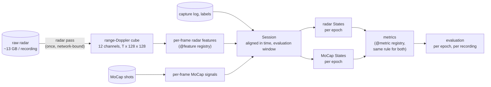

# Mobility index from the ceiling FMCW radar

Mobility metrics in three categories, computed from the ceiling FMCW radar and validated against MoCap, on the January 2026 campaign. The goals and plan are in [SCOPE.md](SCOPE.md); what was done for Category 1, and its bottlenecks, are in [docs/category1.md](docs/category1.md).

| Category | Metrics | Status |
|---|---|---|
| 1. Total movement volume | total activity energy, active time, inactive time | done, validated on 6 recordings |
| 2. Activity bout structure | bout count, bout duration (mean, variance), fragmentation | planned, `mobility/metrics/category2.py` |
| 3. Postural transitions | peak transition Doppler, sit-to-stand, stand-to-sit, lie-to-sit | planned, `mobility/metrics/category3.py` |

## Pipeline



Each metric is a single rule applied to *states*: per-epoch energy, activity level, active/inactive, and later posture. The radar and MoCap states have the same form, so a metric gets the same definition on both sides, and the two are compared per epoch and per recording.

## Layout

```
mobility/                  the package
  config.py                paths, radar constants, radar position, thresholds
  io/                      reading the data: raw .bin frames, capture logs and labels, MoCap shots and tracks
  radar/
    dsp.py                 range-Doppler power of all 12 virtual channels (GPU)
    cube.py                one pass over a raw recording -> cube (the only step that reads raw data)
    features.py            per-frame features, @feature registry
  groundtruth.py           MoCap: joint speeds, kinetic-energy proxy, radial speed, distance to the radar
  align.py                 time offset radar <-> MoCap, radar position fit
  session.py               one recording: aligned features + MoCap + labels + evaluation masks (cached)
  states.py                per-epoch States from the radar or from MoCap
  metrics/                 @metric registry; category1.py, category2.py, category3.py
  evaluation.py            per-epoch scores, leave-one-recording-out thresholds, metric agreement
  plots.py                 diagnostic timeline
scripts/                   command-line entry points (below)
docs/                      write-ups per category; raw data format and missing data (raw_data_january.md)
output/                    everything generated (git-ignored; MOBILITY_OUTPUT overrides the location)
```

## Running

Use the `distrimuse` conda env (it has torch and scikit-learn):

```bash
PY=/cw/dtaiexp/NoCsBack/2026-Xuan/miniforge3/envs/distrimuse/bin/python3

# 1. cubes: reads raw data, ~3 min per recording, network-bound; pick a free GPU
CUDA_VISIBLE_DEVICES=0 $PY scripts/radar_pass.py --only person_1/scenario_1 person_5/scenario_3
# 2. Category 1 evaluation on every recording that has a cube
$PY scripts/evaluate_category1.py
# diagnostics
$PY scripts/plot_timeline.py person_1/scenario_1
$PY scripts/fit_radar_position.py --only person_1/scenario_1 person_5/scenario_3 person_10/scenario_2
```

Outputs, under `output/`:

| Path | Content |
|---|---|
| `<person>/<scenario>/rd12_db.npy` | cube, float16 dB, (T, 128 range, 128 Doppler), ~360 MB |
| `<person>/<scenario>/features.npz`, `mocap_50hz.npz`, `alignment.json` | session cache |
| `category1/*.csv` | evaluation tables |
| `plots/` | timelines |

## Extending

**A radar feature.** Add a function to `mobility/radar/features.py`:

```python
@feature('my_feature', log=True)          # log=True: compared on a log scale (power, counts)
def my_feature(c):                        # c: Chunk with db, floor_db, p, excess (floor removed), on
    return (c.excess * WEIGHTS).sum((1, 2))   # one value per frame
```

The next `load_session` computes it for every recording and adds it to the cache.

**A MoCap signal** (e.g. trunk angle for posture): add it to the dict returned by `mocap_signals` in `mobility/groundtruth.py`. `to_frames` carries it to radar frames.

**A metric.** Add a function of `States` to the category's module:

```python
@metric('n_bouts', category=2, unit='count')
def n_bouts(s):
    return float(len(bouts(s)))
```

It is computed for both radar and MoCap by `compute_metrics` and `evaluation.metric_table`.

**State a metric needs** (posture, transitions for Category 3): add a field to `States` in `mobility/states.py` and fill it in both `radar_states` and `mocap_states`.

**A category's evaluation.** Copy `scripts/evaluate_category1.py`. The building blocks are in `mobility/evaluation.py`.
