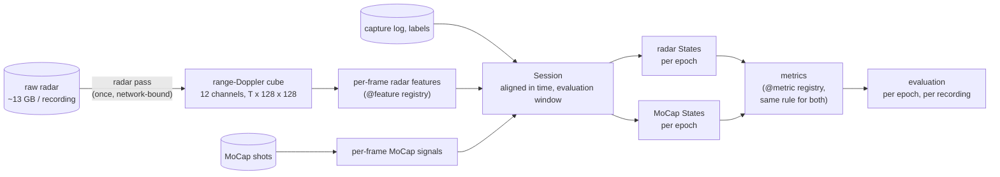

# Mobility index from the ceiling FMCW radar

Mobility metrics in three categories, computed from the ceiling FMCW radar and validated against MoCap, on the January 2026 campaign. The goals and plan are in [SCOPE.md](SCOPE.md); what was done per category, and the bottlenecks, are in [docs/category1.md](docs/category1.md), [docs/category2.md](docs/category2.md) and
[docs/category3.md](docs/category3.md); the angle pass (product 3) in [docs/angle.md](docs/angle.md).

| Category | Metrics | Status |
|---|---|---|
| 1. Total movement volume | total activity energy, active time, inactive time | active / inactive time validated on 148 recordings; energy open |
| 2. Activity bout structure | bout count, bout duration (mean, variance), fragmentation | done, validated on 148 recordings; bout rule calibrated against the labels |
| 3. Postural transitions | peak transition Doppler, sit-to-stand, stand-to-sit, lie-to-sit; time standing, sitting, lying, on the floor | with the angle: posture per epoch F1 0.92, posture times within 0.1 min; transitions F1 0.77 (height rule); peak Doppler within 0.22 m/s on matched sit-to-stand / stand-to-sit; counts fixed by the script |

## Pipeline



Each metric is a single rule applied to *states*: per-epoch energy, activity level, active/inactive, and the postural transitions. The radar and MoCap states have the same form, so a metric gets the same definition on both sides, and the two are compared per epoch and per recording.

## Layout

```
mobility/                  the package
  config.py                paths, radar constants, radar position, thresholds
  io/                      reading the data: raw .bin frames, capture logs and labels, MoCap shots and tracks
  radar/
    dsp.py                 range-Doppler spectrum and power of all 12 virtual channels (GPU or CPU)
    cube.py                one pass over a raw recording -> cube (channel-averaged power)
    points.py              the angle pass: second read -> per-channel complex values of the cells that hold something
    angle.py               points -> direction cosines -> 3-D positions (virtual array, phase corrections, orientation)
    features.py            per-frame features, @feature registry
  groundtruth.py           MoCap: joint speeds, kinetic-energy proxy, radial speed, posture signals; active threshold
  labels.py                activity labels -> active / inactive classes, scripted and caregiver periods
  bouts.py                 bout rule (gap filling, minimum bout) on an active / inactive sequence; its calibration
  posture.py               standing / sitting / lying / floor: from the script, the MoCap posture rule, the radar height rule
  transitions.py           postural transitions from a posture sequence (MoCap and radar); burst classifier (comparison)
  align.py                 time offset radar <-> MoCap, radar position fit
  session.py               one recording: aligned features + MoCap + labels + evaluation masks (cached)
  states.py                per-epoch States from the radar or from MoCap
  metrics/                 @metric registry; category1.py, category2.py, category3.py
  evaluation.py            per-epoch scores, leave-one-subject-out thresholds, metric agreement, bout and transition
                           matching
  plots/                   figures: agreement.py (radar vs MoCap over time), bouts.py, transitions.py, diagnostic.py,
                           style.py
scripts/                   command-line entry points (below)
docs/                      write-ups per category; raw data format and missing data (raw_data_january.md)
output/                    everything generated (git-ignored; MOBILITY_OUTPUT overrides the location)
```

## Running

Use the `distrimuse` conda env (it has torch and scikit-learn):

```bash
PY=/cw/dtaiexp/NoCsBack/2026-Xuan/miniforge3/envs/distrimuse/bin/python3

# 1. cubes: reads raw data, ~3 min per recording, network-bound; pick a free GPU
CUDA_VISIBLE_DEVICES=0 $PY scripts/radar_pass.py --only person_1/scenario_1 person_5/scenario_3
# 2. MoCap active threshold, calibrated against the activity labels (MoCap + labels only, all recordings)
$PY scripts/calibrate_mocap_threshold.py
# 3. Category 1 evaluation on every recording that has a cube
$PY scripts/evaluate_category1.py
# 4. Category 2: bout rule calibrated against the labels (MoCap + labels only), then the evaluation (needs step 3)
$PY scripts/calibrate_bout_rule.py
$PY scripts/evaluate_category2.py --workers 16
# 5. Category 3: MoCap posture rule calibrated against the script (MoCap + labels only), then the evaluation
#    (needs step 3 and the angle pass below)
$PY scripts/calibrate_posture.py --workers 16
$PY scripts/evaluate_category3.py --workers 16
# radar vs MoCap over time (after steps 3-5)
$PY scripts/plot_agreement.py --only person_10/scenario_2
$PY scripts/plot_bouts.py --only person_10/scenario_2
$PY scripts/plot_transitions.py --only person_10/scenario_2
# diagnostics
$PY scripts/plot_timeline.py person_1/scenario_1
# angle pass (product 3; docs/angle.md): second read of the raw data, ~6.5 h for the campaign, after step 1
$PY scripts/angle_pass.py --only person_1/scenario_1 --device cpu --threads 8
$PY scripts/fit_radar_orientation.py --only person_1/scenario_1 person_5/scenario_3 person_10/scenario_2
$PY scripts/fit_radar_position.py --only person_1/scenario_1 person_5/scenario_3 person_10/scenario_2
```

Outputs, under `output/`:

| Path | Content |
|---|---|
| `<person>/<scenario>/rd12_db.npy` | cube, float16 dB, (T, 128 range, 128 Doppler), ~360 MB; NaN rows for frames missing, all-zero or damaged by lost packets |
| `<person>/<scenario>/pass_info.json` | radar pass: missing, all-zero and damaged frames, lost packets from the capture log, timing |
| `<person>/<scenario>/points.npz`, `points_info.json` | angle pass: per-channel complex values of the cells > 6 dB above their floor, ~170 MB |
| `<person>/<scenario>/features.npz`, `subject.json`, `mocap_50hz.npz`, `alignment.json` | session cache |
| `groundtruth/mocap_active_threshold.csv` | MoCap active threshold per left-out person (and `ALL`) |
| `groundtruth/bout_rule.csv` | bout rule per left-out person (and `ALL`) |
| `groundtruth/posture_rule.csv` | MoCap posture rule per left-out person (and `ALL`) |
| `category1/*.csv`, `category2/*.csv`, `category3/*.csv` | evaluation tables |
| `plots/agreement/`, `plots/bouts/`, `plots/transitions/`, `plots/angle/`, `plots/` | radar vs MoCap over time; bouts; transitions; angle check; diagnostic timelines |

## Extending

**A radar feature.** Add a function to `mobility/radar/features.py`:

```python
@feature('my_feature', log=True)          # log=True: compared on a log scale (power, counts)
def my_feature(c):                        # c: Chunk with db, floor_db, p, excess (floor removed), on
    return (c.excess * WEIGHTS).sum((1, 2))   # one value per frame
```

The next `load_session` computes it for every recording and adds it to the cache.

**A MoCap signal**: add it to the dict returned by `mocap_signals` in `mobility/groundtruth.py` and its name to `SIGNALS` (cached files without it are recomputed). `to_frames` carries it to radar frames.

**A metric.** Add a function of `States` to the category's module:

```python
@metric('longest_bout', category=2, unit='s')
def longest_bout(s):
    return float(_durations(s).max())        # helpers of the category's module
```

It is computed for both radar and MoCap by `compute_metrics` and `evaluation.metric_table`. Category 2 metrics read the bout rule from `States.extra['bout_rule']`, which `metric_table(..., bout_rules=...)` sets. Category 3 metrics read the transition events from `States.transitions` and the posture per epoch from `States.posture`, which `metric_table(..., transitions=..., postures=...)` sets.

**State a metric needs**: add a field to `States` in `mobility/states.py` and fill it in both `radar_states` and `mocap_states` (per epoch), or set it in `metric_table` (events, like `transitions`).

**A category's evaluation.** Copy `scripts/evaluate_category1.py` (or `evaluate_category2.py` / `evaluate_category3.py`, which reuse the Category 1 recordings and thresholds). The building blocks are in `mobility/evaluation.py`.
