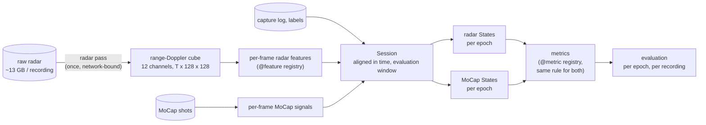

# Mobility index from a ceiling radar

How well does a person move about at home? This project computes **mobility metrics** from a small FMCW radar on the ceiling: no camera, nothing to wear. Every metric is validated against full-body motion capture (MoCap), recorded at the same time in a lab apartment where participants followed a script of everyday activities (January 2026 campaign).

The metrics fall into three categories:

| Category | Metrics | Status |
|---|---|---|
| [1. Total movement volume](docs/category1.md) | total activity energy, active time, inactive time | active / inactive time validated against MoCap; energy ranks recordings like MoCap |
| [2. Activity bout structure](docs/category2.md) | number of bouts, bout duration (mean, variance), fragmentation | validated against MoCap; needs free-living data to show differences between people |
| [3. Postural transitions](docs/category3.md) | sit-to-stand, stand-to-sit, lie-to-sit counts, peak transition speed; time standing, sitting, lying, on the floor | posture and posture times validated against MoCap; transition counts fixed by the script |

Also: [locating the person with the angle of arrival](docs/angle.md), and [how parameters are calibrated](docs/calibration.md), for the population and per person. All radar parameters are calibrated leaving the evaluated person out, so the results show how the radar works for someone it has never seen.

## Pipeline



Each metric is a single rule applied to *states*: per-epoch energy, activity level, active/inactive, and the postural transitions. The radar and MoCap states have the same form, so a metric gets the same definition on both sides, and the two are compared per epoch and per recording.

## Layout

```
mobility/                  the package
  config.py                paths (data, outputs), radar constants, radar position, thresholds, epochs
  experiment.py            experiment runs: a timestamped folder per run, its log and record; reading other runs
  utils.py                 small helpers: NaN-aware signals, runs of a mask, thresholds, calibration tables
  io/                      reading the data: raw .bin frames (also in background batches), capture logs and labels,
                           MoCap shots and tracks
  radar/
    dsp.py                 range-Doppler spectrum and power of all 12 virtual channels (GPU or CPU)
    cube.py                one pass over a raw recording -> cube (channel-averaged power)
    points.py              the angle pass: second read -> per-channel complex values of the cells that hold something
    angle.py               points -> direction cosines -> 3-D positions (virtual array, phase corrections, orientation);
                           per-frame features of the person
    features.py            per-frame features of the cube, @feature registry
    cache.py               per-recording caches of the features (features.npz, angle_features.npz), the noise floor
  groundtruth.py           MoCap: joint speeds, kinetic-energy proxy, radial speed, posture signals; active threshold
  labels.py                activity labels -> active / inactive classes, scripted and caregiver periods
  bouts.py                 bout definition (hysteresis, confirmation, gap filling, minimum bout); its calibration;
                           bout matching
  posture.py               standing / sitting / lying / floor: from the script, the MoCap posture rule, the radar height rule
  transitions.py           postural transitions from a posture sequence (MoCap and radar); burst classifier and hand
                           rule (comparisons); event matching
  align.py                 time offset radar <-> MoCap, radar position and orientation fits
  session.py               one recording: aligned features + MoCap + labels + evaluation masks (cached)
  states.py                per-epoch States from the radar or from MoCap
  metrics/                 @metric registry; category1.py, category2.py, category3.py
  evaluation/              radar vs MoCap, everything calibrated leave-one-subject-out:
    agreement.py           per recording: metrics of both sensors, agreement, no-sensor baseline (all categories)
    category1.py           per epoch: AUC, F1, radar thresholds; per person, per activity, per distance
    category2.py           bouts per epoch and per bout; radar exit and confirmation thresholds
    category3.py           transitions per event, posture per epoch; height rule, peak quantile, comparison methods
    personal.py            personal calibration on top of leave-one-subject-out
  plots/                   figures: agreement.py (radar vs MoCap over time), bouts.py, transitions.py, per_person.py,
                           sensitivity.py, angle.py, diagnostic.py; common.py and style.py shared
  cli.py                   helpers of the scripts: recordings to run, parallel map, printing
scripts/                   command-line entry points (below): they read and write the tables; the logic is in mobility/
docs/                      short overview per category
output/                    everything generated (git-ignored; MOBILITY_OUTPUT overrides the location), below
```

## Running

```bash
# 1. cubes: reads raw data, ~3 min per recording, network-bound; pick a free GPU
CUDA_VISIBLE_DEVICES=0 python scripts/radar_pass.py --only person_1/scenario_1 person_5/scenario_3
# 2. MoCap active threshold, calibrated against the activity labels (MoCap + labels only, all recordings)
python scripts/calibrate_mocap_threshold.py
# 3. Category 1 evaluation on every recording that has a cube
python scripts/evaluate_category1.py --workers 16
# 4. Category 2: MoCap bout definition calibrated against the labels (MoCap + labels only), then the evaluation
#    (needs step 3; calibrates the radar exit and confirmation thresholds)
python scripts/calibrate_bout_rule.py
python scripts/evaluate_category2.py --workers 16
# 5. Category 3: MoCap posture rule calibrated against the script (MoCap + labels only), then the evaluation
#    (needs step 3 and the angle pass below)
python scripts/calibrate_posture.py --workers 16
python scripts/evaluate_category3.py --workers 16
# personal calibration (after steps 3-5)
python scripts/evaluate_personal_calibration.py --workers 16
# radar vs MoCap over time (after steps 3-5)
python scripts/plot_agreement.py --only person_10/scenario_2
python scripts/plot_bouts.py --only person_10/scenario_2
python scripts/plot_transitions.py --only person_10/scenario_2
# per person (after steps 3-4, and the personal calibration)
python scripts/plot_per_person.py
python scripts/plot_per_person_category2.py
python scripts/plot_per_person_personal.py
# diagnostics
python scripts/plot_timeline.py person_1/scenario_1
# angle pass: second read of the raw data, ~6.5 h for the campaign, after step 1
python scripts/angle_pass.py --only person_1/scenario_1 --device cpu --threads 8
python scripts/fit_radar_orientation.py --only person_1/scenario_1 person_5/scenario_3 person_10/scenario_2
python scripts/fit_radar_position.py --only person_1/scenario_1 person_5/scenario_3 person_10/scenario_2
# every run so far: status, git commit, inputs
python scripts/list_experiments.py
```

### Experiment runs

Every script is an experiment: each run writes into its own folder, named after the experiment and the time it started, and never overwrites an earlier run.

```
output/
  cache/<person>/<scenario>/                 per-recording products, shared by all runs (radar cube, angle-pass points,
                                             features, MoCap signals, alignment)
  experiments/<name>_<YYYY-MM-DD_HHMMSS>/    one run: its tables and figures, plus
      log.txt                                everything it printed
      run.json                               command, arguments, start / end, status, git commit, the runs it read
      diff.patch                             uncommitted changes (and new untracked code) at the time of the run
  latest/<name> -> ../experiments/...        the last finished, complete run of each experiment
```

A run reads the results of other experiments through `output/latest/` (for example `evaluate_category2.py` reads `latest/category1/thresholds.csv`) and records which run it read in `run.json`. Every script also takes:

| Option | Effect |
|---|---|
| `--tag NAME` | a variant: the folder becomes `<name>-NAME_<time>`, and the run does not become `latest` |
| `--use NAME=RUN` | read run `RUN` of experiment `NAME` (a folder name in `output/experiments/`) instead of its latest |
| `--promote` | make the run `latest` even if it is tagged or partial |

A run on part of the data (`--only`, `--persons`) or a run that fails doesn't become `latest` either, so downstream steps never pick up an exploration or a quick check by accident.

| Experiment (`output/experiments/<name>_*`) | Script | Content |
|---|---|---|
| `radar_pass`, `angle_pass` | `radar_pass.py`, `angle_pass.py` | log; the cubes and points go to `output/cache/` |
| `mocap_threshold` | `calibrate_mocap_threshold.py` | MoCap active threshold per left-out person (and `ALL`); MoCap epochs |
| `bout_rule` | `calibrate_bout_rule.py` | MoCap exit and confirmation factors and bout rule per left-out person (and `ALL`) |
| `posture_rule` | `calibrate_posture.py` | MoCap posture rule per left-out person (and `ALL`) |
| `category1`, `category2`, `category3` | `evaluate_category<k>.py` | evaluation tables (each script's docstring lists them) |
| `personal` | `evaluate_personal_calibration.py` | personal calibration: parameters, metrics, scores per setup |
| `floor_sensitivity`, `so_cfar` | `sensitivity_floor.py`, `prototype_so_cfar.py` | Category 1 explorations: noise floor, online detector |
| `radar_orientation`, `radar_position` | `fit_radar_orientation.py`, `fit_radar_position.py` | radar geometry fits; angle-check figures |
| `plot_agreement`, `plot_bouts`, `plot_transitions`, `plot_per_person*`, `plot_timeline` | `plot_*.py` | figures |

Per recording, in `output/cache/<person>/<scenario>/`:

| File | Content |
|---|---|
| `rd12_db.npy` | cube, float16 dB, (T, 128 range, 128 Doppler), ~360 MB; NaN rows for frames missing, all-zero or damaged by lost packets |
| `pass_info.json` | radar pass: missing, all-zero and damaged frames, lost packets from the capture log, timing |
| `points.npz`, `points_info.json` | angle pass: per-channel complex values of the cells > 6 dB above their floor, ~170 MB |
| `features.npz`, `angle_features.npz`, `subject.json`, `mocap_50hz.npz`, `alignment.json` | session cache |

## Extending

**A radar feature.** Add a function to `mobility/radar/features.py`:

```python
@feature('my_feature', log=True)          # log=True: compared on a log scale (power, counts)
def my_feature(c):                        # c: Chunk with db, floor_db, p, excess (floor removed), on
    return (c.excess * WEIGHTS).sum((1, 2))   # one value per frame
```

The next `load_session` computes it for every recording and adds it to the cache.

**A MoCap signal**: add it to the dict returned by `mocap_signals` in `mobility/groundtruth.py` and its name to `SIGNALS` (cached files without it are recomputed). `to_frames` carries it to radar frames.

**A metric.** Add a function of `States` to the category's module:

```python
@metric('longest_bout', category=2, unit='s')
def longest_bout(s):
    return float(_durations(s).max())        # helpers of the category's module
```

It is computed for both radar and MoCap by `compute_metrics` and `evaluation.metric_table`. Category 2 metrics read the bout rule and the exit and confirmation thresholds from `States.extra['bout_rule']`, `['exit_threshold']` and `['confirm_threshold']`, which `metric_table(..., bout_rules=..., bout_levels=...)` sets. Category 3 metrics read the transition events from `States.transitions` and the posture per epoch from `States.posture`, which `metric_table(..., transitions=..., postures=...)` sets.

**State a metric needs**: add a field to `States` in `mobility/states.py` and fill it in both `radar_states` and `mocap_states` (per epoch), or set it in `metric_table` (events, like `transitions`).

**A category's evaluation.** Copy `scripts/evaluate_category1.py` (or `evaluate_category2.py` / `evaluate_category3.py`, which reuse the Category 1 recordings and thresholds). The building blocks are in `mobility/evaluation/`, one module per category plus `agreement.py` for the per-recording metrics; all are importable from `mobility.evaluation`.

**A new experiment script.** Add its name and script to `SCRIPTS` in `mobility/experiment.py`, call `add_run_args(ap)` before parsing the arguments, and do the work inside `with run('<name>', args) as run_dir:`, writing into `run_dir`. Read other experiments' results with `latest('<name>', '<file>')`.
