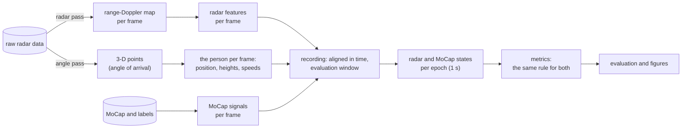

# Mobility index from a ceiling-mounted FMCW radar

This project computes **mobility metrics** of a person at home from a single ceiling-mounted FMCW radar, without a camera or a wearable device. It targets the monitoring of older adults. Every metric is validated against full-body motion capture (MoCap), recorded simultaneously in a lab apartment while participants followed a script of everyday activities.

## Metrics

| Category | Metrics | Method and results |
|---|---|---|
| 1. Total movement volume | active time, inactive time, total activity energy | [docs/c1_movement.md](docs/c1_movement.md) |
| 2. Activity bout structure | number of bouts, mean and variance of bout duration, fragmentation index | [docs/c2_bout.md](docs/c2_bout.md) |
| 3. Postural transitions and posture | sit-to-stand, stand-to-sit and lie-to-sit counts, peak transition speed; time standing, sitting, lying and on the floor | [docs/c3_posture.md](docs/c3_posture.md) |

All radar parameters are calibrated with leave-one-subject-out cross-validation, so the results estimate the performance for an unseen person. [docs/calibration.md](docs/calibration.md) describes the calibration for the population, per person, and without labels.

## Hardware and data

**Radar.**

| | |
|---|---|
| Sensor | Texas Instruments IWR6843AOP, 60 GHz FMCW, antenna-on-package |
| Capture | raw ADC data with a TI DCA1000EVM; configured in mmWave Studio |
| Mounting | on the ceiling, facing down |
| Antennas | 3 TX (time-division multiplexed) × 4 RX = 12 virtual channels in a 2-D array |
| Chirp | starts at 60 GHz, slope 80 MHz/µs; 256 complex samples at 6 Msps (3.4 GHz sampled bandwidth); 150 µs per chirp |
| Frame | 100 chirps per transmitter, every 50 ms (20 frames/s) |
| Range | 4.4 cm per bin; 0.3–5.6 m used |
| Radial velocity | 4.3 cm/s per bin; ±2.78 m/s |

**Reference.** Markerless full-body motion capture (Captury) at 50 Hz, and the start and end times of each scripted activity.

**Campaign.** January 2026: 156 recordings in one lab apartment with six furniture layouts. 148 recordings of 27 participants have radar, MoCap and labels and are evaluated.

## Pipeline



The raw data are read twice: once for the channel-averaged range–Doppler map, and once to keep the per-channel values that carry the direction. Each metric is one rule applied to per-epoch *states* (activity level, energy, posture, transitions), which have the same form for the radar and for MoCap.

## Repository layout

```
mobility/            the package
  config.py          data paths, radar constants, radar position, epoch length
  experiment.py      one output folder per run of a script
  io/                reading raw radar data, MoCap and labels
  radar/             radar processing: range-Doppler map, angle of arrival, features
  groundtruth.py     MoCap signals and the MoCap active threshold
  session.py         one recording: radar, MoCap and labels aligned in time
  states.py          per-epoch states of the radar and of MoCap
  bouts.py           bout detection (Category 2)
  posture.py         posture: MoCap rule and radar posture model (Category 3)
  transitions.py     postural transitions and their matching (Category 3)
  moments.py         walking moments, without labels (calibration)
  metrics/           the metrics of each category
  evaluation/        radar against MoCap, per category
  plots/             figures
scripts/             command-line entry points, one per step
docs/                methods and results per category; figures/
output/              everything generated (not in git)
```

## Reproducing the results

**Requirements.** Python 3.11 and the packages in [requirements.txt](requirements.txt) (`pip install -r requirements.txt`); a GPU speeds up the radar pass but is optional. Set the paths of the campaign data at the top of `mobility/config.py`. Outputs go to `output/`, or to the folder in the environment variable `MOBILITY_OUTPUT`.

**Steps.** Run the scripts in this order. Each step reads the results of the previous ones.

```bash
# 1. Radar processing (once; reads the raw data, network-bound)
python scripts/radar_pass.py                                   # range-Doppler maps, ~3 min per recording
python scripts/angle_pass.py --device cpu --threads 8          # per-channel values for the angle, ~7 h in total

# 2. MoCap reference, calibrated against the script labels (MoCap and labels only)
python scripts/calibrate_mocap_threshold.py                    # active threshold
python scripts/calibrate_posture.py --workers 16               # posture rule

# 3. Evaluation, radar against MoCap
python scripts/evaluate_category1.py --workers 16
python scripts/evaluate_category3.py --workers 16              # needs Category 1 (movement detection)
python scripts/calibrate_bout_rule.py --workers 16             # MoCap bout definition
python scripts/evaluate_category2.py --workers 16              # needs Categories 1 and 3

# 4. Localisation check: one recording per furniture layout
python scripts/fit_radar_orientation.py --only person_1/scenario_1 person_10/scenario_2 person_5/scenario_3 \
    person_12/scenario_5 person_15/scenario_4 person_22/scenario_6

# 5. Figures of the docs (--docs copies them to docs/figures/)
python scripts/plot_category1.py --docs
python scripts/plot_category2.py --docs
python scripts/plot_category3.py --docs
```

Optional analyses:

| Script | Content |
|---|---|
| `evaluate_personal_calibration.py` | personal calibration on top of the population calibration |
| `check_mounting_height.py` | walking moments and the check of the radar's mounting height |
| `fit_radar_position.py` | radar position against MoCap |
| `plot_agreement.py`, `plot_bouts.py`, `plot_transitions.py` | radar and MoCap over time, per recording (`--only person_x/scenario_y`) |
| `plot_per_person*.py` | signed error per participant |
| `list_experiments.py` | every run so far: status, commit, inputs |

**Output.** Every run writes a new folder `output/experiments/<name>_<date>_<time>/` with its tables, figures, `log.txt` and `run.json` (command, arguments, git commit, the runs it read). `output/latest/<name>` points to the last complete run of each step, which later steps read. Common options of every script:

| Option | Effect |
|---|---|
| `--tag NAME` | a variant run, which does not become `latest` |
| `--use NAME=RUN` | read a given run of another step instead of its latest |
| `--promote` | make a tagged or partial run `latest` |

## Extending

- **A radar feature:** a function decorated with `@feature` in `mobility/radar/features.py`; it is computed for every recording at the next load.
- **A metric:** a function of `States` decorated with `@metric` in `mobility/metrics/`; it is computed for the radar and for MoCap alike.
- **A script:** register it in `SCRIPTS` in `mobility/experiment.py`, and write into the folder given by `with run('<name>', args) as run_dir:`.
