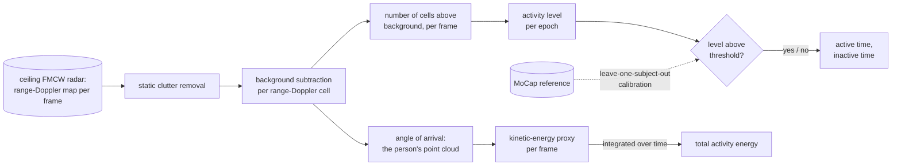
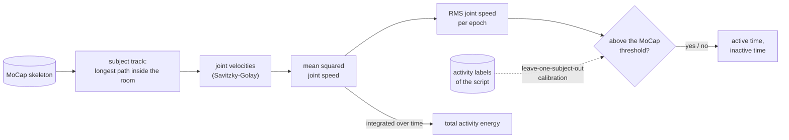
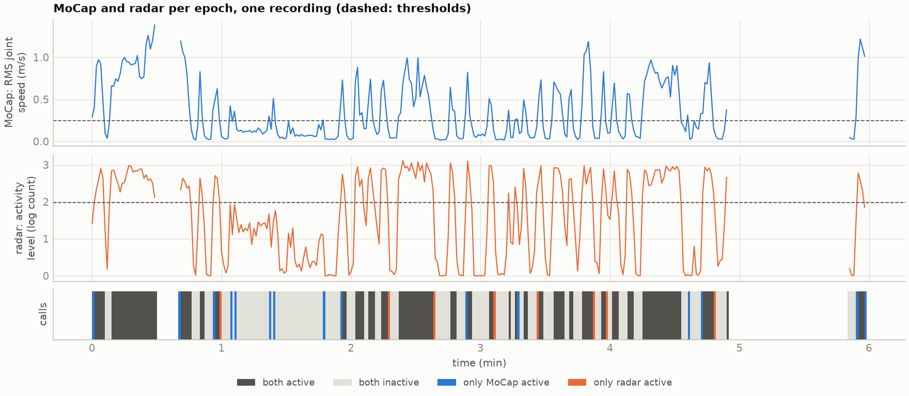
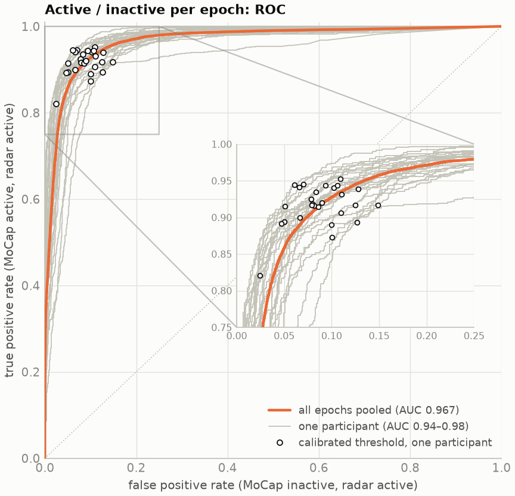
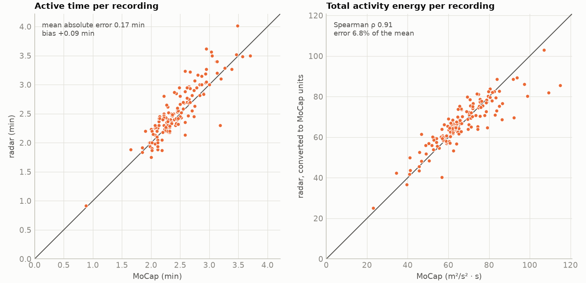
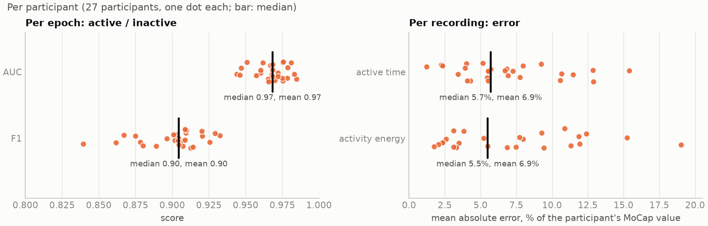

# Category 1: total movement volume

## Metrics

Category 1 quantifies how much a person moves over a period of time:

- **Active time:** the time spent in whole-body movement, such as walking or a change of posture.
- **Inactive time:** the remaining time, such as sitting, lying or standing still. Arm-only activities, such as eating or drinking, count as inactive.
- **Total activity energy:** the intensity of movement, integrated over the period.

These metrics describe the overall volume of daily movement, the most basic component of a mobility profile.

## Overview

## Radar processing

**Range–Doppler map.** The radar is mounted on the ceiling and faces down. For each frame $t$, it yields the received power $P_t(r, v)$ in each range bin $r$ and radial-velocity bin $v$. The map is obtained with standard FMCW processing: a range FFT, static clutter removal by subtracting the mean over the chirps of a frame, and a Doppler FFT. Clutter removal suppresses reflections from static objects such as walls and furniture.

**Background subtraction.** Each range–Doppler cell has a background level $B(r, v)$, estimated as a low percentile of its power over time. This is the order-statistic principle used in constant false alarm rate (CFAR) detectors. A cell is counted as moving when its power exceeds the background by a margin $\delta$. Cells close to the radar, which contain transmitter–receiver leakage, and cells with a very low radial velocity are excluded.

**Activity level.** Let $n_t$ be the number of moving cells in frame $t$. The activity level $L_e$ of an epoch $e$ (one second) is the mean log count over its frames. The epoch is active when this level exceeds a threshold $\theta$:

$$n_t = \bigl\lvert \lbrace (r,v) : P_t(r,v) > B(r,v) + \delta \rbrace \bigr\rvert, \qquad L_e = \frac{1}{\lvert e \rvert} \sum_{t \in e} \log(n_t + c), \qquad a_e = \mathbf{1}[L_e > \theta]$$

Here $\lvert e \rvert$ is the number of frames in the epoch, and the constant $c$ is a small offset that prevents nearly empty frames from dominating the mean. Active and inactive time follow by summation over the epochs, with $\Delta$ the epoch length:

$$T_{\text{active}} = \Delta \sum_e a_e, \qquad T_{\text{inactive}} = \Delta \sum_e (1 - a_e)$$

**Activity energy.** The angle of arrival of each reflection gives its 3-D position ([Localisation of the person](c3_posture.md#localisation-of-the-person)). The person's points $\mathcal{P}_t$ are the points within a fixed radius of their median position. The energy combines two terms:

- the mean squared radial velocity $v_i^2$ of these points;
- the squared horizontal speed $u_t$ of the person's position.

The second term is needed because a radar viewing from above measures horizontal motion poorly along its line of sight. In walking, however, every joint carries the horizontal speed of the body. The energy is zero when the person is not detected:

$$e_t = \frac{1}{\lvert \mathcal{P}_t \rvert} \sum_{i \in \mathcal{P}_t} v_i^2 + u_t^2, \qquad E = \Delta \sum_e \bar{e}_e$$

where $\bar{e}_e$ is the mean of $e_t$ over epoch $e$. This quantity is the radar counterpart of the mean squared joint speed of the reference (below), a proxy for kinetic energy.

**Online operation.** The current background estimate uses the whole recording. A causal variant uses only past frames: a running percentile per cell followed by a two-dimensional smallest-of CFAR detector. It has been prototyped with equal performance, but it is not yet part of the pipeline.

## Reference measurement

The radar is compared with marker-free, full-body motion capture (MoCap), recorded simultaneously in a lab apartment. Participants followed a script of everyday activities: walking, kitchen tasks, eating at a chair, lying in bed, getting down to the floor and back up, and a caregiver visit. The three metrics are computed from the MoCap skeleton as follows:

**Subject track.** The subject is the track with the longest path of its centre of gravity inside the room. This rule rejects static ghost tracks.

**Joint velocities and energy.** The joint velocities $\mathbf{v}_j(t)$ of the $J$ joints are obtained with a Savitzky–Golay derivative filter. The energy is the mean squared joint speed. An epoch is active when its RMS joint speed exceeds a threshold $\theta_{\text{M}}$:

$$e^{\text{M}}_t = \frac{1}{J} \sum_j \lVert \mathbf{v}_j(t) \rVert^2, \qquad a^{\text{M}}_e = \mathbf{1}\Bigl[\sqrt{\bar{e}^{\text{M}}_e} > \theta_{\text{M}}\Bigr], \qquad E^{\text{M}} = \Delta \sum_e \bar{e}^{\text{M}}_e$$

**Threshold.** The threshold $\theta_{\text{M}}$ is calibrated against the activity labels of the script.

- Epochs of whole-body tasks (walking, postural transitions, moving in bed) form the active class.
- Epochs of arm-only tasks and of waiting form the inactive class.

**Alignment and evaluation window.** MoCap is aligned to the radar in time. The comparison uses only epochs in which MoCap tracks the participant inside the radar's field of view, during the scripted period and outside the caregiver visit. Categories 2 and 3 use the same epochs.

## Validation

- **Calibration.** All radar parameters are calibrated with leave-one-subject-out cross-validation. The parameters used for a participant are fitted on the other participants only, so the results estimate the performance for an unseen person. The radar threshold $\theta$ maximises the balanced accuracy against the MoCap active epochs.
- **Per epoch.** The radar's active and inactive calls are compared with MoCap epoch by epoch, using the AUC of the activity level and the F1 score of the thresholded calls.
- **Per recording.** Active and inactive time are compared through the mean absolute error and the bias.
- **Energy.** The two energies have different units. Their agreement is assessed in two ways:
  - with the Spearman rank correlation across recordings;
  - by the error after scaling the radar energy to MoCap units, with one factor fitted on the other participants.

## Results

The evaluation covers 148 recordings of 27 participants, with about 51,000 epochs in the evaluation window. All radar results are leave-one-subject-out.

**Example recording.** Figure 1 shows one recording. The radar activity level rises and falls with the MoCap joint speed. The two sensors make the same active or inactive call in 92% of its epochs. Most disagreements last a single epoch, at the start or end of a movement.

*Figure 1. One recording, per epoch. Top: MoCap RMS joint speed. Middle: radar activity level. Dashed lines: the calibrated thresholds. Bottom: agreement of the active / inactive calls. Gaps are epochs outside the evaluation window.*

**Per epoch.** The radar activity level separates MoCap-active from MoCap-inactive epochs with a pooled AUC of 0.967 (Figure 2). The AUC ranges from 0.94 to 0.98 across participants. With the calibrated thresholds, the radar detects a median of 92% of the active epochs, at a median false positive rate of 9%. The median F1 score per recording is 0.91. The operating points lie close to the pooled curve. A threshold calibrated on other participants therefore transfers well to a new person.

*Figure 2. ROC of the radar activity level against MoCap active, for all epochs pooled (orange) and per participant (grey). Circles: each participant's calibrated threshold. Inset: the upper-left corner, enlarged.*

**Per recording.** Figure 3 compares the totals of each recording.

- **Active time.** The mean absolute error is 0.17 min, a median of 5% of the MoCap active time. The bias is +0.09 min: the radar slightly over-counts active time. Inactive time shows the same error with the opposite sign, because the two add up to the evaluation window.
- **Energy.** The radar energy ranks the recordings almost as MoCap does (Spearman ρ = 0.91). After conversion to MoCap units, its error is 6.8% of the mean MoCap energy. The largest deviations occur for the most energetic recordings, which the radar underestimates.

*Figure 3. Radar against MoCap per recording, with the identity line. Left: active time. Right: total activity energy, with the radar converted to MoCap units by a factor fitted on the other participants.*

**Per participant.** Figure 4 shows how consistent the results are across participants.

- **Per epoch.** The AUC lies between 0.94 and 0.98 for every participant, with a median of 0.97. The median F1 score is 0.90; the lowest is 0.84.
- **Per recording.** The median error of active time is 5.7% of the participant's MoCap value, and that of the energy is 5.5%. For most participants, both errors stay below about 10%. The largest errors, up to 15% for active time and 19% for the energy, concern a few participants only.

*Figure 4. Results per participant, one dot each; the bar marks the median. Left: AUC and F1 of the active / inactive calls per epoch. Right: mean absolute error of active time and of the converted energy over the participant's recordings, in % of the participant's MoCap value.*

**Failure modes.** A breakdown by scripted activity (not shown) locates the remaining errors. The radar under-calls walking far from the radar, such as walking to the kitchen or leaving the room. It over-calls small settling movements in bed. Precise time alignment between radar and MoCap also proved essential: an earlier analysis underestimated the radar because of a misalignment.

## Limitations

- A second person in the room, such as a caregiver, is not yet separated from the resident.
- The signal weakens with distance from the radar.

Related work has estimated active periods of older adults from mmWave radar energy in a residential setting, but without a motion-capture reference or an energy measure [1].

## References

1. García-Gutiérrez G, Aparicio-Esteve E, Ureña J, Villadangos-Carrizo JM, Jiménez-Martín A, García-Domínguez JJ. A practical case of monitoring older adults using mmWave radar and UWB. *Sensors.* 2026;26(2):681. [doi:10.3390/s26020681](https://doi.org/10.3390/s26020681)
