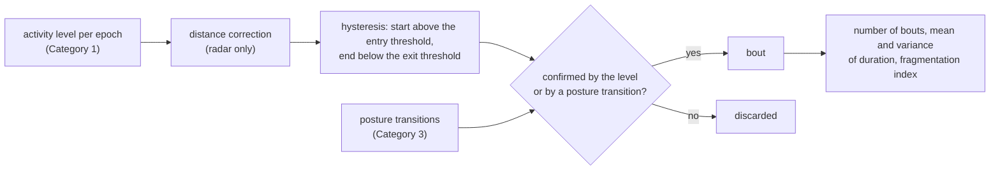
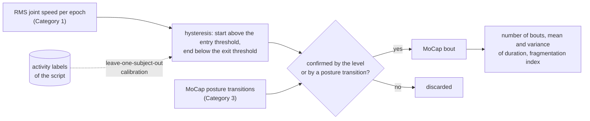
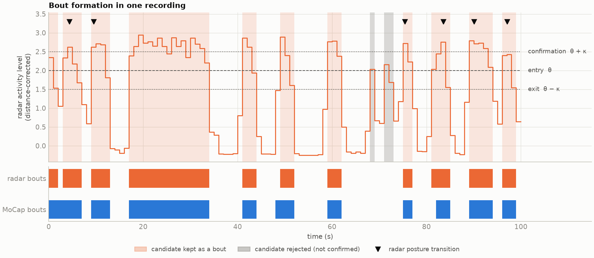
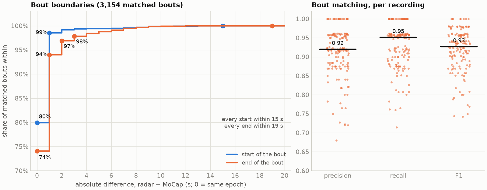
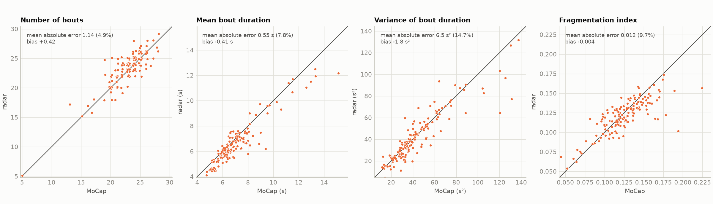
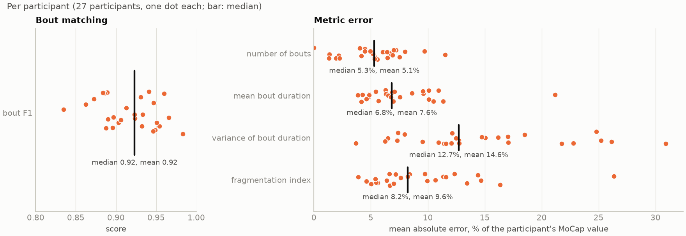
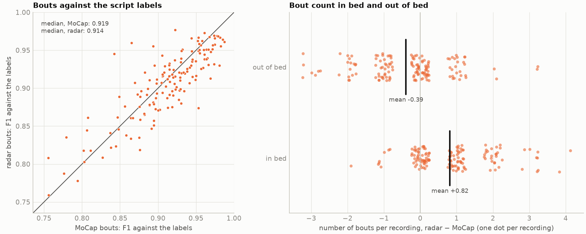

# Category 2: activity bout structure

## Metrics

Category 2 describes how movement is distributed over time, beyond its total volume (Category 1):

- **Number of bouts:** the number of separate periods of activity.
- **Mean and variance of bout duration:** the typical length of these periods and its variability.
- **Fragmentation index:** how often rest is interrupted by activity.

In accelerometer studies of older adults, more fragmented activity is associated with fatigability, poorer physical function, falls and functional decline [1–3]. A ceiling radar could provide the same measures without a wearable device.

## Overview

The radar and the MoCap reference follow the same steps, each on its own activity level and its own posture transitions. Only the radar level is corrected for distance ([Reference measurement](#reference-measurement)).

## Bout detection

Bouts are detected on the per-epoch activity level $L_e$ of [Category 1](c1_movement.md), with the posture transitions of [Category 3](c3_posture.md) as additional evidence. The rule is a one-dimensional form of hysteresis thresholding. It uses three thresholds, $\theta_{\text{exit}} < \theta < \theta_{\text{conf}}$:

1. **Start.** A bout starts when the level exceeds the entry threshold: $L_e > \theta$.
2. **End.** The bout ends when the level falls to the exit threshold: $L_e \le \theta_{\text{exit}}$. A short pause therefore does not split one movement into two bouts.
3. **Confirmation.** A candidate bout $b$ is kept only if its level exceeds the confirmation threshold at least once: $\max_{e \in b} L_e > \theta_{\text{conf}}$. This removes small movements that barely cross the entry threshold. A posture transition within the bout (sitting up, standing up, lying down) also confirms it, since a change of posture is a whole-body movement even when it is slow or under a blanket.
4. **Post-processing.** Short gaps between bouts may be filled and short bouts removed, as in interruption-tolerant bout definitions [4]. The calibration currently selects neither step, because the confirmation already removes such short events.

**Distance correction (radar).** For the same movement, the number of cells above the background decreases with the distance between the person and the radar. The radar therefore corrects its level with its own estimate of the distance $d_e$ to the person:

$$\tilde{L}_e = L_e + b \log \frac{d_e}{d_0}$$

where $d_0$ is a reference distance. The slope $b$ is estimated by least squares, as the dependence of the radar level on the log distance at a given MoCap level. The rule above is applied to $\tilde{L}_e$ with a single margin $\kappa$: $\theta_{\text{exit}} = \theta - \kappa$ and $\theta_{\text{conf}} = \theta + \kappa$.

**Metrics.** For $N$ bouts with durations $D_1, \dots, D_N$:

$$\bar{D} = \frac{1}{N} \sum_i D_i, \qquad s_D^2 = \frac{1}{N-1} \sum_i (D_i - \bar{D})^2, \qquad F = \Pr(\text{bout at } e+1 \mid \text{rest at } e)$$

The fragmentation index $F$ is the transition probability from rest to activity. It is estimated as the share of resting epochs that are followed by a bout epoch.

**Choice of the transition direction.** Accelerometry studies often use the opposite direction: the active-to-sedentary transition probability (ASTP) [1, 5]. The following counting argument shows why ASTP adds no information to $\bar{D}$. Consider a recording with $N$ bouts of durations $D_1, \dots, D_N$ and a total resting time $R$, with epochs of length $\Delta$.

- **ASTP.** A bout of duration $D_i$ contains $D_i / \Delta$ active epochs. Only its last epoch is followed by a rest epoch. ASTP is the number of such epochs divided by the number of active epochs:

  $$\text{ASTP} = \frac{N}{\sum_i D_i / \Delta} = \frac{N \Delta}{N \bar{D}} = \frac{\Delta}{\bar{D}}$$

  ASTP is therefore a function of the mean bout duration alone, and would repeat $\bar{D}$.
- **$F$.** Each bout is preceded by exactly one resting epoch, the last one before it starts. $F$ is the number of such epochs divided by the number of resting epochs:

  $$F = \frac{N}{R / \Delta} = \frac{\Delta}{\bar{R}}, \qquad \bar{R} = \frac{R}{N}$$

  where $\bar{R}$ is the mean rest per bout. $F$ thus measures how often rest is interrupted: the number of bouts per unit of resting time. It depends on the resting time, which $\bar{D}$ does not describe. With the observed time $T = N\bar{D} + R$, the three measures $N$, $\bar{D}$ and $F$ together describe both the active and the resting part of the recording.

Both equalities hold up to edge effects. A bout that is cut by the end of the evaluation window has no following rest epoch. Pairs of epochs that span an excluded period are not counted.

**Calibration.** All parameters are calibrated with leave-one-subject-out cross-validation; none is set by hand.

- On the radar, the slope $b$, the entry threshold $\theta$ and the margin $\kappa$ are calibrated against MoCap.
- The calibrated values are nearly identical across folds.

## Reference measurement

MoCap applies the same rule to its own level, the RMS joint speed ([Category 1](c1_movement.md#reference-measurement)), and to its own posture transitions ([Category 3](c3_posture.md#reference-measurement)):

MoCap has no distance correction.

- **Entry threshold:** the Category 1 MoCap threshold $\theta_{\text{M}}$.
- **Exit and confirmation thresholds:** multiples of it, $\theta_{\text{exit}} = f_{\text{exit}} \theta_{\text{M}}$ and $\theta_{\text{conf}} = f_{\text{conf}} \theta_{\text{M}}$.
- **Calibration:** the two factors and the post-processing are chosen to maximise the balanced accuracy of the bouts against the activity labels. Epochs of whole-body tasks should fall inside bouts, and epochs of arm-only tasks and waiting outside them.

The metrics are computed as for the radar.

## Validation

- **Bout level.** Radar bouts are matched one-to-one to MoCap bouts by their intersection over union. The start and end times of matched bouts are then compared.
- **Recording level.** The four metrics of the radar and of MoCap are compared per recording, through the mean absolute error and the bias (radar − MoCap).
- **Script labels.** The bouts of both sensors are compared with the activity labels of the script, a reference that does not depend on MoCap.
- **In bed and out of bed.** The agreement is reported separately for the two situations, using the radar's own posture.
- **Consistency with Category 3.** Each posture transition should fall inside a bout of the same sensor.

## Results

The evaluation covers the same 148 recordings of 27 participants as Category 1. MoCap detects 3,400 bouts and the radar 3,462. All radar results are leave-one-subject-out.

**Bout formation.** Figure 1 shows the rule at work on a segment of one recording.

- **Hysteresis.** Within the long bout around 20–30 s, the radar level fluctuates but stays above the exit threshold, so the bout is not split.
- **Confirmation.** Two short candidates near 70 s cross the entry threshold but never reach the confirmation threshold. They are rejected; MoCap has no bout there either.
- **Disagreement.** At the start of the segment, a brief dip below the exit threshold splits one MoCap bout into two radar bouts.

*Figure 1. A 100 s segment of one recording. Top: the radar's distance-corrected activity level with the exit, entry and confirmation thresholds. Shaded: candidate runs after the hysteresis, kept as a bout (orange) or rejected by the confirmation (grey). Triangles: posture transitions detected by the radar. Bottom: the resulting radar bouts and the MoCap bouts.*

**Bout-level agreement.** Of the 3,400 MoCap bouts, 3,154 are matched one-to-one by a radar bout, a pooled F1 score of 0.92 (Figure 2). Per recording, the median precision is 0.92, the median recall 0.95 and the median F1 0.93. Matched bouts have accurate boundaries:

- the start is exact in 80% of the bouts, and within one second in 99%;
- the end is exact in 74%, within one second in 94%, and within three seconds in 98%.

The ends are slightly less precise than the starts. The remaining differences form a thin tail: every start lies within 15 s and every end within 19 s of MoCap's.

*Figure 2. Left: cumulative share of the matched bouts whose start and end lie within a given number of seconds of MoCap's, up to the largest difference (epochs of one second; 0 means the same epoch). Right: precision, recall and F1 of the bout matching per recording, one dot each; the bar marks the median.*

**Metrics per recording.** Figure 3 compares the four metrics recording by recording. The mean absolute errors, with the error in % of the mean MoCap value, and the biases are:

| Metric | Mean absolute error | Bias (radar − MoCap) |
|---|---|---|
| Number of bouts | 1.1 bouts (4.9%) | +0.4 bouts |
| Mean bout duration | 0.55 s (7.8%) | −0.41 s |
| Variance of bout duration | 6.5 s² (14.7%) | −1.8 s² |
| Fragmentation index | 0.012 (9.7%) | −0.004 |

The radar finds slightly more bouts than MoCap, and its bouts are slightly shorter, with a median bout of 4 s against 5 s. The variance is the least precise metric, as expected for a second moment: a single long bout weighs heavily on it.

*Figure 3. The four metrics per recording, radar against MoCap, with the identity line. The number of bouts is slightly jittered, because both values are integers.*

**Per participant.** Figure 4 shows the consistency across participants. The bout F1 score lies between 0.83 and 0.98, with a median of 0.92. The median errors per participant are 5.3% for the number of bouts, 6.8% for the mean duration, 12.7% for the variance and 8.2% for the fragmentation index. The variance shows the widest spread between participants.

*Figure 4. Results per participant, one dot each; the bar marks the median. Left: F1 score of the bout matching, pooled over the participant's recordings. Right: mean absolute error of each metric over the participant's recordings, in % of the participant's MoCap value.*

**Additional checks.** Figure 5 shows the first two of three further checks.

- **Script labels.** Against the activity labels of the script, a reference independent of MoCap, the radar bouts reach a median F1 score of 0.914 per recording, against 0.919 for the MoCap bouts. The radar thus agrees with the script almost as well as MoCap does.
- **In bed and out of bed.** Out of bed, the radar detects slightly fewer bouts than MoCap (−0.39 per recording on average). In bed, it detects more (+0.82): the radar might count small settling movements under the blanket as bouts, which MoCap does not.
- **Consistency with Category 3.** Of the posture transitions, 97% of the radar's and 99% of MoCap's fall inside a bout of the same sensor (not shown).

*Figure 5. Left: F1 score of the bouts against the activity labels of the script, per recording, radar against MoCap, with the identity line. Right: difference in the number of bouts per recording, radar − MoCap, for bouts in bed and out of bed, one dot per recording; the bar marks the mean.*

## Limitations

- **Scripted protocol.** All recordings follow the same script, so the number of bouts varies little between participants. The data show that the radar detects the correct bouts. They cannot yet show that bout measures distinguish between people; this requires free-living recordings.
- **Movement in bed.** The two sensors segment movement under a blanket into bouts differently. MoCap is also least reliable in this situation.
- **Online operation.** The posture transitions come from a model that decodes the whole recording. Online use requires its fixed-lag version, which adds a short delay.

## References

1. Schrack JA, Kuo P-L, Wanigatunga AA, Di J, Simonsick EM, Spira AP, Ferrucci L, Zipunnikov V. Active-to-sedentary behavior transitions, fatigability, and physical functioning in older adults. *J Gerontol A Biol Sci Med Sci.* 2019;74(4):560–567. [doi:10.1093/gerona/gly243](https://doi.org/10.1093/gerona/gly243)
2. Popelsky BK, Pettee Gabriel K, Dooley EE, Ylitalo KR. Physical activity fragmentation and falls in older adults: findings from the National Health and Aging Trends Study. *J Gerontol A Biol Sci Med Sci.* 2024;79(7):glae129. [doi:10.1093/gerona/glae129](https://doi.org/10.1093/gerona/glae129)
3. Lamoureux NR, Saavedra JM, Downer B, Schrack JA, Wanigatunga AA. Physical activity fragmentation and functional decline among older adults: findings from NHATS. *J Gerontol A Biol Sci Med Sci.* 2026;81(9):glag177. [doi:10.1093/gerona/glag177](https://doi.org/10.1093/gerona/glag177)
4. Hibbing PR, Creasy SA, Carlson JA. CRIB: a novel method for device-based physical behavior analysis. *J Meas Phys Behav.* 2022;5(4):277–287. [doi:10.1123/jmpb.2021-0059](https://doi.org/10.1123/jmpb.2021-0059)
5. Danilevicz IM, van Hees VT, van der Heide FCT, Jacob L, Landré B, Benadjaoud MA, Sabia S. Measures of fragmentation of rest activity patterns: mathematical properties and interpretability based on accelerometer real life data. *BMC Med Res Methodol.* 2024;24:132. [doi:10.1186/s12874-024-02255-w](https://doi.org/10.1186/s12874-024-02255-w)
