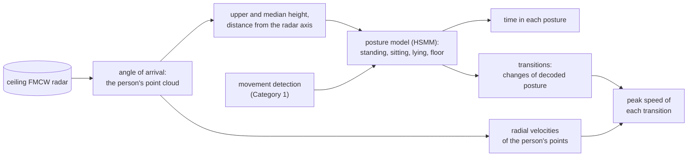
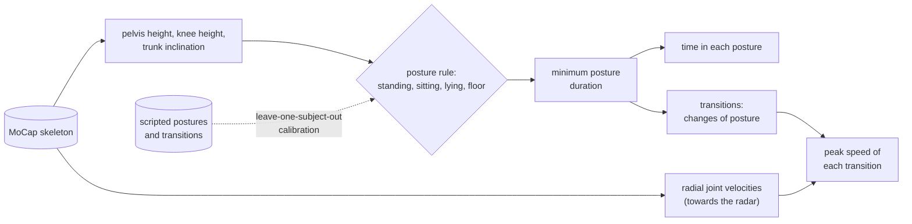
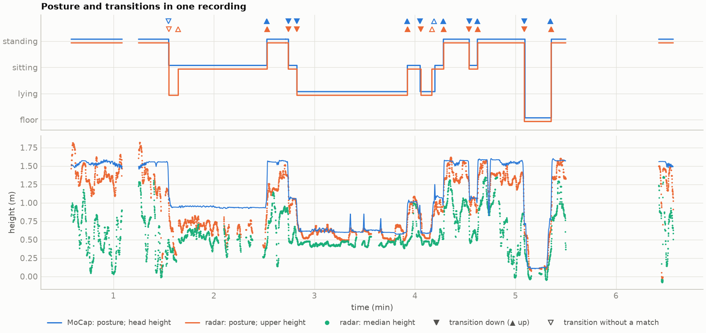
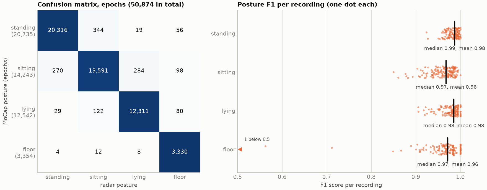
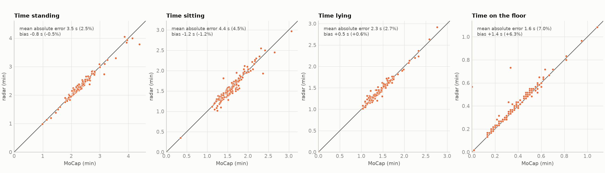
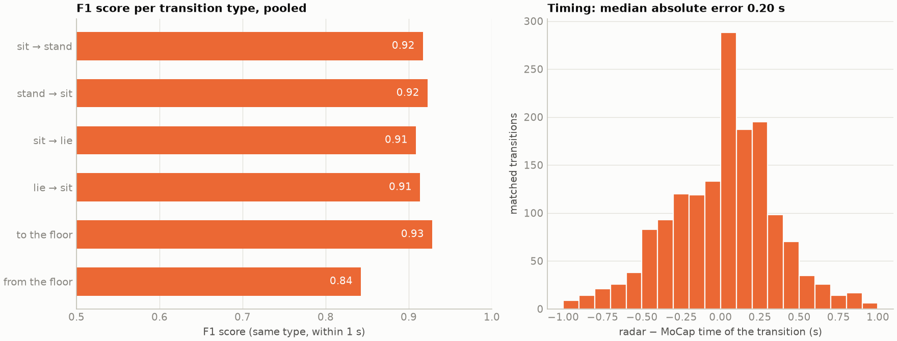
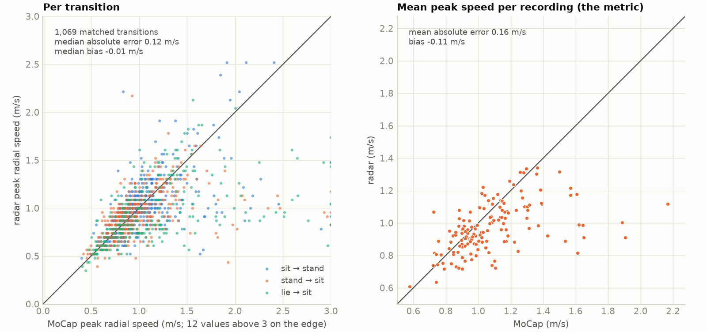
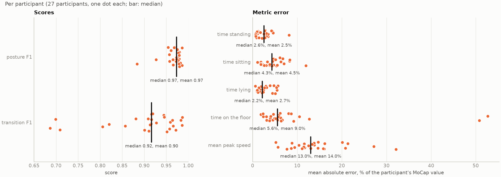

# Category 3: postural transitions and posture

## Metrics

- **Transition counts:** the number of sit-to-stand, stand-to-sit and lie-to-sit transitions.
- **Peak transition speed:** the peak speed of a person rising or sitting down. Sit-to-stand velocity is a marker of physical function in ageing [1].
- **Time in each posture:** standing, sitting, lying and on the floor.

## Overview

## Localisation of the person

**Angle of arrival.** The radar's antennas form a 2-D virtual array of 12 channels (3 transmitters × 4 receivers), spaced half a wavelength apart. A reflection from direction $(u, v)$, the direction cosines along the two array axes, produces a phase difference of $\pi u$ between neighbouring channels along the first axis, and of $\pi v$ along the second. For each range–Doppler cell with channel values $x_c$, the direction cosine is estimated as

$$u = \frac{1}{\pi} \arg \sum_{(c, c')} \overline{x_c} x_{c'}$$

where the sum runs over the channel pairs $(c, c')$ that are one element apart along the first axis. The estimate of $v$ is analogous. This is a single-snapshot phase-comparison estimate. Two corrections are applied to the channel values beforehand:

- the phase offsets of the antenna layout;
- the phase rotation caused by time-division multiplexing of the transmitters, which depends on the Doppler bin.

**3-D position.** With the range $r$, each reflection becomes a point in the room:

$$(x, z) = (x_0, z_0) + r (u, v), \qquad h = H - r \sqrt{1 - u^2 - v^2}$$

Here $`(x_0, z_0)`$ is the point directly below the radar and $H$ is the mounting height. The radar's orientation in the room is fitted once against MoCap.

**Point cloud of the person.** In each frame, every cell above its background becomes a point, whether it is moving or reflects breathing. The person's points are those within a fixed radius of the median position. They provide the activity energy of [Category 1](c1_movement.md) and the body heights below.

## Posture estimation

**Height features.** A ceiling radar measures the height of the upper body directly. This height is high when standing, lower when sitting, and lowest when lying or on the floor. Range alone confounds height with horizontal distance, so a person far from the radar would appear lower than they are. In each frame, two features are computed from the heights $h_i$ of the person's points:

- the upper height $`h^{\text{top}}_t`$, a high quantile of the $h_i$;
- the median height $`h^{\text{mid}}_t`$.

The median height separates lying in bed from lying on the floor. Point-cloud height has been used as a posture and fall cue in earlier mmWave radar work [2].

**Posture model.** Posture is estimated with a hidden semi-Markov model (HSMM), not decided independently per epoch. The hidden state is the posture $k$: standing, sitting, lying or floor.

- **Emissions.** The two heights are Gaussian given the posture. Away from the radar axis, the radar sees less of the top of the head, so measured heights are lower, by an amount that depends on the posture. The mean is therefore linear in the horizontal distance $\rho_t$ from the axis, with posture-specific coefficients:

  $$y_t = \bigl(h^{\text{top}}_t, h^{\text{mid}}_t\bigr) \mid k \sim \mathcal{N}\bigl(\mu_k + \gamma_k \rho_t, \Sigma_k\bigr)$$

  The log-likelihood of each frame is down-weighted, because consecutive frames are not independent. Breathing and small movements keep a still person visible most of the time. When the person is not detected, the frame carries no evidence and the posture persists.
- **Durations.** A posture lasts at least $d_{\min}$, the same minimum as in the MoCap definition. After this minimum, it ends at each frame with probability $p_{\text{move}}$ while the person moves (Category 1), and with a much smaller probability $p_{\text{still}}$ otherwise.
- **Transitions between states.** All posture changes are allowed and equally likely, including a change from a chair or bed directly to the floor. The model therefore learns nothing about the order of the scripted tasks.
- **Decoding.** The posture sequence is the most likely one, $`\hat{k}_{1:T} = \arg\max_{k_{1:T}} P(k_{1:T} \mid y_{1:T})`$, found with the Viterbi algorithm.

**Metrics.** The three metrics follow from the decoded posture.

- **Time in posture $k$:** $`T_k = \Delta \sum_e \mathbf{1}[\hat{k}_e = k]`$, where $`\hat{k}_e`$ is the most frequent posture in epoch $e$.
- **Transitions:** the frames where $`\hat{k}_t \ne \hat{k}_{t-1}`$.
- **Peak speed:** per frame, $`v^{(q)}_t`$ is the power-weighted $q$-quantile of the radial speeds of the person's moving points. This is the percentile method for micro-Doppler envelopes. A quantile is used instead of the maximum because strong reflections leak power into neighbouring Doppler bins. The peak of a transition at time $t_0$ is $`v_{\text{peak}} = \max_{\lvert t - t_0 \rvert \le \tau} v^{(q)}_t`$. The metric is the mean peak over the transitions of a recording.

**Calibration.** All parameters are calibrated with leave-one-subject-out cross-validation.

- The emission parameters are fitted by least squares on frames where the MoCap posture is known.
- The weight of the evidence and $p_{\text{move}}$ maximise the F1 score of the transitions against MoCap.
- The quantile $q$ minimises the error of the peak speed against MoCap.

An earlier method, which applies three height thresholds per epoch, is kept for comparison.

## Reference measurement

MoCap follows the common steps of [Category 1](c1_movement.md#reference-measurement). Posture is derived from the skeleton with a rule on three measures. Transitions and peak speed are then defined as for the radar:

Let $h_{\text{pelvis}}$ and $h_{\text{knee}}$ be the heights of the pelvis and the knees, and $\alpha$ the inclination of the trunk from vertical (hips to neck). The rule is applied in this order:

1. **standing** if $`h_{\text{pelvis}} > \eta_{\text{stand}}`$;
2. otherwise **floor** if $`\min(h_{\text{pelvis}}, h_{\text{knee}}) < \eta_{\text{floor}}`$ (lying, sitting or kneeling on the ground);
3. otherwise **lying** if $\alpha > \alpha_{\text{lie}}$;
4. otherwise **sitting** (on a chair, on the edge of the bed, or upright in bed).

A posture counts only after it has lasted $d_{\min}$. The parameters are calibrated with leave-one-subject-out cross-validation:

- $\eta_{\text{stand}}$ and $\alpha_{\text{lie}}$ maximise the balanced accuracy per epoch against the scripted posture;
- $\eta_{\text{floor}}$ and $d_{\min}$ maximise the F1 score of the transitions against the scripted changes.

The peak speed is that of the fastest joint along the line of sight of the radar, the component that the radar measures:

$$v^{\text{M}}_{\text{peak}} = \max_{\lvert t - t_0 \rvert \le \tau} \max_j \lvert v_{j,r}(t) \rvert$$

where $v_{j,r}$ is the radial velocity of joint $j$ with respect to the radar.

## Validation

- **Localisation.** The radar's 3-D positions are compared with the MoCap skeleton: the nearest moving reflection against the nearest joint, in one recording per furniture layout.
- **Reference posture.** The MoCap posture is compared with the scripted postures and transitions.
- **Radar posture.** The radar is compared with MoCap in three ways:
  - posture per epoch;
  - transitions, matched one-to-one when they have the same type and lie within one second of each other;
  - time in each posture and transition counts per recording.
- **Generalisation.** The posture model is also evaluated with a whole furniture layout left out, and with both the participant and the layout left out.

## Results

The posture results cover the same 148 recordings of 27 participants as Categories 1 and 2. All radar results are leave-one-subject-out. The MoCap reference itself reproduces almost all scripted posture changes.

**Localisation.** Against the nearest MoCap joint, the radar positions have a median horizontal error of 14 cm. With the angle of arrival, the median height error is 9 cm, against 53 cm from the range alone; away from the radar axis, the range alone misjudges the height by more than a metre.

**Example recording.** Figure 1 shows how the heights translate into postures in one recording. The upper height follows the MoCap head height closely while the person lies. It reads lower while the person stands or sits away from the radar axis, by an amount that depends on the posture; the posture model accounts for this. The radar matches 10 of MoCap's 12 transitions with the same type. After the first sit-down, for instance, it briefly decodes lying before sitting, so that transition has no match of the same type.

*Figure 1. One recording. Top: posture of both sensors and their transitions; hollow markers have no match of the same type in the other sensor. Bottom: the radar's upper and median heights of the person and the MoCap head height. Gaps are outside the evaluation window.*

**Posture.** Over all 50,874 epochs, the radar assigns the MoCap posture in 97.4% of the cases (Figure 2, epoch counts). Per MoCap posture, the radar agrees in 98.0% of the standing, 95.4% of the sitting, 98.2% of the lying and 99.3% of the floor epochs. The most frequent confusions are between sitting and standing or lying, each about 2% of the sitting epochs. Per recording, the F1 score has a median (mean) of 0.99 (0.98) for standing, 0.97 (0.96) for sitting, 0.98 (0.98) for lying and 0.97 (0.96) for the floor. Three recordings have a low floor score. In one, MoCap records no floor time while the radar decodes about half a minute on the floor. In the other two, the radar's floor episode lasts longer than MoCap's.

*Figure 2. Left: confusion matrix of the posture per epoch, MoCap against radar, pooled over all recordings, in numbers of epochs; the row labels give each MoCap posture's total, and the shading its share. Right: F1 score of each posture per recording, one dot each; the bar marks the median.*

**Time in each posture.** The time in each posture closely follows MoCap (Figure 3). Per recording, the mean absolute errors and biases are, with the error in % of the mean MoCap time:

| Posture | Mean MoCap time | Mean absolute error | Bias (radar − MoCap) |
|---|---|---|---|
| Standing | 140 s | 3.5 s (2.5%) | −0.8 s (−0.5%) |
| Sitting | 96 s | 4.4 s (4.5%) | −1.2 s (−1.2%) |
| Lying | 85 s | 2.3 s (2.7%) | +0.5 s (+0.6%) |
| Floor | 23 s | 1.6 s (7.0%) | +1.4 s (+6.3%) |

The floor has the largest relative error, because its episodes are short: a few seconds of difference weigh more. The radar tends to keep the floor posture slightly longer than MoCap.

*Figure 3. Time in each posture per recording, radar against MoCap, with the identity line.*

**Transitions.** Of the 1,762 MoCap transitions, the radar matches 1,597 with the same type within one second, a pooled F1 score of 0.91 (Figure 4). The median F1 score per recording is 0.92.

- **Per type.** The F1 score is between 0.91 and 0.93 for all types except getting up from the floor (0.84).
- **Timing.** The median absolute timing error of matched transitions is 0.20 s.

The posture model also performs as well in a furniture layout that was left out of its calibration.

*Figure 4. Left: F1 score per transition type, pooled over all recordings. Right: timing error of the matched transitions, radar − MoCap.*

**Peak speed.** For the 1,069 matched transitions of the counted types, the radar's peak radial speed agrees with MoCap's: the median absolute error is 0.12 m/s and the median bias −0.01 m/s (Figure 5). Below 1 m/s, the two agree without bias. Above 1.5 m/s of MoCap speed, which concerns about one transition in ten, the radar reads lower. These fast MoCap peaks come from a single joint, so some may be brief tracking errors. This tail makes the radar's mean peak speed per recording, the metric, lower than MoCap's: mean absolute error 0.16 m/s, bias −0.11 m/s.

*Figure 5. Peak radial speed. Left: per matched transition of the counted types (sit to stand, stand to sit, lie to sit); values above 3 m/s are drawn on the edge. Right: the metric, the mean peak speed of a recording's transitions, radar against MoCap.*

**Per participant.** Figure 6 shows the consistency across participants. The posture F1 score has a median and a mean of 0.97, and is above 0.88 for every participant. The transition F1 score has a median of 0.92 and a mean of 0.90; three participants score below 0.75. In % of the participant's MoCap value, the errors have a median (mean) of:

- time standing: 2.6% (2.5%);
- time sitting: 4.3% (4.5%);
- time lying: 2.2% (2.7%);
- time on the floor: 5.6% (9.0%);
- mean peak speed: 13.0% (14.0%).

The floor time has a low median but a higher mean, because of two participants with errors above 50%. In their recordings, the radar keeps the floor posture much longer than MoCap, or decodes floor time where MoCap has none. The peak speed has the largest typical error, in line with the per-recording results.

*Figure 6. Results per participant, one dot each; the bar marks the median, and the median and mean are written below. Left: mean posture F1 score and pooled transition F1 score. Right: mean absolute error of each posture time and of the mean peak speed over the participant's recordings, in % of the participant's MoCap value.*

**Calibration data.** About one hour of MoCap recordings is sufficient to calibrate the posture model.

Related work includes ceiling-mounted radar posture recognition with a MoCap reference [3], and sit-to-stand analysis with mmWave radar against reference systems [4, 5].

## Limitations

- **Transition counts.** All recordings contain the same scripted transitions. Validating the counts requires free-living recordings.
- **Short postures.** In the scripted tasks, nearly every posture shorter than a few seconds is a passing phase of one movement, such as kneeling while getting up. The shortest genuine posture, and whether the radar detects it, can only be assessed in free-living recordings.
- **Other rooms.** All recordings share one room and one radar position, so other ceilings and mountings are untested. The posture model depends on an accurate mounting height. The resident's height while walking can verify it without labels ([calibration](calibration.md#calibration-without-labels)).
- **Two people.** The resident and a caregiver are not yet separated, so the caregiver visits are excluded. Separating them would make about a third more radar time usable.
- **Future work.** The sign of the Doppler shift could serve as evidence of moving down or up. The duration of a transition could be an additional metric.

## References

1. O'Brien MW. Time to stand up faster: underutilization of real-world sit-to-stand transition velocity in aging research. *Front Aging.* 2026;7:1639286. [doi:10.3389/fragi.2026.1639286](https://doi.org/10.3389/fragi.2026.1639286)
2. Jin F, Sengupta A, Cao S. mmFall: fall detection using 4-D mmWave radar and a hybrid variational RNN autoencoder. *IEEE Trans Autom Sci Eng.* 2022;19(2):1245–1257. [doi:10.1109/TASE.2020.3042158](https://doi.org/10.1109/TASE.2020.3042158)
3. Garg S, Černý M, Hrubý D, Bansal A. RadarMoCap-Posture: a synchronized mmWave point-cloud and motion-capture benchmark for human posture recognition. Zenodo; 2026. [doi:10.5281/zenodo.22945438](https://doi.org/10.5281/zenodo.22945438)
4. Hu S, Ackun P, Zhang X, Cao S, Barton J, Hector MG, Fain MJ, Toosizadeh N. mmWave radar for sit-to-stand analysis: a comparative study with wearables and Kinect. *IEEE Trans Biomed Eng.* 2025;72(9):2623–2634. [doi:10.1109/TBME.2025.3548092](https://doi.org/10.1109/TBME.2025.3548092)
5. Ziaee Bideskan M, Karbaschi N, Abedi H, Abbasi Z. Radar-based assessment of sit-to-stand transitions as digital biomarkers of pain and physical decline. *Sensors.* 2026;26(9):2769. [doi:10.3390/s26092769](https://doi.org/10.3390/s26092769)
