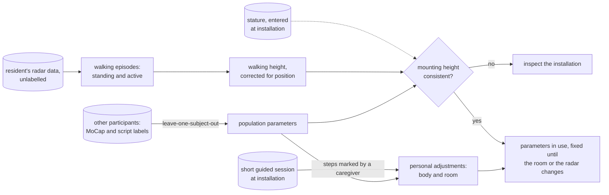

# Calibration

Each method in Categories 1–3 has a small number of parameters, such as thresholds on the activity level or on the measured height. This page describes how these parameters are set at three levels:

- for the population;
- for an individual resident;
- without any labels, from the resident's own radar data.

## Overview

## Population calibration

All parameters are calibrated with leave-one-subject-out cross-validation. The parameters applied to a participant are fitted on the other participants only. The reported results therefore estimate the performance for a new resident without any individual setup. This is the primary measure of generalisation.

No parameter is set by hand. The reference definitions are calibrated against the labels of the scripted activities, also with the participant left out. These definitions are what counts as active on MoCap, what constitutes a bout, and what defines each posture.

## Personal calibration (under evaluation)

Part of the remaining error is systematic for a given person rather than random. For example, the radar may consistently underestimate one person's energy. Another person's measured heights may depend on their stature and furniture. A short calibration in the resident's own room could remove such offsets.

**Principles.**

- **Definitions remain population-wide.** The definitions of activity, bouts and postures are never personalised. Otherwise, the thresholds of a resident who slows down would drift with them, and the calibration would conceal the decline that the metrics are meant to detect.
- **Only the measurement is personalised:** the body (stature, size), the person's position relative to the radar, and the room (bed and chair heights).
- **Adjustment, not replacement.** A personal parameter starts from its population value and departs from it only as far as the person's own data support.

**Deployment.** In practice, the personal data would come from a short guided session at installation. The resident stands, walks, sits on their chair and lies in bed for a few minutes, while a caregiver marks each step. No motion capture is required.

**Experiment.** Three setups are compared on the same data:

1. population calibration only;
2. population calibration and a short labelled segment of the recording, which simulates the installation session;
3. population calibration, the person's other recordings and the segment. This is an upper bound, with far more personal data than a session would provide.

**Preliminary results.** Personalisation brings little benefit for the activity threshold. The energy scale, in contrast, improves with more personal data. The session design is being revised to capture the relevant information, for example with a timed walk.

## Calibration without labels

Ideally, the radar requires no setup, or calibrates itself from a few hours of the resident's ordinary life. Without labels or motion capture, it can only learn from episodes whose interpretation is unambiguous.

**Walking episodes.** When the radar tracks the person crossing the room at a steady pace, the person is standing and active, by the definitions used here. Such episodes are detected causally from the radar's own track of the person. They agree with motion capture in almost all cases. Episodes of remaining in one place are not unambiguous: the person may move their arms, and may be sitting or lying.

**Uses of walking episodes.**

- **Verification of the installation.** All heights are measured relative to the radar's mounting height. An error in the entered mounting height shifts every height, including the walking height.
  - **Position correction.** Heights are less accurate far from the radar axis. The walking height is therefore corrected for the horizontal distance from the axis, with a correction learned on other participants, so that it no longer depends on where the person walked.
  - **Without the stature.** Because stature varies between people, the walking height alone detects only large mounting errors.
  - **With the stature.** When the resident's stature is entered at installation, the check becomes precise. A mounting error large enough to affect the posture model is detected after about an hour of ordinary activity, and mostly within the first few minutes of walking.
- **Standing height.** Walking episodes also give the person's standing height, which the guided session would otherwise have to measure.

**What walking episodes cannot provide.**

- **Energy scale.** The person-to-person differences in the energy scale arise from how a person moves, which the radar cannot observe without a reference.
- **Activity threshold.** It showed no systematic personal offset.

Unsupervised adaptation of the posture model to the resident's data was also tested and was not pursued.
