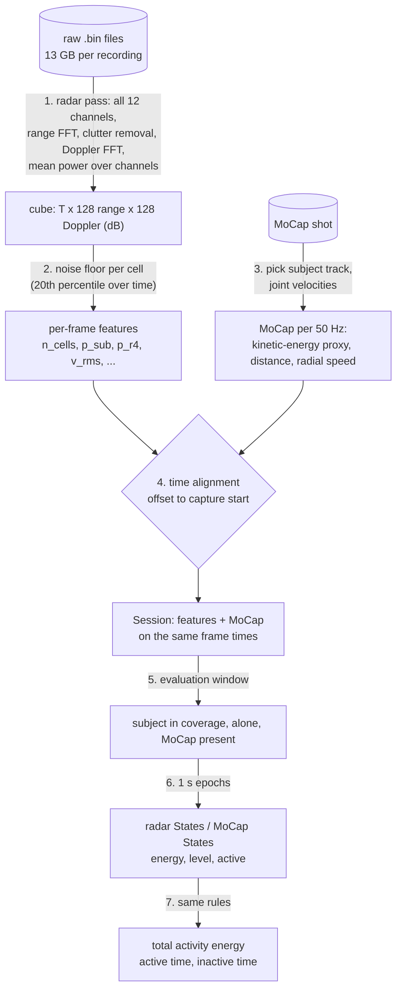
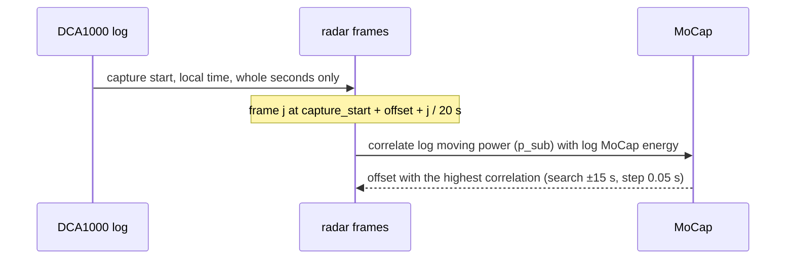
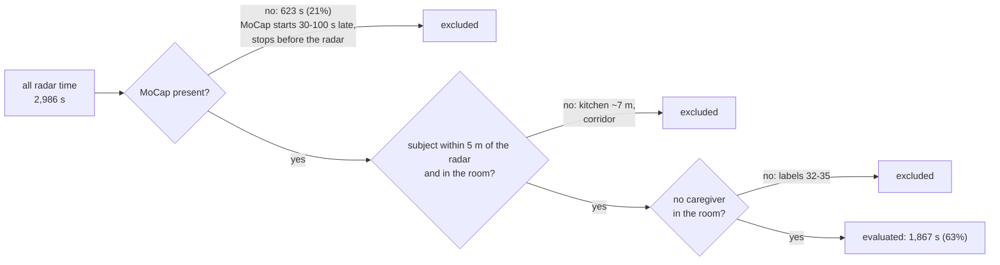
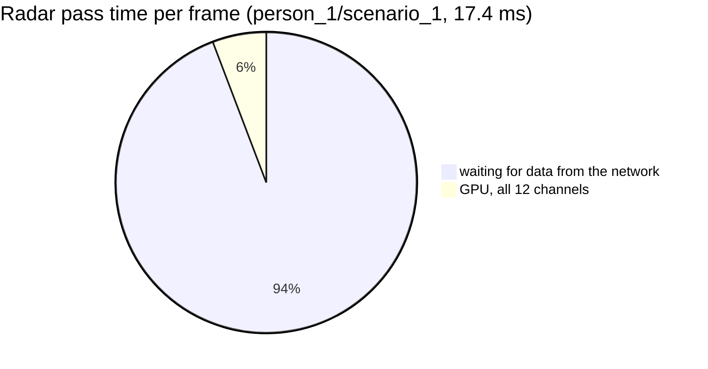

# Category 1: total movement volume

*Total activity energy, active time, inactive time*, from the ceiling FMCW radar, validated against MoCap. This note covers what was done, the results on the first 6 recordings, and the bottlenecks. The code is in `mobility/` (see [README](../README.md)); the numbers below come from `scripts/evaluate_category1.py`, written to `output/category1/`.

## Summary

- **The radar measures movement volume well, once it is aligned with MoCap and restricted to the times it can see the subject.** Per 1 s epoch, active vs inactive against MoCap: median AUC 0.96, and F1 0.91 with a fixed threshold calibrated on the other recordings.
- **Active and inactive time per recording** agree to within 0.22 min on average (bias −0.08 min), out of about 4–7 evaluable minutes per recording.
- **Total activity energy is not validated yet**: Spearman 0.14 across only 6 recordings.
- **The biggest problem was time alignment.** The legacy code (`mobilityIndex_legacy`) placed radar frames evenly between the first and last label, which is tens of seconds wrong. Its finding that "the radar can't see walking" is most likely this bug, not physics.
- **Main bottlenecks:**
  - reading the raw data, limited by the 1 Gbit/s network (about 5 h for the campaign);
  - the parts of each recording where MoCap and radar don't see the same thing (only 63% of radar time is usable);
  - the signal level's dependence on where the person is;
  - small arm movements, which are partly missed.

## Data used

6 recordings: 6 people, one recording of each of the 6 scenario layouts. They were picked to have one clear MoCap subject track and to cover different layouts.

| Recording | Radar frames | MoCap shot | Epochs with MoCap | Epochs evaluated |
|---|---|---|---|---|
| person_1/scenario_1 | 11,106 | shot_001 | 329 | 248 |
| person_5/scenario_3 | 8,249 | shot_003 | 364 | 278 |
| person_10/scenario_2 | 9,022 | shot_002 | 367 | 294 |
| person_12/scenario_5 | 9,982 | shot_005 | 351 | 262 |
| person_15/scenario_4 | 10,798 | shot_004 | 483 | 397 |
| person_22/scenario_6 | 10,575 | shot_006 | 469 | 388 |

All scenarios follow the same 38-step script (enter, walk, kitchen, chair with eating and drinking, bed with lying and turning, floor, caregiver visit, leave). Only the furniture layout changes.

## Method



### 1. One radar pass

Each raw recording is read once. The range-Doppler power of all 12 virtual channels (3 TX × 4 RX) is computed on the GPU, averaged over the channels, and stored as a float16 dB cube (about 360 MB per recording). The DSP is the same as in the original preprocessing code (drop ADC sample 0, Hann, range FFT, mean over the chirps removed per frame, Hann, Doppler FFT). Bins: 4.40 cm in range (0–5.6 m), 4.34 cm/s in Doppler (±2.78 m/s); + = away from the radar. The raw data format and the recordings with missing data are in [raw_data_january.md](raw_data_january.md).

Everything after this step reads the cube, so new features or metrics never need the raw data again.

### 2. Per-frame features

A cell (range bin, Doppler bin) can hold a moving person when its range is ≥ 0.3 m (beyond the TX–RX leakage) and its speed is ≥ 0.1 m/s. Slower motion is residual clutter, breathing, or a person standing still; breathing shows up at ±0.04 m/s and is correctly ignored. The noise floor of each cell is its 20th percentile over the recording; the floors are within 0.8 dB across recordings.

| Feature | Definition | Used for |
|---|---|---|
| `n_cells` | number of moving cells > 6 dB above their floor | **active / inactive** |
| `p_sub` | moving power above the floor, summed | alignment |
| `p_r4` | `p_sub` with each range bin weighted by r⁴ | **total activity energy** (distance-corrected) |
| `v_rms` | RMS radial speed of the cells above the floor | alternative activity level |
| `v_centroid` | signed mean radial velocity | direction check (Category 3) |
| `r_near` | range of the nearest clearly moving reflector | radar position fit, height (Category 3) |

### 3. MoCap ground truth

- **Pairing:** shots are paired with radar recordings by time overlap, not by number.
- **Subject track:** the track with the longest centre-of-gravity path inside the room. The largest file is wrong in 3 of 152 shots (person_4/shot_006, person_5/shot_005 and shot_006), where a static ghost track spans the whole shot.
- **Per sample:** joint velocities with a Savitzky–Golay filter (0.26 s), over 16 joints. From them:
  - a kinetic-energy proxy, `ke` = mean squared joint speed;
  - the same along the line to the radar (what the radar can see);
  - the distance from the radar to the CoG.
- **Active epoch:** RMS joint speed > 0.15 m/s (`config.MOCAP_ACTIVE_SPEED`, a first choice; see open decisions).

### 4. Time alignment



- **Offset:** frame 0 comes 0.2–0.95 s after the logged start, consistent with the start being truncated to the second.
- **Sharp peak:** the correlation peak is 0.30–0.41 above the best correlation more than 2 s away, so 1 s of error destroys the agreement.

| Recording | Offset (s) | Peak correlation | Margin |
|---|---|---|---|
| person_1/scenario_1 | 0.95 | 0.40 | 0.39 |
| person_5/scenario_3 | 0.85 | 0.48 | 0.37 |
| person_10/scenario_2 | 0.35 | 0.60 | 0.41 |
| person_12/scenario_5 | 0.30 | 0.47 | 0.40 |
| person_15/scenario_4 | 0.50 | 0.43 | 0.30 |
| person_22/scenario_6 | 0.20 | 0.59 | 0.31 |

On person_1/scenario_1, the legacy mapping (frames spread between the first and last label) gives a correlation of 0.05, against 0.35 aligned. The dataset's `Doppler/time_doppler_max.npy` also has fewer rows than frames on disk (11,085 vs 11,106), so it can't be aligned by frame index.

### 5. Radar position

The position is fitted by grid search: `r_near` against the MoCap distance from the radar to the nearest of head, shoulders, wrists and knees, over frames with clear movement (19,793 frames, 6 recordings).

- **Result:** x = −3.25 m, height 2.45 m, z = 0.40 m (MoCap frame, Y up). Median range error 5.8 cm (1.3 range bins).
- **Floor plan:** it gives about x −3.25, z 0.47 m. The height was not known; 2.7 m gave a 15 cm error.
- **Doppler sign:** checked: the signed Doppler centroid follows the MoCap CoG radial speed (r = 0.83; + = away).

### 6. Evaluation window

A 1 s epoch is evaluated only where MoCap and radar can see the same thing:



### 7. States and metrics

Per epoch, the radar and MoCap are turned into the same `States`: energy, activity level, active/inactive, and valid. The three metrics are one rule each, applied to both (`mobility/metrics/category1.py`):

| Metric | Rule | Radar | MoCap |
|---|---|---|---|
| total activity energy | Σ energy over valid epochs × epoch length | `p_r4` | mean squared joint speed |
| active time | active valid epochs × 1 s | `n_cells` level > threshold | RMS joint speed > 0.15 m/s |
| inactive time | inactive valid epochs × 1 s | | |

The radar threshold is calibrated against MoCap, maximising balanced accuracy. For each recording it comes from the other five (leave-one-recording-out, which equals leave-one-subject-out here).

**Scores.** MoCap active is the positive class.

- **Per epoch:**
  - **AUC** of the radar activity level: how well active and inactive epochs can be separated by any threshold. It judges the feature.
  - **F1** of the radar active/inactive calls, with the calibrated threshold. It judges the feature plus its threshold.

  The same AUC with a lower F1 means the threshold doesn't transfer well between recordings. F1 counts only the active class; about half the epochs are active, so calling everything active would still give F1 ≈ 0.7.
- **Per recording**, on the metrics themselves:
  - active and inactive time: mean absolute error and bias (radar − MoCap), in minutes;
  - total activity energy: radar and MoCap energy are different quantities in different units, so only a rank correlation across recordings (Spearman) can check it.

## Results

### Per epoch (median over the 6 recordings)

| Feature | AUC | F1 |
|---|---|---|
| **`n_cells`** | **0.96** | **0.91** |
| `p_r4` | 0.96 | 0.87 |
| `v_rms` | 0.94 | 0.87 |
| `p_sub` | 0.95 | 0.87 |

Per recording, AUC / F1:

| Recording | `n_cells` | `p_r4` | `p_sub` | `v_rms` |
|---|---|---|---|---|
| person_1/scenario_1 | 0.97 / 0.87 | 0.97 / 0.90 | 0.95 / 0.86 | 0.96 / 0.86 |
| person_5/scenario_3 | 0.98 / 0.94 | 0.98 / 0.87 | 0.96 / 0.88 | 0.97 / 0.92 |
| person_10/scenario_2 | 0.97 / 0.93 | 0.97 / 0.92 | 0.96 / 0.90 | 0.94 / 0.87 |
| person_12/scenario_5 | 0.95 / 0.92 | 0.93 / 0.85 | 0.91 / 0.87 | 0.91 / 0.89 |
| person_15/scenario_4 | 0.95 / 0.90 | 0.94 / 0.88 | 0.92 / 0.83 | 0.93 / 0.85 |
| person_22/scenario_6 | 0.95 / 0.87 | 0.95 / 0.87 | 0.95 / 0.87 | 0.93 / 0.88 |

- **Separation (AUC) is about the same for all features** (0.91–0.98). The threshold is what separates them.
- **`n_cells` keeps the best F1** (0.87–0.94): it counts cells against each recording's own noise floor, so one threshold fits all recordings.
- **Thresholds on power transfer less well:** `p_r4` has the same median AUC as `n_cells` (0.96) but a lower F1 (0.87). Its active threshold sits close to the noise floor, so small baseline differences between recordings move epochs across it.

### Per recording

| Recording | Active min (radar / MoCap) | Inactive min (radar / MoCap) | Energy (radar / MoCap) |
|---|---|---|---|
| person_1/scenario_1 | 2.45 / 2.03 | 1.68 / 2.10 | 3.70 / 40.9 |
| person_5/scenario_3 | 2.52 / 2.60 | 2.12 / 2.03 | 3.64 / 58.4 |
| person_10/scenario_2 | 2.65 / 2.73 | 2.25 / 2.17 | 4.47 / 73.5 |
| person_12/scenario_5 | 2.77 / 2.87 | 1.60 / 1.50 | 3.61 / 79.1 |
| person_15/scenario_4 | 3.45 / 3.48 | 3.17 / 3.13 | 4.71 / 57.4 |
| person_22/scenario_6 | 3.00 / 3.62 | 3.47 / 2.85 | 6.09 / 80.6 |

| Metric | Mean abs. error | Bias (radar − MoCap) | Spearman across recordings |
|---|---|---|---|
| active time | 0.22 min | −0.08 min | |
| inactive time | 0.22 min | +0.08 min | |
| total activity energy | | | 0.14 |

With 6 recordings these are indications, not validation.

### Per scripted activity (pooled threshold)

The table shows the share of epochs active by MoCap → by radar, where the two differ.

| Activity | MoCap → radar | Distance | Why |
|---|---|---|---|
| Lay down on the ground | 0.62 → 0.41 | 2.9 m | low and far from the radar |
| Stop eating and put down the plate | 0.67 → 0.52 | 3.2 m | small arm movements at the chair |
| Turn on your right/left side (some scenarios) | 0.92 → 0.77 | 2.0 m | slow turning in bed (possibly under a blanket) |
| Press the button on the wearable | 0.17 → 0.38 | 2.0 m | radar more sensitive than the 0.15 m/s MoCap threshold |
| Caregiver enters / leaves | 0.18 → 0.57, 0.00 → 0.71 | | the radar sees the caregiver |
| Walk to / back from the kitchen | 0.98 → 0.69 | 4.0 m | partly out of range |
| Wander in the corridor | 1.00 → 0.00 | 7.1 m | out of range |

Walking and wandering in the room, bed movements, standing up and sitting down agree within ±0.1.

### Distance dependence

These are residuals of each feature after a fit on log MoCap energy, for active epochs at increasing distance from the radar to the CoG (log10 units; × 10 = dB for power):

| Distance | `p_sub` | `p_r4` | `n_cells` |
|---|---|---|---|
| < 2 m | +0.27 | +0.04 | +0.32 |
| 2–2.5 m | −0.18 | −0.07 | +0.07 |
| 2.5–3 m | −0.33 | −0.08 | −0.12 |
| 3–3.5 m | −0.40 | −0.11 | −0.32 |
| 3.5–4 m | −0.55 | −0.16 | −0.56 |
| 4–5 m | −0.70 | −0.27 | −0.93 |

- **Uncorrected power:** falls about 10 dB from under 2 m to 4–5 m.
- **r⁴ correction:** removes most of that; 3 dB is left, probably from the antenna pattern off-axis.
- **`n_cells`:** 18 times fewer cells at 4–5 m. Good for detecting activity, but not usable as an energy measure.

## Bottlenecks



1. **Time alignment: solved for now, but it depends on MoCap.** The radar log has the start only to the second, and a 1 s error ruins the comparison, so every recording needs its own fitted offset. That needs MoCap motion in the recording. A recording without usable MoCap would have to use the typical offset (about 0.5 ± 0.4 s). Any earlier result built on the legacy timing should be redone.

2. **Reading the raw data.** One January pass reads about 2 TB.
   - The link of this machine is 1 Gbit/s (about 110 MB/s). Eight parallel reads together reach 116 MB/s, so parallelism doesn't help: about 5 h minimum for the campaign.
   - Per frame: 16–23 ms in total, of which about 95% is waiting for data. The GPU work for 12 channels is 1 ms, so the extra channels are free. The "184 ms/frame to read" in SCOPE.md is not right.
   - Reading MoCap or cubes over the same link at the same time slows the pass (23 ms/frame vs 16 ms/frame).
   - Mitigation: read each recording once (done), keep every product in the cube, and if possible run the pass on a machine with a faster link to the storage.

3. **MoCap and radar don't cover the same thing: 37% of radar time can't be evaluated.**
   - MoCap starts 30–100 s after the radar and stops before it.
   - The kitchen (about 7 m away) and the corridor are beyond the radar's range.
   - A caregiver is in the room during labels 32–35, and the operator moves before and after MoCap. The radar counts everyone, so it reports "active" when only the caregiver moves.

   For the metrics this needs a decision: either define them only over the subject-alone, in-range window (as here), or separate people with the angle information (product 3 in SCOPE.md).

4. **Signal level depends on position, not only on movement.** Power falls about 10 dB from under 2 m to 4–5 m. Range correction recovers about 7 dB of that; the antenna pattern, and later the angle, would be needed for the rest. A threshold on power transfers less well between recordings (`p_r4`: AUC 0.96 like `n_cells`, but F1 0.87 vs 0.91), because it sits close to the noise floor. Counting cells above each recording's own floor (`n_cells`) is robust for active/inactive but depends even more on distance, so active/inactive and energy need different features.

5. **Small and low movements are partly missed.** These are eating, drinking and putting down plate or glass at about 3.2 m, lying down on the floor, and turning under a blanket. The radar under-counts them by 0.15–0.2 in the share of active epochs.

6. **Total activity energy is not validated.**
   - Radar and MoCap energy are different quantities: radial-only, distance-weighted power against whole-body joint speed.
   - Six recordings give no usable correlation (0.14).
   - It needs the full campaign, plus a decision on the reference: total kinetic energy, or only the motion along the line to the radar (`vr2`, also computed).

7. **Choosing the MoCap subject track and defining "active".**
   - The subject track is solved with the path-length rule; it was wrong in 3 of 152 shots.
   - The MoCap active threshold of 0.15 m/s is a first choice. It decides the reference active time: for example, "press the button on the wearable" is active for the radar but mostly not for MoCap.

8. **Storage and re-reading.** Cubes are 360 MB per recording, about 56 GB for the campaign. Computing features from a cube takes about 1 min, mostly reading it back over NFS. That is acceptable; a campaign-wide noise floor would allow writing compact products directly in the pass instead.

## Open decisions

- **MoCap "active" threshold:** keep 0.15 m/s RMS joint speed, or calibrate it against the activity labels?
- **Evaluation window:** exclude caregiver and operator periods (current choice), or keep them as known radar errors?
- **Energy reference:** whole-body kinetic energy, or only the radial component?
- **Full campaign:** run the radar pass on all 156 January recordings (≥ 5 h) to validate the per-recording metrics on enough recordings.

## Reproducing

```bash
PY=/cw/dtaiexp/NoCsBack/2026-Xuan/miniforge3/envs/distrimuse/bin/python3
RECS="person_1/scenario_1 person_5/scenario_3 person_10/scenario_2 person_12/scenario_5 person_15/scenario_4 person_22/scenario_6"
CUDA_VISIBLE_DEVICES=0 $PY scripts/radar_pass.py --only $RECS   # ~20 min
$PY scripts/evaluate_category1.py --only $RECS                   # ~10 min the first time
$PY scripts/fit_radar_position.py --only $RECS
$PY scripts/plot_timeline.py person_1/scenario_1
```
