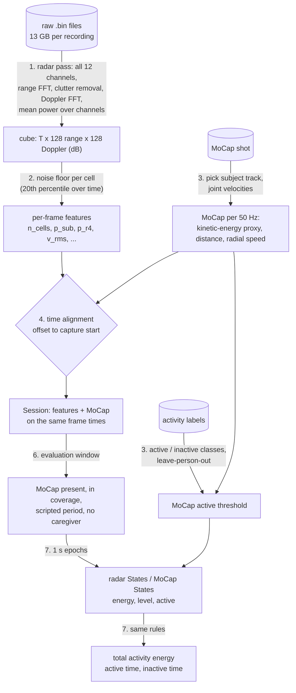
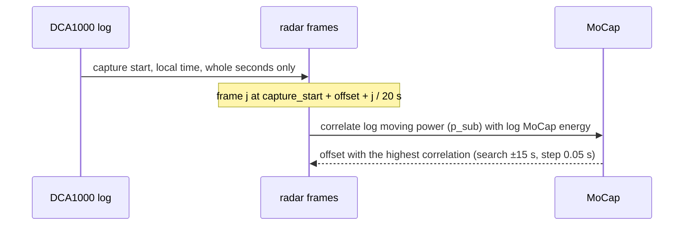
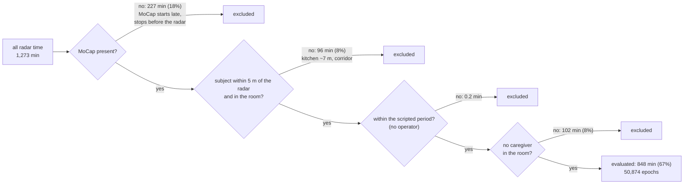
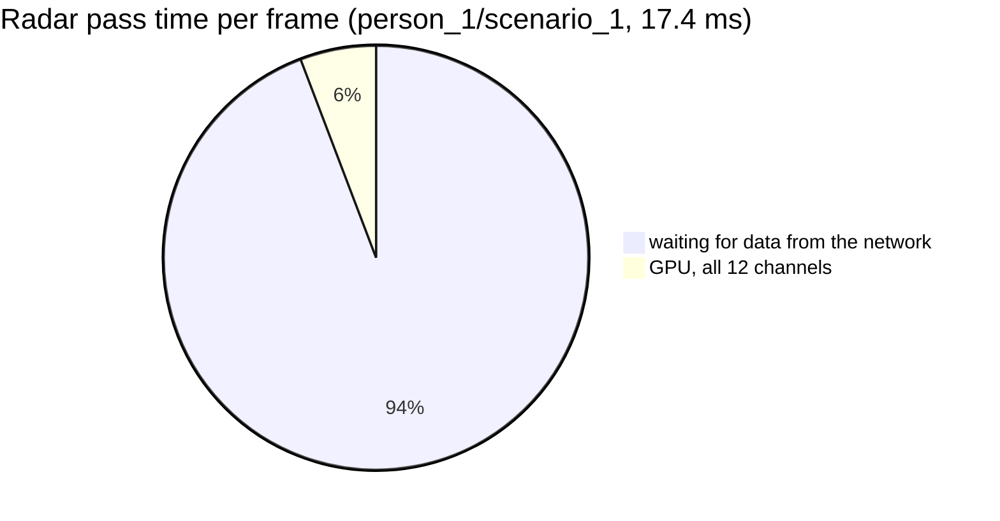

# Category 1: total movement volume

*Total activity energy, active time, inactive time*, from the ceiling FMCW radar, validated against MoCap on the full January 2026 campaign. This note covers what was done, the results, the runs that produced them, and the bottlenecks. The code is in `mobility/` (see [README](../README.md)). The numbers come from `scripts/calibrate_mocap_threshold.py` (written to `output/groundtruth/`) and `scripts/evaluate_category1.py` (written to `output/category1/`); see [Runs and outputs](#runs-and-outputs).

## Summary

- **Active and inactive time work.** On 148 recordings from 27 people, the radar's active/inactive call per 1 s epoch matches MoCap with median AUC 0.97 and F1 0.91 (10th–90th percentile over recordings: F1 0.86–0.93). No recording scores below F1 0.82. Per recording, active and inactive time are off by 0.17 min on average, out of about 5.6 evaluated minutes (6.8% of the active time). Every threshold is calibrated without the person being evaluated.
- **Total activity energy does not work yet.** Radar and MoCap energy rank the 148 recordings almost independently (Spearman 0.15). With the full campaign, too few recordings is no longer the explanation: the radar's energy measure doesn't track whole-body movement energy across recordings. This is the main open problem of Category 1.
- **The MoCap ground truth is calibrated, not set by hand.** "Active" means whole-body movement: the RMS joint-speed threshold is calibrated against the activity labels, leaving the evaluated person out. It comes out at 0.25 m/s, the same within ±0.003 m/s whoever is left out.
- **The biggest problem was time alignment.** The legacy code (`mobilityIndex_legacy`) placed radar frames evenly between the first and last label, which is tens of seconds wrong. Its finding that "the radar can't see walking" is most likely this bug, not physics.
- **Main bottlenecks:**
  - total activity energy (above);
  - the parts of each recording where MoCap and radar don't see the same subject alone (a third of the radar time can't be evaluated);
  - the signal level's dependence on where the person is;
  - reading the raw data, limited by the 1 Gbit/s network (7 h for the campaign).

## Data used

| | Recordings | Persons |
|---|---|---|
| January radar recordings | 156 | 30 (person_1–27, person_100–102) |
| with a cube from the full radar pass | 156 | 30 |
| with MoCap and labels | 150 | 27 |
| **evaluated** (alignment succeeded) | **148** | **27** |

Recordings left out, and why:

| Recording | Reason |
|---|---|
| person_100/scenario_100, person_101/scenario_100, person_101/scenario_101, person_102/scenario_100 | no MoCap, no labels |
| person_9/scenario_2 | no MoCap shot covers the recording (`shot_002` is missing from the person_9 folder) |
| person_24/scenario_3 | no labels, no MoCap shot |
| person_20/scenario_3, person_20/scenario_5 | alignment failed: person_20's MoCap clock is off (in scenario 3 the MoCap timestamps fall before the radar recording starts). The dataset readme flags person_20's MoCap. |

All scenarios follow the same 38-step script (enter, walk, kitchen, chair with eating and drinking, bed with lying and turning, floor, caregiver visit, leave). Only the furniture layout changes.

The method was developed on 6 recordings, one per scenario layout: person_1/scenario_1, person_5/scenario_3, person_10/scenario_2, person_12/scenario_5, person_15/scenario_4 and person_22/scenario_6. The radar position fit (§5) and the figures in [Over time](#over-time) come from them.

## Method



### 1. One radar pass

Each raw recording is read once. The range-Doppler power of all 12 virtual channels (3 TX × 4 RX) is computed on the GPU, averaged over the channels, and stored as a float16 dB cube (about 360 MB per recording).

- **DSP:** the same as in the original preprocessing code: drop ADC sample 0, Hann, range FFT, subtract the mean over the chirps per frame, Hann, Doppler FFT.
- **Bins:** 4.40 cm in range (0–5.6 m), 4.34 cm/s in Doppler (±2.78 m/s); + = away from the radar.
- **Raw data:** the format and the recordings with missing data are in [raw_data_january.md](raw_data_january.md).

Frames damaged by packets lost during the capture are set to NaN: they look like bursts of movement (see [raw_data_january.md](raw_data_january.md#lost-packets)). Everything after this step reads the cube, so new features or metrics never need the raw data again.

### 2. Per-frame features

A cell (range bin, Doppler bin) can hold a moving person when its range is ≥ 0.3 m (beyond the TX–RX leakage) and its speed is ≥ 0.1 m/s. Slower motion is residual clutter, breathing, or a person standing still; breathing shows up at ±0.04 m/s and is correctly ignored. The noise floor of each cell is its 20th percentile over the recording.

| Feature | Definition | Used for |
|---|---|---|
| `n_cells` | number of moving cells > 6 dB above their floor | **active / inactive** |
| `p_sub` | moving power above the floor, summed | alignment |
| `p_r4` | `p_sub` with each range bin weighted by r⁴ | **total activity energy** (distance-corrected); also a good active / inactive feature |
| `v_rms` | RMS radial speed of the cells above the floor | alternative activity level |
| `v_centroid` | signed mean radial velocity | direction check (Category 3) |
| `r_near` | range of the nearest clearly moving reflector | radar position fit, height (Category 3) |

### 3. MoCap ground truth

**Subject track and signals.**
- **Pairing:** shots are paired with radar recordings by time overlap, not by number.
- **Subject track:** the track with the longest centre-of-gravity path inside the room. The largest file is wrong in 3 of 152 shots (person_4/shot_006, person_5/shot_005 and shot_006), where a static ghost track spans the whole shot.
- **Per sample:** joint velocities with a Savitzky–Golay filter (0.26 s), over 16 joints. From them:
  - the **energy reference**, `ke` = mean squared joint speed over all joints and all three directions (whole body);
  - the same along the line to the radar (`vr2`, what the radar can see; a diagnostic, not used by the metrics);
  - the distance from the radar to the CoG.

**Active threshold, calibrated against the activity labels.** Per 1 s epoch, MoCap is active when the RMS joint speed exceeds a threshold. The threshold is calibrated against the scripted activities, not set by hand ([mobility/labels.py](../mobility/labels.py)):

| Class | Labels |
|---|---|
| active (whole-body movement) | walking, wandering, going to the bed, kitchen or outside; sitting down, standing up, lying down, getting up, sitting upright, picking up a coin; anxious movement in bed |
| inactive | arm-only tasks while seated or lying (eating, drinking, putting down the plate or glass, pressing the wearable button); waiting between instructions, at least 2 s away from any label |
| not used | labels that mix both (e.g. "turn on your left side and lie still"), entering the room, the caregiver visit |

The threshold maximises balanced accuracy between the two classes. For each person, it is calibrated on the **other 26 people** (MoCap and labels of all their recordings, no radar needed). That person's scores, and the radar threshold used for them, are then judged with this threshold.

| | Value |
|---|---|
| Data | 150 recordings, 27 people; 23,473 active and 11,381 inactive labelled epochs |
| Threshold, leaving each person out | 0.249–0.254 m/s (all people: 0.253 m/s) |
| Held-out person vs labels | AUC median 0.92 (0.84–0.96), F1 median 0.88 (0.78–0.93) |

The threshold barely moves when a person is left out, so it should generalise to new people. Labelled segments are not uniformly active: a "sit down" label also holds a moment of standing still before and after. As a result, only 45–83% of the epochs in transition labels are above the threshold, and the held-out F1 against the labels stays below 1.

### 4. Time alignment



On the 150 recordings with MoCap (median, 10th–90th percentile):

| | Value |
|---|---|
| offset of radar frame 0 after the logged capture start | 0.50 s (0.20–0.90) |
| peak correlation | 0.52 (0.46–0.57) |
| margin: peak minus the best correlation more than 2 s away | 0.34 (0.26–0.40) |

- **Offset:** consistent with the capture start being logged to the whole second only.
- **Sharp peak:** 1 s of error destroys the agreement.
- **Quality check:** a recording whose margin is below 0.1 is left out of the evaluation. Its alignment is unreliable, and a misaligned recording would compare unrelated seconds. Two recordings fail it, both person_20 (scenario_3: no overlap within ±15 s; scenario_5: margin 0.01).

On person_1/scenario_1, the legacy mapping (frames spread between the first and last label) gives a correlation of 0.05, against 0.35 aligned. The dataset's `Doppler/time_doppler_max.npy` also has fewer rows than frames on disk (11,085 vs 11,106), so it can't be aligned by frame index.

### 5. Radar position

The position is fitted by grid search on the 6 development recordings: `r_near` against the MoCap distance from the radar to the nearest of head, shoulders, wrists and knees, over frames with clear movement (19,793 frames).

- **Result:** x = −3.25 m, height 2.45 m, z = 0.40 m (MoCap frame, Y up). Median range error 5.8 cm (1.3 range bins).
- **Floor plan:** it gives about x −3.25, z 0.47 m. The height was not known; 2.7 m gave a 15 cm error.
- **Doppler sign:** checked: the signed Doppler centroid follows the MoCap CoG radial speed (r = 0.83; + = away).

### 6. Evaluation window

A 1 s epoch is evaluated only where MoCap and radar see the same subject, alone. Caregiver and operator periods are excluded, because the radar counts everyone who moves. Over the 148 evaluated recordings:



The **scripted period** runs from the first label start to the last label end. Before and after it, the operator sets up or clears the room. The **caregiver visit** runs from the first to the last caregiver label. Nearly all out-of-script time with MoCap is already excluded by coverage (subject in the corridor). The check makes the operator exclusion explicit.

### 7. States and metrics

Per epoch, the radar and MoCap are turned into the same `States`: energy, activity level, active/inactive, and valid. The three metrics are one rule each, applied to both (`mobility/metrics/category1.py`):

| Metric | Rule | Radar | MoCap |
|---|---|---|---|
| total activity energy | Σ energy over valid epochs × epoch length | `p_r4` | mean squared joint speed (whole body) |
| active time | active valid epochs × 1 s | `n_cells` level > radar threshold | RMS joint speed > MoCap threshold (§3) |
| inactive time | inactive valid epochs × 1 s | | |

**Thresholds, leave-one-subject-out.** For each evaluated person:
- the radar threshold is calibrated against MoCap (maximising balanced accuracy) on the recordings of the **other 26 persons**;
- MoCap active is defined by that person's MoCap threshold, also calibrated without them.

So nothing calibrated on the evaluated person is used, also when a person has several recordings.

**Scores.** MoCap active is the positive class.

- **Per epoch:**
  - **AUC** of the radar activity level: how well active and inactive epochs can be separated by any threshold. It judges the feature.
  - **F1** of the radar active/inactive calls, with the calibrated threshold. It judges the feature plus its threshold.

  The same AUC with a lower F1 means the threshold doesn't transfer well between persons. F1 counts only the active class; about 40% of the epochs are active, so calling everything active would still give F1 ≈ 0.6.
- **Per recording**, on the metrics themselves:
  - active and inactive time: mean absolute error and bias (radar − MoCap), in minutes;
  - total activity energy: radar and MoCap energy are different quantities in different units, so only a rank correlation across recordings (Spearman) can check it.

## Results

All results are on the 148 evaluated recordings (27 persons, 50,874 epochs). "Median (10th–90th)" is over recordings.

### The three metrics

**Active time**

| | Value |
|---|---|
| MoCap, per recording | 2.39 min (2.03–2.97) |
| radar, per recording | 2.45 min (2.00–3.19) |
| mean absolute error | **0.17 min** (6.8% of the MoCap active time) |
| bias (radar − MoCap) | +0.09 min |
| absolute error: median, 90th percentile, max | 0.12, 0.33, 0.88 min (max: person_26/scenario_6) |
| recordings within ±0.25 min / ±0.5 min | 76% / 95% |
| mean error per person | −0.39 (person_26) to +0.38 min (person_6) |

**Inactive time**

| | Value |
|---|---|
| MoCap, per recording | 3.14 min (2.48–4.08) |
| radar, per recording | 3.15 min (2.46–3.92) |
| mean absolute error | **0.17 min** (5.1% of the MoCap inactive time) |
| bias (radar − MoCap) | −0.09 min |

Active and inactive time are complementary: both sides use the same valid epochs, so an error in one is the opposite error in the other.

**Total activity energy**

| | Value |
|---|---|
| radar (`p_r4`, arbitrary units × s), per recording | 4.73 (3.86–5.80) |
| MoCap (m²/s² × s), per recording | 65.3 (52.1–85.4) |
| Spearman across recordings | **0.15** |

The two energies rank the recordings almost independently. Possible reasons, not checked yet:
- they measure different things: radar power grows with the reflecting body surface moving along the line to the radar, MoCap energy with whole-body speed squared;
- the radar side still depends on distance and angle (below);
- the recordings differ little in total energy (they all follow the same script), so small errors reorder them.

Active and inactive time vary between persons in a way that is partly systematic. The mean active-time error per person ranges from −0.39 to +0.38 min, so some people come out consistently too active (person_6, person_15, person_24) or too inactive (person_26).

### Per epoch

| Feature | AUC | F1 | lowest F1 |
|---|---|---|---|
| **`n_cells`** | **0.971 (0.949–0.986)** | **0.907 (0.862–0.931)** | 0.82 |
| `p_r4` | 0.962 (0.931–0.980) | 0.904 (0.859–0.934) | 0.80 |
| `v_rms` | 0.961 (0.929–0.975) | 0.878 (0.838–0.912) | 0.76 |
| `p_sub` | 0.931 (0.890–0.958) | 0.847 (0.794–0.878) | 0.74 |

- **`n_cells` and `p_r4` are on par** on the median. `n_cells` holds up better in the worst recordings (lowest F1 0.82 vs 0.80), so it stays the active/inactive feature.
- **Uncorrected power (`p_sub`) is clearly worse,** because of its distance dependence (below).
- **The lowest F1 (`n_cells`)** is 0.82–0.84, in person_15/scenario_5, person_6 (scenarios 1, 2 and 3), person_25/scenario_1, person_12/scenario_5, person_26/scenario_6 and person_15/scenario_4. Per person, the median F1 ranges from 0.84 to 0.94.

The development subset gave the same picture (AUC 0.96, F1 0.88–0.89 on 6 recordings), so the method generalises to the full campaign.

### Over time

`scripts/plot_agreement.py` draws two figures per recording, from the same per-epoch states the metrics use, in `output/plots/agreement/`. They exist for the 6 development recordings; the script draws any recording.

- **`<person>_<scenario>_recording.png`:** the whole recording, top to bottom:
  - the activity labels, by class;
  - the movement measured by MoCap and by the radar;
  - the "active?" row: both active, both inactive, only MoCap active (radar missed), only radar active;
  - the subject's distance to the radar.

  Hatched time is not evaluated.
- **`<person>_<scenario>_episodes.png`:** close-ups at 20 Hz of three typical episodes (at the chair, in bed, on the floor and walking), with the label names.

Movement is the z-score of log energy, each sensor standardised over its evaluated epochs, so the two share one axis without a second scale.


What the figures show:
- **Onsets and offsets line up within about a second.** Walking, sitting down, standing up, lying down, getting up and restless movement in bed rise and fall together in both sensors. Most disagreements are one or two epochs at the edges of a movement: the thin blue and orange slivers.
- **The radar has a floor; MoCap doesn't.** When nothing moves faster than 0.1 m/s, the radar sits flat at its noise floor, while MoCap still shows small arm movements. At the far chair (3.2 m, e.g. person_10) the radar doesn't see eating and drinking at all. Both call those epochs inactive, so they agree, but the radar loses the detail.
- **Arm-only tasks near the radar.** In scenario 5 (person_12) the chair stands close to the radar (median distance 2.0 m). There the radar sees the eating and drinking movements and calls some of them active, while the label definition counts arm-only tasks as inactive. So whether arm-only tasks come out inactive depends partly on the distance to the radar.
- **Person_15: disagreements cluster in bed** (minutes 3.5–4.6). The radar calls movement where MoCap stays below its threshold. SCOPE.md notes that MoCap is unreliable under a blanket; whether that is the cause has not been checked.
- **Outside the window, the radar sees others.** Before MoCap starts and after the subject leaves, the radar keeps seeing movement (operator, caregiver). This is why those periods are excluded.

### Per scripted activity (pooled threshold)

The table shows the share of epochs active by MoCap → by radar, where the two differ by 0.1 or more, over all epochs with MoCap (inside and outside the evaluation window).

| Activity | MoCap → radar | Distance | Why |
|---|---|---|---|
| Stop anxious movement and lie on your back | 0.36 → 0.58 | 1.9 m | in bed close to the radar, the radar calls more movement |
| Lie on your back again and lie still | 0.64 → 0.77 | 1.9 m | same |
| Anxious movement in bed | 0.82 → 0.94 | 1.9 m | same |
| Lay down on the bed; go from upright to lying | 0.72 → 0.82; 0.45 → 0.55 | 1.9 m | same |
| Enter the room and stand on the cross | 0.28 → 0.12 | 3.9 m | far, at the entrance (only 32 epochs) |
| Caregiver enters / leaves (outside the window) | 0.07 → 0.40; 0.08 → 0.43 | | the radar sees the caregiver |
| Walk to / back from the kitchen | 0.94 → 0.52; 0.93 → 0.52 | 4.2–4.3 m | partly out of range |
| Person goes outside; wander in the corridor | 0.93 → 0.41; 0.91 → 0.01 | 4.5–6.5 m | out of range |

- **Arm-only tasks agree:** eating 0.09 vs 0.11, drinking 0.05 vs 0.05, wearable button 0.12 vs 0.18.
- **Putting down the plate or glass:** 0.29 vs 0.21 and 0.14 vs 0.09.
- **Walking and wandering in the room** (0.97 vs 0.97), standing up, sitting down, getting up, picking up a coin and lying down on the floor (0.51 vs 0.52) all agree within ±0.1.
- **In bed the radar errs on the side of "active"** by 0.1–0.2 across the lying and turning labels.

### Distance dependence

These are residuals of each feature after a fit on log MoCap energy, for active epochs at increasing distance from the radar to the CoG (log10 units; × 10 = dB for power):

| Distance | `p_sub` | `p_r4` | `n_cells` |
|---|---|---|---|
| < 2 m | +0.32 | +0.06 | +0.27 |
| 2–2.5 m | −0.15 | −0.05 | +0.06 |
| 2.5–3 m | −0.33 | −0.10 | −0.12 |
| 3–3.5 m | −0.44 | −0.12 | −0.26 |
| 3.5–4 m | −0.43 | −0.12 | −0.39 |
| 4–5 m | −0.49 | −0.18 | −0.73 |

- **Uncorrected power:** falls about 8 dB from under 2 m to 4–5 m.
- **r⁴ correction:** removes most of that; about 2.4 dB is left, probably from the antenna pattern off-axis.
- **`n_cells`:** 10 times fewer cells at 4–5 m. Good for detecting activity, but not usable as an energy measure.

## Runs and outputs

The full-campaign results above come from these runs, on the machine `barabas` (1 Gbit/s link to the storage, GPU 0: NVIDIA RTX 3080 Ti), in the `distrimuse` conda env.

| Run | When | Command | Output |
|---|---|---|---|
| radar pass, all January recordings | 2026-10-22, 15:32–22:37 | `CUDA_VISIBLE_DEVICES=0 python scripts/radar_pass.py` | `output/<person>/<scenario>/rd12_db.npy`, `pass_info.json`; log `output/radar_pass_january.log` |
| MoCap active threshold | 2026-10-22 | `python scripts/calibrate_mocap_threshold.py` | `output/groundtruth/` |
| Category 1 evaluation | 2026-10-23 | `python scripts/evaluate_category1.py --workers 16` | `output/category1/`; log `output/category1_full.log` |

**Where the radar pass is written.** `output/` is `/cw/dtaiexp/2026-XuanFeng/mobilityIndex/output/` (git-ignored; `MOBILITY_OUTPUT` overrides it). Each recording has its own folder:

```
/cw/dtaiexp/2026-XuanFeng/mobilityIndex/output/<person>/<scenario>/
    rd12_db.npy        cube: (T, 128 range, 128 Doppler) float16 dB, 12-channel mean; NaN rows = no data
    pass_info.json     missing, all-zero and damaged frames; lost packets from the capture log; timing
    features.npz       per-frame radar features (session cache)
    subject.json       MoCap shot and subject track
    mocap_50hz.npz     MoCap signals of the subject
    alignment.json     time offset of radar frame 0
```

| Radar pass | Value |
|---|---|
| recordings | 156 of 156, no failures |
| frames | 1,627,513 (22.6 h of radar data) |
| missing frames (files absent or truncated) | 26,231: person_101/scenario_100 (frames 0–26,214) and person_23/scenario_5 (frames 858–873) |
| all-zero frames | 0 |
| frames damaged by lost packets (set to NaN) | 120 (0.007%), only in recordings whose log reports lost packets; at most 10 per recording (person_10/scenario_2) |
| time | 7.0 h in total, median 2.6 min per recording, about 95% of it waiting for data |
| size | 51 GB |

**Code version.** The runs used the working tree on top of commit `7935728` ("initial resutls catgory 1"). The changes since that commit, which these runs depend on, were not committed yet:
- damaged-frame masking and `pass_info.json` (`mobility/radar/cube.py`);
- the label-calibrated MoCap threshold (`mobility/labels.py`, `mobility/groundtruth.py`, `scripts/calibrate_mocap_threshold.py`);
- leave-one-subject-out radar thresholds and the alignment quality check (`mobility/evaluation.py`, `scripts/evaluate_category1.py`).

Commit them to pin the version that produced these numbers.

**Tables in `output/category1/`:**

| File | Content |
|---|---|
| `alignment.csv` | per recording: MoCap shot and track, time offset, peak correlation, margin |
| `thresholds.csv` | per recording: radar and MoCap active thresholds used for it |
| `epoch_scores.csv` | per feature and recording: AUC, F1 |
| `metrics.csv` | per recording: the three metrics, radar and MoCap |
| `agreement.csv` | per metric: mean absolute error and bias (times), Spearman (energy) |
| `per_label.csv` | per scripted activity: MoCap and radar active share, coverage, distance |
| `distance.csv` | distance dependence of each feature |

## Bottlenecks



1. **Total activity energy is not validated.** With 148 recordings the radar and MoCap energies still rank recordings almost independently (Spearman 0.15). Possible next steps:
   - compare energy per evaluated minute instead of the total;
   - compare against the radial part of the MoCap motion;
   - learn a mapping from radar to MoCap energy, leaving the person out;
   - correct the radar energy for distance and angle.

2. **Time alignment depends on MoCap.** The radar log has the start only to the second, and a 1 s error ruins the comparison, so every recording needs its own fitted offset. That needs MoCap motion in the recording. A recording without usable MoCap would have to use the typical offset (0.5 s, 10th–90th percentile 0.2–0.9 s). Any earlier result built on the legacy timing should be redone.

3. **MoCap and radar don't cover the same thing: a third of the radar time can't be evaluated.**
   - MoCap starts late and stops before the radar (18% of the radar time).
   - The kitchen (about 7 m away) and the corridor are beyond the radar's range (8%).
   - A caregiver is in the room during the caregiver labels (8%), and the operator moves outside the scripted period. The radar counts everyone: during the caregiver's entrance and exit, when the subject is mostly still, it reports "active" for about 40% of the epochs.

   These periods are excluded from the evaluation. A deployed system would face the same problem: separating people needs the angle information (product 3 in SCOPE.md).

4. **Signal level depends on position, not only on movement.** Power falls about 8 dB from under 2 m to 4–5 m. Range correction recovers about 6 dB of that; the antenna pattern, and later the angle, would be needed for the rest. Counting cells above each recording's own floor (`n_cells`) detects activity well but depends even more on distance, so it can't serve as the energy measure.

5. **The radar errs towards "active" in bed and is person-dependent.**
   - In bed, close to the radar, it calls 0.1–0.2 more epochs active than MoCap across the lying and turning labels. MoCap under a blanket may also be the cause (not checked).
   - The mean active-time error per person ranges from −0.39 to +0.38 min.

6. **Reading the raw data.** One January pass reads about 2 TB and took 7.0 h.
   - The link of this machine is 1 Gbit/s (about 110 MB/s). Eight parallel reads together reach 116 MB/s, so parallelism doesn't help.
   - Per frame, about 95% of the time is waiting for data. The GPU work for 12 channels is 1 ms, so the extra channels are free. The "184 ms/frame to read" in SCOPE.md is not right.
   - Mitigation: read each recording once (done), keep every product in the cube, and if possible run the pass on a machine with a faster link to the storage.

7. **Imprecise labels limit the ground-truth calibration.** The labels were set by hand by the operator, and a transition label also covers standing still before and after. So even MoCap matches the labels only to AUC 0.92 and F1 0.88 on held-out people. The threshold is stable (0.249–0.254 m/s), so this mostly adds noise rather than bias. The corrected timestamps (`timestamps_corrected/`, from the IMU) are not used, per SCOPE.md.

8. **Storage and re-reading.** The cubes take 51 GB for the campaign. Computing the features of all recordings took about 8 min with 16 parallel workers, mostly reading the cubes back over NFS. A campaign-wide noise floor would allow writing compact products directly in the pass instead.

## Decisions

| Question | Decision |
|---|---|
| MoCap active threshold | calibrated against the activity labels, leaving the evaluated person out; never set by hand |
| Radar active threshold | calibrated against MoCap, leaving the evaluated person out |
| Arm-only tasks (eating, drinking, wearable button) | inactive: active means whole-body movement |
| Evaluation window | exclude caregiver and operator periods, and times outside radar coverage |
| Recordings whose alignment fails (margin < 0.1) | left out of the evaluation |
| Channels | always all 12 |
| Scores | AUC and F1 per epoch; error in minutes per recording; Spearman only for energy |

Still open:
- **Total activity energy:** how to make the radar estimate track MoCap (Bottleneck 1).
- **Energy reference:** the MoCap energy is currently whole-body (mean squared joint speed over all joints and all three directions). The radial part (`vr2`, motion along the line to the radar) is computed as a diagnostic, not used.

## Reproducing

```bash
PY=/cw/dtaiexp/NoCsBack/2026-Xuan/miniforge3/envs/distrimuse/bin/python3
CUDA_VISIBLE_DEVICES=0 $PY scripts/radar_pass.py                 # all January recordings, ~7 h
$PY scripts/calibrate_mocap_threshold.py                         # MoCap + labels of all recordings, ~15 min
$PY scripts/evaluate_category1.py --workers 16                   # ~15 min the first time
$PY scripts/plot_agreement.py --only person_10/scenario_2        # radar vs MoCap over time, any recording
$PY scripts/fit_radar_position.py --only person_1/scenario_1 person_5/scenario_3 person_10/scenario_2
$PY scripts/plot_timeline.py person_1/scenario_1                 # diagnostic
```
