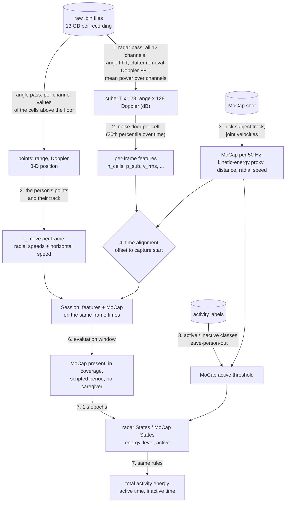
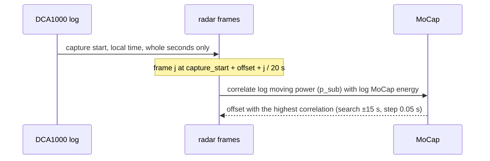
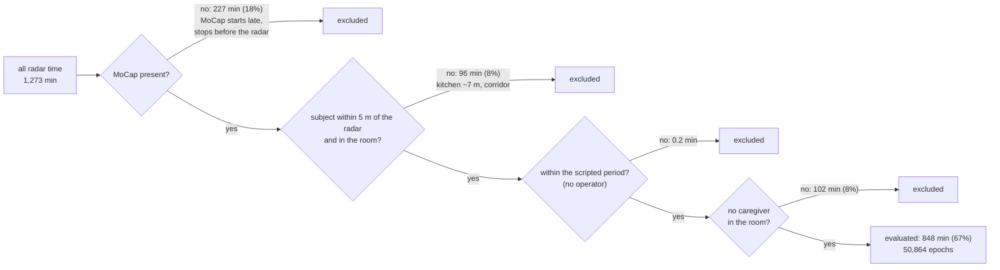
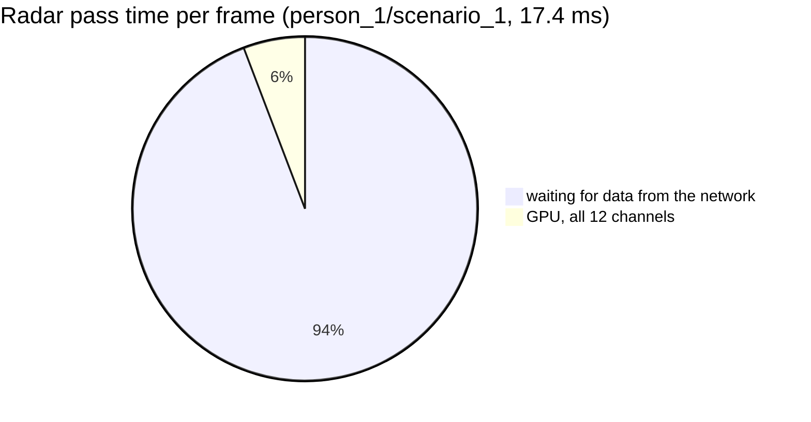

# Category 1: total movement volume

*Total activity energy, active time, inactive time*, from the ceiling FMCW radar, validated against MoCap on the full January 2026 campaign. This note covers what was done, the results, the runs that produced them, and the bottlenecks. The code is in `mobility/` (see [README](../README.md)). The numbers come from `scripts/calibrate_mocap_threshold.py` (written to `output/groundtruth/`) and `scripts/evaluate_category1.py` (written to `output/category1/`); see [Runs and outputs](#runs-and-outputs).

## Summary

- **Active and inactive time work.** On 148 recordings from 27 people, the radar's active/inactive call per 1 s epoch matches MoCap with median AUC 0.97 and F1 0.91 (10th–90th percentile over recordings: F1 0.86–0.93). No recording scores below F1 0.83. Per recording, active and inactive time are off by 0.17 min on average, out of about 5.6 evaluated minutes (6.9% of the active time). Every threshold is calibrated without the person being evaluated.
- **The detection of moving cells can run online.** The chosen design is a running 20th percentile per cell (τ = 2 min) plus a 2D SO-CFAR at 4.5 dB. It needs only past frames and matches the current whole-recording floor (AUC 0.972, F1 0.910, against 0.971 and 0.907). It is a prototype, not yet wired into the pipeline; see [Online detector](#online-detector).
- **Total activity energy works, from the point cloud.** The energy is the mean squared radial speed of the person's own points, from the angle pass, plus their horizontal speed squared. It ranks the 148 recordings like MoCap (Spearman 0.91). After one conversion factor fitted without the evaluated person, it is off by 6.8% of the MoCap energy on average. A no-radar guess (the other people's mean) is off by 16.0%. Energies from the range-Doppler map did not work (Spearman 0.16–0.60): they grow with the recording's length even when nobody moves.
- **The MoCap ground truth is calibrated, not set by hand.** "Active" means whole-body movement: the RMS joint-speed threshold is calibrated against the activity labels, leaving the evaluated person out. It comes out at 0.25 m/s, the same within ±0.003 m/s whoever is left out.
- **The biggest problem was time alignment.** The legacy code (`mobilityIndex_legacy`) placed radar frames evenly between the first and last label, which is tens of seconds wrong. Its finding that "the radar can't see walking" is most likely this bug, not physics.
- **Main bottlenecks:**
  - the energy needs the angle pass, a second 7 h read of the raw data;
  - the parts of each recording where MoCap and radar don't see the same subject alone (a third of the radar time can't be evaluated);
  - the signal level's dependence on where the person is;
  - reading the raw data, limited by the 1 Gbit/s network (7 h for the campaign).

## Data used

| | Recordings | Persons |
|---|---|---|
| January radar recordings | 156 | 30 (person_1–27, person_100–102) |
| with a cube from the full radar pass | 156 | 30 |
| with MoCap and labels | 150 | 27 |
| **evaluated** (alignment succeeded) | **148** | **27** |

Recordings left out, and why:

| Recording | Reason |
|---|---|
| person_100/scenario_100, person_101/scenario_100, person_101/scenario_101, person_102/scenario_100 | no MoCap, no labels |
| person_9/scenario_2 | no MoCap shot covers the recording (`shot_002` is missing from the person_9 folder) |
| person_24/scenario_3 | no labels, no MoCap shot |
| person_20/scenario_3, person_20/scenario_5 | alignment failed: person_20's MoCap clock is off (in scenario 3 the MoCap timestamps fall before the radar recording starts). The dataset readme flags person_20's MoCap. |

All scenarios follow the same 38-step script (enter, walk, kitchen, chair with eating and drinking, bed with lying and turning, floor, caregiver visit, leave). Only the furniture layout changes.

The method was developed on 6 recordings, one per scenario layout: person_1/scenario_1, person_5/scenario_3, person_10/scenario_2, person_12/scenario_5, person_15/scenario_4 and person_22/scenario_6. The radar position fit (§5) and the figures in [Over time](#over-time) come from them.

## Method



### 1. One radar pass

Each raw recording is read once. The range-Doppler power of all 12 virtual channels (3 TX × 4 RX) is computed on the GPU, averaged over the channels, and stored as a float16 dB cube (about 360 MB per recording).

- **DSP:** the same as in the original preprocessing code: drop ADC sample 0, Hann, range FFT, subtract the mean over the chirps per frame, Hann, Doppler FFT.
- **Bins:** 4.40 cm in range (0–5.6 m), 4.34 cm/s in Doppler (±2.78 m/s); + = away from the radar.
- **Raw data:** the format and the recordings with missing data are in [raw_data_january.md](raw_data_january.md).

Frames damaged by packets lost during the capture are set to NaN: they look like bursts of movement (see [raw_data_january.md](raw_data_january.md#lost-packets)). Everything after this step reads the cube, so new features or metrics never need the raw data again.

### 2. Per-frame features

A cell (range bin, Doppler bin) can hold a moving person when its range is ≥ 0.3 m (beyond the TX–RX leakage) and its speed is ≥ 0.1 m/s. Slower motion is residual clutter, breathing, or a person standing still; breathing shows up at ±0.04 m/s and is correctly ignored. The noise floor of each cell is its 20th percentile over the recording.

| Feature | Definition | Used for |
|---|---|---|
| `n_cells` | number of moving cells > 6 dB above their floor | **active / inactive** |
| `p_sub` | moving power above the floor, summed | alignment |
| `v_rms` | RMS radial speed of the cells above the floor | alternative activity level |
| `v_centroid` | signed mean radial velocity | direction check (Category 3) |
| `r_near` | range of the nearest clearly moving reflector | radar position fit, height (Category 3) |
| `e_move` | `e_body` + `v_horiz`²: mean squared radial speed of the person's points, plus their horizontal speed squared, from the point cloud (below) | **total activity energy** |

**Energy from the point cloud (`e_move`).** The angle pass ([angle.md](angle.md)) stores, for every cell more than 6 dB above its floor, its value on each of the 12 channels, so each cell becomes a point with a 3-D position and a radial speed. Per frame ([mobility/radar/angle.py](../mobility/radar/angle.py), `frame_features`):
1. **Clearly visible points:** more than 12 dB above the floor, within the 5 m coverage and the room, between the floor and the radar.
2. **The person's points:** within 1 m (horizontally) of the median position of those points; at least 3 of them, otherwise the person isn't seen.
3. **`e_body`:** the mean of v² over *all* of the person's points, still ones included (slow Doppler bins: breathing, small movements). It is 0 when the person isn't seen: nothing is seen moving.
4. **`v_horiz`:** the person's horizontal speed, from their position (the median of the visible points) over time. The track jumps between body parts and jitters, so it is first filtered (0.5 s running median, then 1 s running mean); the speed is the displacement over 1 s, and 0 where the person isn't seen.
5. **`e_move` = `e_body` + `v_horiz`²**, the energy.

This mirrors the MoCap energy, the mean of the squared speed over all joints, still joints included:
- **Only the person's points count,** so noise and reflections elsewhere in the room drop out.
- **Averaging over the person's own points** also cancels much of the distance effect: a distant person yields fewer points, moving and still alike.
- **The horizontal speed adds what a ceiling radar can't see.** The radar measures only speed along its line of sight, which near the axis is mostly vertical. When someone walks, every joint carries the body's horizontal speed, and the MoCap energy contains it in full. So `v_horiz`² is added with weight 1. Fitting both weights freely on the data gives the horizontal part 0.97 times the weight of `e_body`, which confirms it.

**Online detector (chosen design, prototype).** The noise floor above needs the whole recording, so it can't run live. The online replacement judges each frame only against the past, in three steps per frame:

1. **Clutter map:** a running 20th percentile of each cell's power in dB. When the cell is above the map, the map moves up by a small step; otherwise it moves down by four times that step. A person who occupies a cell less than 80% of the time therefore doesn't raise it. The map starts as the 20th percentile of the first 2 s.
2. **Subtraction:** the current map minus the clutter map, in dB (a ratio in linear power), so that noise is about the same in every cell.
3. **2D SO-CFAR:** around each cell, four training strips (before and after it in range, before and after it in Doppler), outside a guard window. The cell's background is the *smallest* of the four strip means. The cell is detected when it exceeds k × background.

Each frame is tested against the map from the previous frame, and the map is updated afterwards. `n_det`, the number of detected moving cells (range ≥ 0.3 m, speed ≥ 0.1 m/s), replaces `n_cells`. Its active threshold is calibrated leaving the person out, exactly as for `n_cells`.

| Parameter | Value |
|---|---|
| clutter-map percentile | 20th |
| time constant τ | 2 min: a reflector that stays 10 dB above the map is absorbed after τ (up 0.004 dB per frame, down 0.017 dB per frame) |
| start | 20th percentile of the first 2 s |
| guard, each side | 4 range bins (18 cm), 3 Doppler bins (13 cm/s) |
| training strips | 8 cells long (35 cm in range, 35 cm/s in Doppler), 3 cells wide; Doppler wraps around, range is mirrored at its ends |
| CFAR factor k | 4.5 dB (× 2.8) |

Why these choices:
- **A running percentile, not a running mean.** A running mean takes in the person's own echoes where they move, so the current power there is only 0.3–0.5 of the map. SO-CFAR then takes those strips as the background, and about 200 cells fire in quiet frames.
- **SO-CFAR (smallest of):** a person covers tens of range bins and many Doppler bins. Taking the smallest strip keeps the noise estimate from the side the person doesn't fill.
- **The subtraction keeps a noise scale:** CFAR runs on the ratio to the clutter map, not on the linear difference. In a difference, noise-only cells average zero, and the CFAR background would collapse with them.

### 3. MoCap ground truth

**Subject track and signals.**
- **Pairing:** shots are paired with radar recordings by time overlap, not by number.
- **Subject track:** the track with the longest centre-of-gravity path inside the room. The largest file is wrong in 3 of 152 shots (person_4/shot_006, person_5/shot_005 and shot_006), where a static ghost track spans the whole shot.
- **Per sample:** joint velocities with a Savitzky–Golay filter (0.26 s), over 16 joints. From them:
  - the **energy reference**, `ke` = mean squared joint speed over all joints and all three directions (whole body);
  - the same along the line to the radar (`vr2`, what the radar can see; a diagnostic, not used by the metrics);
  - the distance from the radar to the CoG.

**Active threshold, calibrated against the activity labels.** Per 1 s epoch, MoCap is active when the RMS joint speed exceeds a threshold. The threshold is calibrated against the scripted activities, not set by hand ([mobility/labels.py](../mobility/labels.py)):

| Class | Labels |
|---|---|
| active (whole-body movement) | walking, wandering, going to the bed, kitchen or outside; sitting down, standing up, lying down, getting up, sitting upright, picking up a coin; anxious movement in bed |
| inactive | arm-only tasks while seated or lying (eating, drinking, putting down the plate or glass, pressing the wearable button); waiting between instructions, at least 2 s away from any label |
| not used | labels that mix both (e.g. "turn on your left side and lie still"), entering the room, the caregiver visit |

The threshold maximises balanced accuracy between the two classes. For each person, it is calibrated on the **other 26 people** (MoCap and labels of all their recordings, no radar needed). That person's scores, and the radar threshold used for them, are then judged with this threshold.

| | Value |
|---|---|
| Data | 150 recordings, 27 people; 23,473 active and 11,381 inactive labelled epochs |
| Threshold, leaving each person out | 0.249–0.254 m/s (all people: 0.253 m/s) |
| Held-out person vs labels | AUC median 0.92 (0.84–0.96), F1 median 0.88 (0.78–0.93) |

**Tracking jumps.** An epoch whose RMS joint speed exceeds 3 m/s is a MoCap tracking jump, not movement, and is not valid (10 epochs in 7 recordings). The squared speed has no upper bound, so a single jump can dominate an energy total: in person_22/scenario_5, one such epoch held 91% of the recording's MoCap energy. The 3 m/s cut is set by hand: well above any whole-body movement in the script (99th percentile per person: 0.8–2.0 m/s).

The threshold barely moves when a person is left out, so it should generalise to new people. Labelled segments are not uniformly active: a "sit down" label also holds a moment of standing still before and after. As a result, only 45–83% of the epochs in transition labels are above the threshold, and the held-out F1 against the labels stays below 1.

### 4. Time alignment



On the 150 recordings with MoCap (median, 10th–90th percentile):

| | Value |
|---|---|
| offset of radar frame 0 after the logged capture start | 0.50 s (0.20–0.90) |
| peak correlation | 0.52 (0.46–0.57) |
| margin: peak minus the best correlation more than 2 s away | 0.34 (0.26–0.40) |

- **Offset:** consistent with the capture start being logged to the whole second only.
- **Sharp peak:** 1 s of error destroys the agreement.
- **Quality check:** a recording whose margin is below 0.1 is left out of the evaluation. Its alignment is unreliable, and a misaligned recording would compare unrelated seconds. Two recordings fail it, both person_20 (scenario_3: no overlap within ±15 s; scenario_5: margin 0.01).

On person_1/scenario_1, the legacy mapping (frames spread between the first and last label) gives a correlation of 0.05, against 0.35 aligned. The dataset's `Doppler/time_doppler_max.npy` also has fewer rows than frames on disk (11,085 vs 11,106), so it can't be aligned by frame index.

### 5. Radar position

The position is fitted by grid search on the 6 development recordings: `r_near` against the MoCap distance from the radar to the nearest of head, shoulders, wrists and knees, over frames with clear movement (19,793 frames).

- **Result:** x = −3.25 m, height 2.45 m, z = 0.40 m (MoCap frame, Y up). Median range error 5.8 cm (1.3 range bins).
- **Floor plan:** it gives about x −3.25, z 0.47 m. The height was not known; 2.7 m gave a 15 cm error.
- **Doppler sign:** checked: the signed Doppler centroid follows the MoCap CoG radial speed (r = 0.83; + = away).

### 6. Evaluation window

A 1 s epoch is evaluated only where MoCap and radar see the same subject, alone. Caregiver and operator periods are excluded, because the radar counts everyone who moves. Over the 148 evaluated recordings:



The **scripted period** runs from the first label start to the last label end. Before and after it, the operator sets up or clears the room. The **caregiver visit** runs from the first to the last caregiver label. Nearly all out-of-script time with MoCap is already excluded by coverage (subject in the corridor). The check makes the operator exclusion explicit. The 10 epochs with a MoCap tracking jump (§3) are left out as well.

### 7. States and metrics

Per epoch, the radar and MoCap are turned into the same `States`: energy, activity level, active/inactive, and valid. The three metrics are one rule each, applied to both (`mobility/metrics/category1.py`):

| Metric | Rule | Radar | MoCap |
|---|---|---|---|
| total activity energy | Σ energy over valid epochs × epoch length | `e_move` (point cloud) | mean squared joint speed (whole body) |
| active time | active valid epochs × 1 s | `n_cells` level > radar threshold | RMS joint speed > MoCap threshold (§3) |
| inactive time | inactive valid epochs × 1 s | | |

**Thresholds, leave-one-subject-out.** For each evaluated person:
- the radar threshold is calibrated against MoCap (maximising balanced accuracy) on the recordings of the **other 26 persons**;
- MoCap active is defined by that person's MoCap threshold, also calibrated without them.

So nothing calibrated on the evaluated person is used, also when a person has several recordings.

**Scores.** MoCap active is the positive class.

- **Per epoch:**
  - **AUC** of the radar activity level: how well active and inactive epochs can be separated by any threshold. It judges the feature.
  - **F1** of the radar active/inactive calls, with the calibrated threshold. It judges the feature plus its threshold.

  The same AUC with a lower F1 means the threshold doesn't transfer well between persons. F1 counts only the active class; about 40% of the epochs are active, so calling everything active would still give F1 ≈ 0.6.
- **Per recording**, on the metrics themselves:
  - active and inactive time: mean absolute error and bias (radar − MoCap), in minutes;
  - total activity energy: the radar sees only the radial speed of reflecting points, MoCap the full speed of 16 joints, so the two scales differ. Two checks:
    - Spearman across recordings;
    - the error after converting the radar energy to MoCap units with one factor (total MoCap ÷ total radar energy) fitted on the other 26 persons: mean absolute error and bias, in % of the mean MoCap energy. It is compared with a no-radar baseline that predicts every recording as the other persons' mean MoCap energy.

## Results

All results are on the 148 evaluated recordings (27 persons, 50,864 epochs). "Median (10th–90th)" is over recordings.

### The three metrics

**Active time**

| | Value |
|---|---|
| MoCap, per recording | 2.39 min (2.03–2.95) |
| radar, per recording | 2.45 min (2.00–3.19) |
| mean absolute error | **0.17 min** (6.9% of the MoCap active time) |
| bias (radar − MoCap) | +0.09 min |
| absolute error: median, 90th percentile, max | 0.12, 0.33, 0.88 min (max: person_26/scenario_6) |
| recordings within ±0.25 min / ±0.5 min | 77% / 95% |
| mean error per person | −0.39 (person_26) to +0.38 min (person_6) |

**Inactive time**

| | Value |
|---|---|
| MoCap, per recording | 3.14 min (2.48–4.08) |
| radar, per recording | 3.15 min (2.46–3.92) |
| mean absolute error | **0.17 min** (5.2% of the MoCap inactive time) |
| bias (radar − MoCap) | −0.09 min |

Active and inactive time are complementary: both sides use the same valid epochs, so an error in one is the opposite error in the other.

**Total activity energy**

| | Value |
|---|---|
| radar (`e_move`, m²/s² × s), per recording | 58.3 (47.7–70.3) |
| MoCap (m²/s² × s), per recording | 65.2 (51.5–83.0) |
| Spearman across recordings | **0.91** |
| error after the conversion to MoCap units | **6.8%** of the MoCap energy (bias −0.0%) |
| no-radar baseline | 16.0% |
| error per person | median 5.5%; all below the baseline except person_26 (19.0%) |

- **The energy doesn't grow with recording length.** Across recordings, its Spearman with the evaluated minutes is 0.01, like MoCap's (−0.02): when nobody moves, there are no moving points, and extra still time adds nothing. While the person is still, `v_horiz` is about 0.05 m/s (track jitter), against 0.27 m/s while active.
- **The horizontal speed fixed the fast walkers.** With the radial part `e_body` alone, Spearman was 0.80 and the error 9.4% (person_8 21%, person_26 30%). The error drifted with the recording day, from +9.4% (median) on the first day to −1.2% on the last.
  - **Cause:** later participants walked faster, +7% to +24% over the first day. MoCap and the radar's own person track agree on that.
  - **MoCap was ruled out:** its frame timing, its distance scale (against the radar's measured range: stable within 1 cm), its skeleton sizes and its jitter don't shift between days.
  - **The radial part was steady:** the radar tracked MoCap's *radial* energy within about 3% over the week, while the radial share of the motion fell by about 10% after day 1.
  - **What remains:** `v_horiz`² narrows the drift to +4.2% … −4.0%.
- **Person_26 is still underestimated,** in every recording (bias −19%). They are a fast walker, but they also fall short of MoCap's radial energy, so the horizontal speed explains only part of it.

**From the range-Doppler map it didn't work.** Distance-corrected moving power (r⁴-weighted, `p_r4`) ranked the recordings at Spearman 0.16, with an error of 18.7%, worse than the no-radar baseline. The power-weighted squared Doppler speed (`v_rms`²) reached 0.60 and 12.1%. Both grow with the recording's length (Spearman 0.70 and 0.52 with the evaluated minutes): noise and reflections above the floor add energy even when nobody moves. People with long, mostly still recordings (person_6, person_24) came out 80–85% too high. The point cloud removes both, by keeping only the person's points. `p_r4` has been removed from the code.


In the signed plot, the bars show each person's mean error (red: radar too high, blue: too low), and the dots show their single recordings. The mean over all recordings is close to 0 (bias −0.0%), but not by construction: each person's conversion factor is fitted on the *other* persons' totals, so it doesn't match the totals of all recordings exactly.

Active and inactive time vary between persons in a way that is partly systematic. The mean active-time error per person ranges from −0.39 to +0.38 min, so some people come out consistently too active (person_6, person_15, person_24) or too inactive (person_26).

### Per epoch

| Feature | AUC | F1 | lowest F1 |
|---|---|---|---|
| **`n_cells`** | **0.971 (0.949–0.986)** | **0.907 (0.862–0.931)** | 0.83 |
| `v_rms` | 0.961 (0.931–0.975) | 0.880 (0.837–0.912) | 0.76 |
| `p_sub` | 0.931 (0.891–0.958) | 0.847 (0.794–0.878) | 0.74 |

- **`n_cells` is the best feature,** also in the worst recordings, so it is the active/inactive feature.
- **Moving power (`p_sub`) is clearly worse,** because of its distance dependence (below).
- **The lowest F1 (`n_cells`)** is 0.83–0.84, in person_15/scenario_5, person_6 (scenarios 1, 2 and 3), person_25/scenario_1, person_12/scenario_5, person_26/scenario_6 and person_15/scenario_4.
- **Per person** (each person's epochs pooled): AUC 0.94–0.98, F1 0.84–0.93 for the active calls and 0.89–0.95 for the inactive ones. F1 is higher for the inactive class because inactive epochs are the majority (about 60%).


The development subset gave the same picture (AUC 0.96, F1 0.88–0.89 on 6 recordings), so the method generalises to the full campaign.

### Online detector

The online detector (§2) was scored like `n_cells`: leave-person-out radar threshold, AUC and F1 per recording against MoCap active, on the 148 recordings. Two subsets test its specific risks, with F1 pooled over the epochs in the evaluation window:
- **In bed:** a person staying in the same cells could be taken into the clutter map. The subset is the lying period, from "Lay down on the bed" to "Get up and sit on the edge of the bed", with the turns, lying still and the wearable button included (14,546 epochs).
- **Cold start:** the clutter map needs time to converge. Every variant is run a second time, started cold at "Walk towards the chair", so the arm tasks at the chair follow. Both runs are then scored on the same 2 min after that restart, with the same thresholds (17,067 epochs). The table gives F1 converged → cold.

| Detector | AUC | F1 | F1, 10th percentile | F1 in bed | F1 after a cold start |
|---|---|---|---|---|---|
| global 20th percentile + 6 dB (`n_cells`, current) | 0.971 | 0.907 | 0.862 | 0.863 | (not online) |
| **running 20th percentile (τ 2 min) + SO-CFAR 4.5 dB (chosen)** | **0.972** | **0.910** | **0.861** | **0.865** | **0.846 → 0.835** |
| running 20th percentile (τ 30 s) + fixed 6 dB, no CFAR | 0.972 | 0.909 | 0.861 | 0.865 | 0.846 → 0.847 |
| running 20th percentile (τ 10 min) + SO-CFAR 4.5 dB | 0.971 | 0.908 | 0.869 | 0.865 | 0.846 → 0.765 |
| SO-CFAR 4.5 dB alone, no clutter map | 0.972 | 0.908 | 0.866 | 0.864 | 0.849 → 0.847 |
| running mean (τ 2 min) + SO-CFAR 6 dB | 0.794 | 0.617 | 0.488 | 0.604 | 0.625 → 0.600 |

- **Online costs nothing once converged:** every running-percentile and SO-CFAR-only variant scores AUC 0.969–0.973 and F1 0.899–0.910. That holds for every time constant (30 s, 2 min, 10 min) and every CFAR factor (3, 4.5, 6 dB).
- **No absorption in bed:** over the lying period, every running-percentile and SO-CFAR-only variant scores F1 0.845–0.868, against 0.863 for the global floor (0.865 for the chosen design).
- **A cold start costs little with τ = 2 min, but a lot with a slower map.** In the 2 min after a cold start:
  - the chosen design drops by 0.011 in F1 (0.846 → 0.835);
  - with τ = 30 s, the drop is at most 0.012 (k = 3 dB), and 0.003 at k = 4.5 dB;
  - with τ = 10 min, F1 drops to 0.765, and to 0.626 with k = 3 dB. A map started from only 2 s of data is noisy, and a slow map keeps that noise for minutes.

  The variants with a fixed 6 dB margin barely change (0.843–0.847), and SO-CFAR alone keeps no state at all. A cold start happens once per deployment, so with τ = 2 min this is a short, small cost.
- **The running mean fails** for the reason in §2: the person's echoes raise it.
- **On these recordings, the clutter map adds nothing measurable:** SO-CFAR on the range-Doppler map alone scores the same. The per-frame chirp-mean subtraction already removes static reflections, and the lab has no persistent moving clutter (fans, curtains) for the map to learn. The clutter map is kept for deployment, where such clutter is expected.
- **The design is chosen on its properties, not on these scores.** The variants differ by at most 0.004, and that difference was measured on the same data a choice would be judged on.

The global floor itself is just as insensitive. Over percentiles 5–50 and margins 3–12 dB, median AUC stays within 0.961–0.975 and F1 within 0.889–0.911 (`output/plots/sensitivity/floor_sensitivity.png`). Most of the change is taken up by the recalibrated radar threshold.

Not done yet: choosing the point cloud's cells (for the energy) with the online detector instead of the global floor.

### Over time

`scripts/plot_agreement.py` draws two figures per recording, from the same per-epoch states the metrics use, in `output/plots/agreement/`. They exist for the 6 development recordings; the script draws any recording.

- **`<person>_<scenario>_recording.png`:** the whole recording, top to bottom:
  - the activity labels, by class;
  - the movement measured by MoCap and by the radar;
  - the "active?" row: both active, both inactive, only MoCap active (radar missed), only radar active;
  - the subject's distance to the radar.

  Hatched time is not evaluated.
- **`<person>_<scenario>_episodes.png`:** close-ups at 20 Hz of three typical episodes (at the chair, in bed, on the floor and walking), with the label names.

Movement is the z-score of log energy, each sensor standardised over its evaluated epochs, so the two share one axis without a second scale.


What the figures show:
- **Onsets and offsets line up within about a second.** Walking, sitting down, standing up, lying down, getting up and restless movement in bed rise and fall together in both sensors. Most disagreements are one or two epochs at the edges of a movement: the thin blue and orange slivers.
- **The radar's movement also follows small movements.** At the far chair (3.2 m, person_10), eating and drinking show in both sensors, because the point cloud keeps the slow points of the person. When the person isn't seen at all, the radar drops to its floor. While the person keeps still, it sits a little above MoCap, because of the jitter of the person's track in `v_horiz`.
- **Arm-only tasks near the radar.** In scenario 5 (person_12) the chair stands close to the radar (median distance 2.0 m). There the radar sees the eating and drinking movements and calls some of them active, while the label definition counts arm-only tasks as inactive. So whether arm-only tasks come out inactive depends partly on the distance to the radar.
- **Person_15: disagreements cluster in bed** (minutes 3.5–4.6). The radar calls movement where MoCap stays below its threshold. SCOPE.md notes that MoCap is unreliable under a blanket; whether that is the cause has not been checked.
- **Outside the window, the radar sees others.** Before MoCap starts and after the subject leaves, the radar keeps seeing movement (operator, caregiver). This is why those periods are excluded.

### Per scripted activity (pooled threshold)

The table shows the share of epochs active by MoCap → by radar, where the two differ by 0.1 or more, over all epochs with MoCap (inside and outside the evaluation window).

| Activity | MoCap → radar | Distance | Why |
|---|---|---|---|
| Stop anxious movement and lie on your back | 0.36 → 0.58 | 1.9 m | in bed close to the radar, the radar calls more movement |
| Lie on your back again and lie still | 0.64 → 0.76 | 1.9 m | same |
| Anxious movement in bed | 0.82 → 0.94 | 1.9 m | same |
| Lay down on the bed; go from upright to lying | 0.72 → 0.81; 0.45 → 0.55 | 1.9 m | same |
| Enter the room and stand on the cross | 0.28 → 0.12 | 3.9 m | far, at the entrance (only 32 epochs) |
| Caregiver enters / leaves (outside the window) | 0.07 → 0.39; 0.08 → 0.42 | | the radar sees the caregiver |
| Walk to / back from the kitchen | 0.94 → 0.51; 0.93 → 0.52 | 4.2–4.3 m | partly out of range |
| Person goes outside; wander in the corridor | 0.93 → 0.40; 0.91 → 0.01 | 4.5–6.5 m | out of range |

- **Arm-only tasks agree:** eating 0.09 vs 0.10, drinking 0.05 vs 0.04, wearable button 0.12 vs 0.17.
- **Putting down the plate or glass:** 0.29 vs 0.19 and 0.14 vs 0.08.
- **Walking and wandering in the room** (0.97 vs 0.97), standing up, sitting down, getting up, picking up a coin and lying down on the floor (0.51 vs 0.52) all agree within ±0.1.
- **In bed the radar errs on the side of "active"** by 0.1–0.2 across the lying and turning labels.

### Distance dependence

These are residuals of each feature after a fit on log MoCap energy, for active epochs at increasing distance from the radar to the CoG (log10 units; × 10 = dB for power):

| Distance | `p_sub` | `n_cells` |
|---|---|---|
| < 2 m | +0.32 | +0.27 |
| 2–2.5 m | −0.14 | +0.06 |
| 2.5–3 m | −0.33 | −0.12 |
| 3–3.5 m | −0.44 | −0.26 |
| 3.5–4 m | −0.43 | −0.39 |
| 4–5 m | −0.49 | −0.74 |

- **Moving power:** falls about 8 dB from under 2 m to 4–5 m.
- **`n_cells`:** 10 times fewer cells at 4–5 m. Good for detecting activity, but not usable as an energy measure. The energy (`e_move`) averages over the person's own points instead, so it doesn't count cells.

## Runs and outputs

The full-campaign results above come from these runs, on the machine `barabas` (1 Gbit/s link to the storage, GPU 0: NVIDIA RTX 3080 Ti), in the `distrimuse` conda env.

| Run | When | Command | Output |
|---|---|---|---|
| radar pass, all January recordings | 2026-10-22, 15:32–22:37 | `CUDA_VISIBLE_DEVICES=0 python scripts/radar_pass.py` | `output/<person>/<scenario>/rd12_db.npy`, `pass_info.json`; log `output/radar_pass_january.log` |
| MoCap active threshold | 2026-10-22 | `python scripts/calibrate_mocap_threshold.py` | `output/groundtruth/` |
| angle pass (points, for the energy) | 2026-10-25 18:31 – 2026-10-26 01:28 | `python scripts/angle_pass.py --device cpu --threads 8` | `output/<person>/<scenario>/points.npz`; see [angle.md](angle.md) |
| Category 1 evaluation | 2026-11-02, after adding the horizontal speed to the point-cloud energy (point-cloud energy and MoCap tracking-jump filter: 2026-10-29); re-run 2026-11-18 on commit `f78b16c`, all tables identical | `python scripts/evaluate_category1.py --workers 16` | `output/category1/`; log `output/category1_full.log` |
| per-person plots | 2026-11-02 | `python scripts/plot_per_person.py` | `output/plots/per_person/`: scores, energy error, signed energy error |
| global-floor sensitivity | 2026-10-27 | `python scripts/sensitivity_floor.py --workers 16` | `output/category1/floor_sensitivity.csv`, `output/plots/sensitivity/floor_sensitivity.png` |
| online detector (prototype) | 2026-10-27; re-run 2026-11-18 with the in-bed and cold-start subsets redefined (and the MoCap tracking-jump filter, which the first run predates) | `python scripts/prototype_so_cfar.py --workers 16` | `output/category1/so_cfar_prototype.csv`; log `output/category1/so_cfar_prototype.log` |

**Where the radar pass is written.** `output/` is `/cw/dtaiexp/2026-XuanFeng/mobilityIndex/output/` (git-ignored; `MOBILITY_OUTPUT` overrides it). Each recording has its own folder:

```
/cw/dtaiexp/2026-XuanFeng/mobilityIndex/output/<person>/<scenario>/
    rd12_db.npy        cube: (T, 128 range, 128 Doppler) float16 dB, 12-channel mean; NaN rows = no data
    pass_info.json     missing, all-zero and damaged frames; lost packets from the capture log; timing
    features.npz       per-frame radar features (session cache)
    subject.json       MoCap shot and subject track
    mocap_50hz.npz     MoCap signals of the subject
    alignment.json     time offset of radar frame 0
    points.npz         the angle pass: per-channel values of the cells above the floor (docs/angle.md)
    angle_features.npz per-frame features of the person from the points, including e_move (session cache)
```

| Radar pass | Value |
|---|---|
| recordings | 156 of 156, no failures |
| frames | 1,627,513 (22.6 h of radar data) |
| missing frames (files absent or truncated) | 26,231: person_101/scenario_100 (frames 0–26,214) and person_23/scenario_5 (frames 858–873) |
| all-zero frames | 0 |
| frames damaged by lost packets (set to NaN) | 120 (0.007%), only in recordings whose log reports lost packets; at most 10 per recording (person_10/scenario_2) |
| time | 7.0 h in total, median 2.6 min per recording, about 95% of it waiting for data |
| size | 51 GB |

**Code version.** The results come from commit `f78b16c` (2026-11-17, on `origin/master`). The Category 1 evaluation was re-run on it on 2026-11-18 and reproduced every table of the 2026-11-02 run exactly.

How the Category 1 code got there:

| Commit | Date | Category 1 changes |
|---|---|---|
| `ac098d0` | 2026-10-23 | damaged-frame masking and `pass_info.json`; label-calibrated MoCap threshold; leave-one-subject-out radar thresholds; alignment quality check |
| `249d60c` | 2026-10-26 | the angle pass |
| `ae6077f` | 2026-11-02 | point-cloud energy (`e_body`); MoCap tracking-jump filter; energy error after conversion and per-person table; `p_r4` removed |
| `21f49c4` | 2026-11-04 | horizontal speed (`v_horiz`, `e_move`). The 2026-11-02 evaluation ran on this code before it was committed. |
| `6ea79f9`, `f78b16c` | 2026-11-17 | refactor (evaluation package, script helpers, shared plot modules); results unchanged |

The online-detector subsets were redefined after `f78b16c`, in `scripts/prototype_so_cfar.py`, and its results re-run on 2026-11-18 (see [Online detector](#online-detector)). Earlier, "in bed" was any label containing "bed": it included walking to the bed and left out lying still. The warm-up subset was the first 2 min of the recording, mostly before MoCap starts and then walking in, so it didn't test convergence.

**Tables in `output/category1/`:**

| File | Content |
|---|---|
| `alignment.csv` | per recording: MoCap shot and track, time offset, peak correlation, margin |
| `thresholds.csv` | per recording: radar and MoCap active thresholds used for it |
| `epoch_scores.csv` | per feature and recording: AUC, F1 |
| `metrics.csv` | per recording: the three metrics, radar and MoCap |
| `agreement.csv` | per metric: mean absolute error and bias (times); Spearman, error and bias after the conversion to MoCap units, and the no-radar baseline (energy) |
| `per_person.csv` | per person: AUC, F1 active, F1 inactive, energy error and bias |
| `per_label.csv` | per scripted activity: MoCap and radar active share, coverage, distance |
| `distance.csv` | distance dependence of each feature |
| `floor_sensitivity.csv` | per floor percentile and margin: AUC and F1 of `n_cells` |
| `so_cfar_prototype.csv` | per online-detector variant: AUC, F1, F1 in bed, F1 converged and after a cold start |

## Bottlenecks



1. **Total activity energy depends on the angle pass.**
   - The points come from a second read of the raw data (6.9 h, 25 GB).
   - They are chosen with the global noise floor, so the energy is not online yet.
   - The person is found as the points within 1 m of the frame's median position, and their track from that position. Both assume one person in the room: the caregiver visit stays excluded.
   - Some error remains: person_26 −19%, and a day-to-day drift of about ±4%.

2. **Time alignment depends on MoCap.** The radar log has the start only to the second, and a 1 s error ruins the comparison, so every recording needs its own fitted offset. That needs MoCap motion in the recording. A recording without usable MoCap would have to use the typical offset (0.5 s, 10th–90th percentile 0.2–0.9 s). Any earlier result built on the legacy timing should be redone.

3. **MoCap and radar don't cover the same thing: a third of the radar time can't be evaluated.**
   - MoCap starts late and stops before the radar (18% of the radar time).
   - The kitchen (about 7 m away) and the corridor are beyond the radar's range (8%).
   - A caregiver is in the room during the caregiver labels (8%), and the operator moves outside the scripted period. The radar counts everyone: during the caregiver's entrance and exit, when the subject is mostly still, it reports "active" for about 40% of the epochs.

   These periods are excluded from the evaluation. A deployed system would face the same problem: separating people needs the angle information (product 3 in SCOPE.md).

4. **Signal level depends on position, not only on movement.** Moving power falls about 8 dB from under 2 m to 4–5 m, and `n_cells` 10 times. The active/inactive call copes with it, because its threshold sits low. The energy avoids it by averaging over the person's own points instead of summing power or counting cells.

5. **The radar errs towards "active" in bed and is person-dependent.**
   - In bed, close to the radar, it calls 0.1–0.2 more epochs active than MoCap across the lying and turning labels. MoCap under a blanket may also be the cause (not checked).
   - The mean active-time error per person ranges from −0.39 to +0.38 min.

6. **Reading the raw data.** One January pass reads about 2 TB and took 7.0 h.
   - The link of this machine is 1 Gbit/s (about 110 MB/s). Eight parallel reads together reach 116 MB/s, so parallelism doesn't help.
   - Per frame, about 95% of the time is waiting for data. The GPU work for 12 channels is 1 ms, so the extra channels are free. The "184 ms/frame to read" in SCOPE.md is not right.
   - Mitigation: read each recording once (done), keep every product in the cube, and if possible run the pass on a machine with a faster link to the storage.

7. **Imprecise labels limit the ground-truth calibration.** The labels were set by hand by the operator, and a transition label also covers standing still before and after. So even MoCap matches the labels only to AUC 0.92 and F1 0.88 on held-out people. The threshold is stable (0.249–0.254 m/s), so this mostly adds noise rather than bias. The corrected timestamps (`timestamps_corrected/`, from the IMU) are not used, per SCOPE.md.

8. **Storage and re-reading.** The cubes take 51 GB for the campaign. Computing the features of all recordings took about 8 min with 16 parallel workers, mostly reading the cubes back over NFS. A campaign-wide noise floor would allow writing compact products directly in the pass instead.

## Decisions

| Question | Decision |
|---|---|
| MoCap active threshold | calibrated against the activity labels, leaving the evaluated person out; never set by hand |
| Radar active threshold | calibrated against MoCap, leaving the evaluated person out |
| Arm-only tasks (eating, drinking, wearable button) | inactive: active means whole-body movement |
| Evaluation window | exclude caregiver and operator periods, and times outside radar coverage |
| Recordings whose alignment fails (margin < 0.1) | left out of the evaluation |
| Channels | always all 12 |
| Total activity energy | from the point cloud: mean squared radial speed of the person's points plus their horizontal speed squared (`e_move`). Range-Doppler energies (r⁴-corrected power, `v_rms`²) rejected |
| MoCap tracking jumps | epochs with an RMS joint speed above 3 m/s are not valid |
| Detection of moving cells | online: running 20th percentile per cell (τ = 2 min) + 2D SO-CFAR, k = 4.5 dB (§2). Until it is in the pipeline, the results use the global 20th percentile + 6 dB |
| Scores | AUC and F1 per epoch; error in minutes per recording; for energy, Spearman and the error after a conversion to MoCap units fitted leaving the person out |

Still open:
- **Energy online:** choose the point cloud's cells with the online detector, not the global floor (Bottleneck 1).
- **Online detector in the pipeline:** it keeps state from frame to frame, so it has to run as a streaming feature (`n_det`) rather than in the whole-recording feature code. The benefit of the clutter map against persistent moving clutter is still to be shown.
- **Energy reference:** the MoCap energy is currently whole-body (mean squared joint speed over all joints and all three directions). The radial part (`vr2`, motion along the line to the radar) is computed as a diagnostic, not used.

## Reproducing

```bash
PY=/cw/dtaiexp/NoCsBack/2026-Xuan/miniforge3/envs/distrimuse/bin/python3
CUDA_VISIBLE_DEVICES=0 $PY scripts/radar_pass.py                 # all January recordings, ~7 h
$PY scripts/angle_pass.py --device cpu --threads 8              # points for the energy, ~7 h (docs/angle.md)
$PY scripts/calibrate_mocap_threshold.py                         # MoCap + labels of all recordings, ~15 min
$PY scripts/evaluate_category1.py --workers 16                   # ~15 min the first time
$PY scripts/plot_per_person.py                                   # AUC, F1 and energy error per person
$PY scripts/sensitivity_floor.py --workers 16                    # global floor: percentile x margin, ~10 min
$PY scripts/prototype_so_cfar.py --workers 16                    # online detector variants, ~10 min
$PY scripts/plot_agreement.py --only person_10/scenario_2        # radar vs MoCap over time, any recording
$PY scripts/fit_radar_position.py --only person_1/scenario_1 person_5/scenario_3 person_10/scenario_2
$PY scripts/plot_timeline.py person_1/scenario_1                 # diagnostic
```
