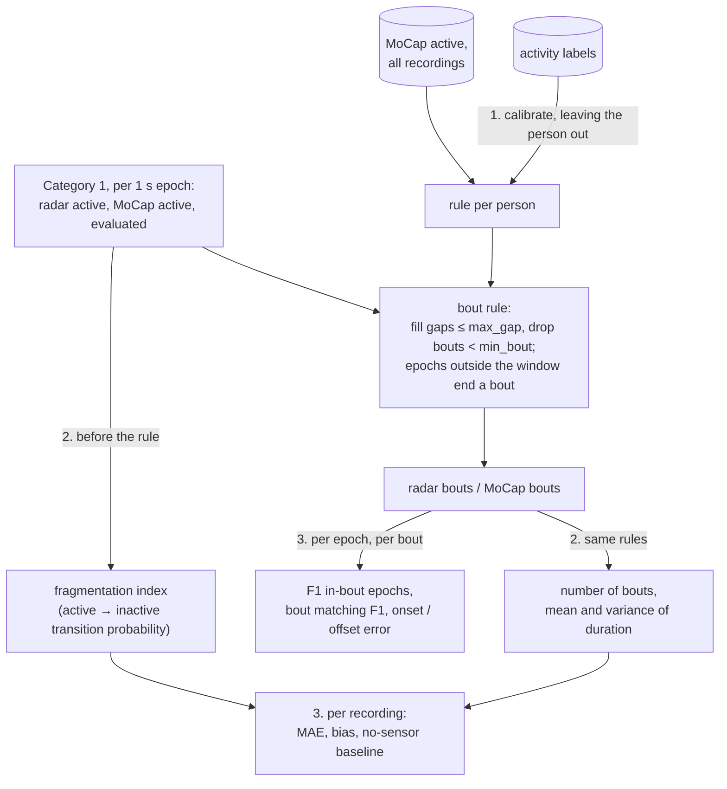

# Category 2: activity bout structure

*Number of bouts, mean and variance of bout duration, fragmentation index*, from the ceiling FMCW radar, validated against MoCap on the full January 2026 campaign. Category 2 is built on the per-epoch active/inactive calls of [Category 1](category1.md): same recordings, same alignment, same evaluation window, same leave-one-subject-out thresholds. This note covers only what Category 2 adds. The code is in `mobility/bouts.py` and `mobility/metrics/category2.py`. The numbers come from `scripts/calibrate_bout_rule.py` (written to `output/groundtruth/`) and `scripts/evaluate_category2.py` (written to `output/category2/`); see [Runs and outputs](#runs-and-outputs).

## Summary

- **Radar and MoCap bouts match well, one by one.** On 148 recordings from 27 people, 86% of the MoCap bouts and 88% of the radar bouts are matched one to one (median bout F1 0.88 per recording, 10th–90th percentile 0.77–0.96). For 90% of the matched bouts, both onset and offset agree within 1 s.
- **The four metrics agree within 8–24%:**
  - number of bouts: 1.9 bouts off on about 26 per recording (7.5%);
  - mean bout duration: 0.57 s off on 5.4 s (10%);
  - fragmentation index: 0.024 off on 0.21 (11%);
  - variance of bout duration: 24% off.

  The radar's bouts are slightly fewer and longer (bias −0.6 bouts and +0.4 s), mostly because it merges restless movement in bed into fewer bouts.
- **But the script, not the person, sets most of the bout structure, as SCOPE.md warned.** A guess with no sensor at all (the median MoCap value of the other people) comes almost as close as the radar for bout count (error 2.2 vs 1.9), mean duration (0.67 vs 0.57 s) and fragmentation (0.025 vs 0.024). Only the variance of bout duration is clearly better with the radar (12.4 vs 7.1 s²). This campaign can confirm that the radar sees the same bouts as MoCap. It can't show that the radar tells people apart on bout structure.
- **The bout rule is calibrated, not set by hand.** Like the MoCap active threshold, it is calibrated against the activity labels, leaving the evaluated person out. Every fold chooses the same rule: no gap filling and a minimum bout of 2 s. In practice this only drops isolated 1 s blips.
- **Main bottlenecks:**
  - the scripted protocol (above);
  - restless movement in bed, where the two sensors split movement into bouts differently and MoCap under the blanket may be unreliable;
  - everything Category 1 inherits: a third of the radar time can't be evaluated, and the signal level depends on position.

## Data used

The 148 recordings (27 people) evaluated in Category 1. Its [Data used](category1.md#data-used) section lists the recordings left out and why. The bout rule is calibrated on the MoCap and labels of all 150 recordings that have them (no radar needed), like the MoCap active threshold.

## Method



### 1. Bout rule

A bout is a run of active epochs after two rules ([mobility/bouts.py](../mobility/bouts.py)):

1. **Gaps:** inactive runs of at most `max_gap` epochs between two active runs are filled.
2. **Minimum bout:** active runs shorter than `min_bout` epochs (after step 1) are dropped.

Together they act as a temporal hysteresis: a change of state has to last before it counts. SCOPE.md also mentions hysteresis on the signal level (a higher threshold to enter than to leave). That would need a second threshold, calibrated separately for each sensor, so the hysteresis is applied in time instead.

**Evaluation window.** Epochs outside it (no MoCap, out of coverage, operator or caregiver; see [Category 1 §6](category1.md#6-evaluation-window)) end a bout. A bout never spans them, and no gap is filled across them. A bout cut by the window edge counts with its part inside the window. The radar and MoCap use the same valid epochs, so both are cut in the same places.

**Calibration against the labels.** Per left-out person, the rule is the one that best separates active from inactive label epochs of the **other 26 people** (balanced accuracy). It is applied to their MoCap active sequence, with MoCap active defined by the left-out person's fold threshold. The label classes are those of Category 1 ([mobility/labels.py](../mobility/labels.py)). The grid is `max_gap` 0–10 s × `min_bout` 1–10 s. Balanced accuracy, all people:

| `max_gap` \ `min_bout` | 1 s | **2 s** | 3 s | 5 s | 10 s |
|---|---|---|---|---|---|
| 0 s | 0.854 | **0.868** | 0.852 | 0.786 | 0.685 |
| 1 s | 0.852 | 0.859 | 0.843 | 0.799 | 0.710 |
| 2 s | 0.851 | 0.855 | 0.840 | 0.805 | 0.735 |
| 5 s | 0.861 | 0.863 | 0.861 | 0.861 | 0.846 |
| 10 s | 0.829 | 0.830 | 0.830 | 0.834 | 0.829 |

| | Value |
|---|---|
| rule, leaving each person out | no gap filling, minimum bout 2 s, in all 27 folds and on all people |
| training balanced accuracy | 0.867–0.873 |
| held-out F1 against the labels, before → after the rule | median 0.881 → 0.883 (range 0.781–0.930 → 0.788–0.933) |

- **The labels support only light smoothing.** Dropping isolated 1 s active epochs helps a little. Filling gaps doesn't: a 1 s pause in MoCap usually falls between two scripted actions.
- **A second, lower optimum at 5 s gaps** merges whole multi-step activities, such as walking to the chair and sitting down, into one bout. It scores 0.863, against 0.868.
- **The held-out gain is small (+0.002 F1).** The labels themselves are imprecise ([Category 1, Bottleneck 7](category1.md#bottlenecks)), and that limits how finely they can calibrate a temporal rule.

### 2. Metrics

The metrics are one rule each, applied to the radar and the MoCap `States` alike ([mobility/metrics/category2.py](../mobility/metrics/category2.py)):

| Metric | Unit | Rule |
|---|---|---|
| `n_bouts` | count | number of bouts in the valid epochs |
| `bout_duration_mean` | s | mean bout duration |
| `bout_duration_var` | s² | sample variance of the bout duration |
| `fragmentation_index` | per epoch | active → inactive transition probability (ASTP): the share of active epochs followed by an inactive one, over pairs of consecutive valid epochs, **before** the bout rule |

**Why the fragmentation index is taken before the bout rule.** SCOPE.md suggests bouts per active hour or the transition probability. On the bouts themselves, both are the same quantity: the probability is exactly 1 / mean bout duration (in epochs), and bouts per active hour is the same up to a factor. Either would repeat the mean duration. Taken on the raw epochs, the probability is the standard ASTP definition. It is also the one metric that sees fragmentation finer than the bout rule. It isn't an independent measure, though: it is roughly 1 / mean raw run length.

### 3. Evaluation

MoCap is the reference. All radar thresholds and bout rules come from the Category 1 and calibration runs, leaving the evaluated person out.

- **Per epoch:** F1 of the radar's in-bout calls, next to the F1 of its active calls before the rule (the Category 1 F1). AUC doesn't apply: the in-bout call is binary. Category 1 reports the AUC of the underlying activity level (0.97).
- **Per bout:**
  - **Matching:** radar and MoCap bouts are matched one to one, greedily by overlap, when their intersection over union is at least 0.5.
  - **Scores:** precision, recall and F1 of the matching; onset and offset error (radar − MoCap) of the matched bouts.
- **Per recording, on the four metrics:** mean absolute error and bias (radar − MoCap) in the metric's own units, and the error relative to the mean MoCap value.
- **No-sensor baseline:** every recording gets the median MoCap value of the other people's recordings, and its error is compared with the radar's.

  *Why the baseline:* all recordings follow the same script, so the per-recording errors can look small even if the radar adds nothing. The baseline measures how much of the bout structure the script alone explains. It uses the same statistic (MAE) and needs no sensor.

## Results

All results are on the 148 evaluated recordings (27 people). "Median (10th–90th)" is over recordings.

### The four metrics

| Metric | MoCap | Radar | MAE (relative) | Bias | No-sensor MAE |
|---|---|---|---|---|---|
| number of bouts | 26 (23–29) | 25 (22–29) | **1.9** (7.5%) | −0.6 | 2.2 |
| mean bout duration (s) | 5.4 (4.5–6.6) | 5.8 (4.6–7.2) | **0.57 s** (10%) | +0.39 s | 0.67 s |
| bout duration variance (s²) | 27 (12–48) | 29 (12–57) | **7.1 s²** (24%) | +2.7 s² | 12.4 s² |
| fragmentation index (per epoch) | 0.209 (0.174–0.252) | 0.194 (0.155–0.249) | **0.024** (11%) | −0.011 | 0.025 |

- **The radar makes slightly fewer, longer bouts and is less fragmented.** All three biases point the same way, and nearly all of the −0.6 bout bias comes from restless movement in bed (below).
- **Against the no-sensor baseline:**
  - The **variance** is the only metric the radar clearly improves on: 7.1 vs 12.4 s². It depends on a few long bouts per recording, and how long those last varies between people and scenarios.
  - **Bout count and mean duration** improve modestly: 1.9 vs 2.2 bouts, 0.57 vs 0.67 s.
  - **Fragmentation** barely improves: 0.024 vs 0.025.
- **The spread between recordings is small:** MoCap bout counts lie within 23–29 for 80% of the recordings. A 2-bout error is most of that spread.
- **Per person:**

  | Metric | Mean error per person |
  |---|---|
  | number of bouts | −4.5 (person_27) to +2.0 (person_23) |
  | mean bout duration | −0.9 s (person_26) to +1.5 s (person_27) |
  | fragmentation index | −0.050 (person_6) to +0.020 (person_26) |

### Per epoch and per bout

| | Value |
|---|---|
| F1 per epoch: active calls before the rule (as Category 1) | 0.907 (0.862–0.931) |
| F1 per epoch: in-bout calls | 0.906 (0.862–0.937) |
| bouts, pooled | 3,804 MoCap, 3,720 radar, 3,268 matched |
| bout F1 per recording | **0.879 (0.768–0.957)** |
| bout precision / recall | 0.891 (0.790–0.960) / 0.866 (0.747–0.960) |
| onset error of matched bouts, per-recording MAE | 0.24 s (0.09–0.53); mean +0.04 s |
| offset error of matched bouts, per-recording MAE | 0.54 s (0.31–0.96); mean +0.19 s |
| matched bouts with onset and offset both within ±1 s | 90% |
| bout duration, all bouts | MoCap 4 s (2–11), radar 4 s (2–13) |

- **The bout rule doesn't change the per-epoch agreement** (0.906 vs 0.907). Its effect is on the bout counts, not on which epochs are active.
- **Onsets agree better than offsets.** The radar starts a bout when MoCap does, but ends it about 1 s late more often than early (730 vs 321 matched bouts). A plausible cause: the slowing end of a movement still shows up above 0.1 m/s in the Doppler while the joint speed has already dropped below its threshold. This hasn't been checked.
- **The lowest bout F1** (0.67–0.73) is in person_23/scenario_1, person_26/scenario_1, person_25/scenario_1, person_6 (scenarios 1–3), person_27/scenario_5 and person_5/scenario_1.

**What the unmatched bouts are.**

| | MoCap | Radar |
|---|---|---|
| unmatched bouts | 536 (14%) | 452 (12%) |
| overlap a bout of the other sensor (split or merged differently) | 342 | 226 |
| overlap nothing (missed / extra), median duration | 194, 2 s | 226, 2 s |
| share of bout time in unmatched bouts | 10% | 11% |

So most disagreements are about *how* a movement is cut into bouts, not *whether* it is seen. Entirely missed or extra bouts are short (median 2 s, the minimum).

Per scripted activity (labels with at least 60 MoCap bouts):

| Activity | Bouts MoCap → radar | Unmatched MoCap / radar |
|---|---|---|
| Anxious movement in bed | 286 → 207 | 56% / 39% |
| Go from upright to lying on the bed | 76 → 110 | 18% / 44% |
| Sit upright in the bed | 111 → 123 | 14% / 22% |
| Pick up a coin from the floor | 144 → 148 | 15% / 17% |
| Walk to the kitchen | 64 → 75 | 6% / 16% (edge of coverage) |
| Walking, wandering, sit down, stand up, lie down, turns | within ±10% | ≤ 12% |

- **Restless movement in bed is the main disagreement.** MoCap splits it into many short bouts at brief pauses. The radar, close above the bed (1.9 m), sees continuous movement and makes fewer, longer bouts. This accounts for about −0.5 of the −0.6 bias in bout count. Category 1 found the radar errs towards "active" in bed. SCOPE.md also flags MoCap as unreliable under the blanket, and in some recordings MoCap shows no bout for "sit up" or "lie down" while the radar does (person_23/scenario_1, below). Which sensor is closer to the truth in bed can't be decided from these data.
- **Lying down from upright and sitting up in bed:** here the radar splits the movement into more bouts than MoCap.
- **Walking, postural transitions on the chair and the floor, and turning in bed** agree well.

### Over time

`scripts/plot_bouts.py` draws the bouts of both sensors over the whole recording, with a close-up of the bed episode, in `output/plots/bouts/`. The figures exist for the 6 development recordings and person_23/scenario_1; the script draws any recording.
- **Bars:** solid bars are matched bouts, outlined bars unmatched ones.
- **Grey ticks:** the active epochs before the bout rule.


A typical recording (bout F1 0.98): one bout each per scripted movement. The single unmatched bout is a short MoCap blip around the wearable-button press.


The worst recording (bout F1 0.67), shown in the close-up:
- **"Lie down":** the radar bout lasts longer than the MoCap one.
- **"Restless":** MoCap splits it into two bouts at a 1 s pause; the radar keeps one.
- **"Sit up" and "lie down" in the second half:** the radar makes bouts where MoCap has none.

### Sensitivity to the rule

Agreement for fixed rules, the same for everyone (relative MAE = MAE / mean MoCap value under that rule; F1 = median over recordings):

| `max_gap`, `min_bout` | bouts | mean duration | variance | bout F1 | in-bout F1 |
|---|---|---|---|---|---|
| 0 s, 1 s (no rule) | 12% | 15% | 25% | 0.83 | 0.91 |
| **0 s, 2 s (calibrated)** | **7.5%** | **10%** | **24%** | **0.88** | **0.91** |
| 0 s, 3 s | 11% | 7% | 22% | 0.85 | 0.89 |
| 1 s, 2 s | 8% | 10% | 23% | 0.89 | 0.91 |
| 2 s, 2 s | 9% | 12% | 26% | 0.86 | 0.90 |
| 5 s, 2 s | 15% | 24% | 69% | 0.75 | 0.91 |

- **The calibrated rule is near the best for radar–MoCap agreement too,** though it was chosen on labels and MoCap only. Filling 1 s gaps would give a similar result.
- **Without a minimum bout,** 1 s blips in either sensor become bouts, and the count error rises to 12%.
- **Long gap filling (5 s)** makes few, long bouts whose duration depends on whether a single pause is filled. The variance error rises to 69%.
- **The fragmentation index** doesn't depend on the rule (11%).

## Runs and outputs

| Run | When | Command | Output |
|---|---|---|---|
| bout rule calibration | 2026-10-23, 12 s | `python scripts/calibrate_bout_rule.py` | `output/groundtruth/bout_rule.csv`, `bout_rule_grid.csv` |
| Category 2 evaluation | 2026-10-23, 18 s (session caches from Category 1) | `python scripts/evaluate_category2.py --workers 16` | `output/category2/`; log `output/category2_full.log` |
| bout figures | 2026-10-23 | `python scripts/plot_bouts.py --only ...` | `output/plots/bouts/` |

Machine and env: `barabas`, `distrimuse` conda env.

**Inputs and code version.**
- **Inputs:** the Category 1 thresholds (`output/category1/thresholds.csv`) and the MoCap epochs and thresholds in `output/groundtruth/`, from the runs in [Category 1](category1.md#runs-and-outputs).
- **Code:** the runs used the working tree on top of commit `ac098d0`. The Category 2 code is not committed yet; commit it to pin the version that produced these numbers.

**Tables in `output/category2/`:**

| File | Content |
|---|---|
| `rules.csv` | per recording: radar and MoCap active thresholds, the bout rule used |
| `epoch_scores.csv` | per recording: F1 of the active and of the in-bout calls |
| `bout_scores.csv` | per recording: bouts per sensor, matched, precision, recall, F1, onset and offset MAE |
| `bouts.csv` | every bout of both sensors: start, end, duration, matched, onset and offset error |
| `metrics.csv` | per recording: the four metrics, radar and MoCap |
| `agreement.csv` | per metric: MAE, bias, medians, relative MAE, no-sensor baseline MAE |
| `sensitivity.csv` | per fixed rule and metric: MAE, bias, relative MAE, bout F1 |

## Bottlenecks

1. **The script imposes the bout structure.** Every recording follows the same 38 steps, so bout count, mean duration and fragmentation hardly vary between people (MoCap bout count 23–29), and a guess without a sensor is almost as close as the radar. The campaign validates that the radar *sees the same bouts* (bout F1 0.88, onsets within 1 s). It can't validate the metrics as measures that tell people apart; that needs free-living or less scripted recordings. Variance of bout duration is the exception within this campaign.
2. **Restless movement in bed.** This is where the two sensors cut movement into bouts most differently, and it is where MoCap under the blanket is least trustworthy. The labels can't settle it either: the "anxious movement" label is one long active block. Settling it would need a third, independent reference in bed.
3. **The labels can only calibrate a light rule.** The rule improves held-out F1 against the labels by only 0.002, because the manual labels are imprecise at the 1 s scale. A rule with gap filling could be preferable for a deployed system, where the 1–2 s pauses between scripted instructions don't exist. With 1 s gap filling the agreement is similar (sensitivity table), so the conclusions above don't hinge on this choice.
4. **The radar ends bouts late.** Offsets are 0.19 s late on average, and late by 1 s more often than early. This lengthens radar bouts (+0.4 s mean duration). A per-sensor offset correction, or a hysteresis on the signal level, could reduce it.
5. **Inherited from Category 1:**
   - a third of the radar time can't be evaluated;
   - bouts are cut at the window edges;
   - the radar counts everyone who moves;
   - the signal level depends on where the person is (the per-person spread of the errors).

## Decisions

| Question | Decision |
|---|---|
| Input | the Category 1 active / inactive calls per 1 s epoch, with their leave-one-subject-out thresholds |
| Bout rule | gap filling + minimum bout (hysteresis in time), calibrated against the activity labels, leaving the person out; the same rule for radar and MoCap |
| Epochs outside the evaluation window | end a bout; no gap filled across them |
| Fragmentation index | active → inactive transition probability before the bout rule (on the bouts it would be 1 / mean duration) |
| Bout variance | sample variance (ddof = 1), NaN with fewer than 2 bouts (none in this campaign) |
| Bout matching | one to one, intersection over union ≥ 0.5 |
| Scores | F1 per epoch and per bout; MAE and bias per recording, next to a no-sensor baseline |

Still open:
- **Validating between-person differences:** needs recordings that are not scripted (Bottleneck 1).
- **Which sensor to trust in bed** (Bottleneck 2).

## Reproducing

```bash
PY=/cw/dtaiexp/NoCsBack/2026-Xuan/miniforge3/envs/distrimuse/bin/python3
# after the Category 1 runs (radar pass, calibrate_mocap_threshold.py, evaluate_category1.py)
$PY scripts/calibrate_bout_rule.py                                 # ~15 s, MoCap + labels only
$PY scripts/evaluate_category2.py --workers 16                     # ~20 s with the session caches
$PY scripts/plot_bouts.py --only person_10/scenario_2 person_23/scenario_1
```
