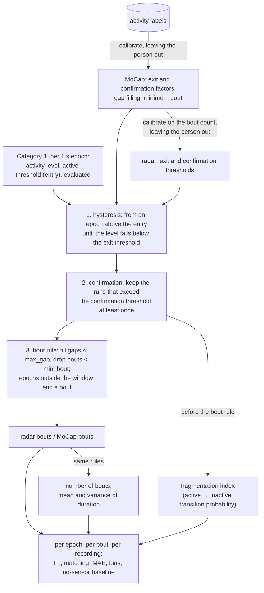

# Category 2: activity bout structure

*Number of bouts, mean and variance of bout duration, fragmentation index*, from the ceiling FMCW radar, validated against MoCap on the full January 2026 campaign. Category 2 is built on the per-epoch activity level and active/inactive calls of [Category 1](category1.md): same recordings, same alignment, same evaluation window, same leave-one-subject-out thresholds. This note covers only what Category 2 adds. The code is in `mobility/bouts.py` and `mobility/metrics/category2.py`. The numbers come from `scripts/calibrate_bout_rule.py` (written to `output/groundtruth/`) and `scripts/evaluate_category2.py` (written to `output/category2/`); see [Runs and outputs](#runs-and-outputs).

## Summary

- **Radar and MoCap bouts match well, one by one.** On 148 recordings from 27 people, 90% of the MoCap bouts and 89% of the radar bouts are matched one to one (median bout F1 0.91 per recording, 10th–90th percentile 0.82–0.97). For 92% of the matched bouts, both onset and offset agree within 1 s.
- **The four metrics, and how much the radar beats a guess without any sensor** (the median MoCap value of the other people):

  | Metric | Error per recording | vs no-sensor guess |
  |---|---|---|
  | number of bouts | 1.8 bouts on about 24 (7.8%) | 0.86× |
  | mean bout duration | 0.60 s on 6.7 s (8.5%) | 0.53× |
  | variance of bout duration | 16.5% | 0.42× |
  | fragmentation index | 0.014 on 0.14 (10.6%) | 0.66× |

- **A bout is defined by three thresholds on the activity level, the same steps for the radar and MoCap:**
  - it begins at the Category 1 active threshold;
  - it ends only when the level falls below a lower exit threshold, so a brief dip doesn't split a movement;
  - it counts only if the level exceeds a higher confirmation threshold at least once, so weak arm movements that just cross the active threshold, such as eating and drinking, don't become bouts.
- **What each step adds:** the exit threshold raised bout F1 from 0.88 to 0.91 and lowered the errors on mean duration (0.85× → 0.56× the guess) and fragmentation (0.95× → 0.67×). The confirmation threshold then lowered the variance error from 20% to 16.5% and removed most of the room-layout bias in the bout count (below).
- **Nothing is set by hand.**
  - The MoCap exit and confirmation thresholds (0.5× and 1.6× the active speed) and the bout rule are calibrated against the activity labels, leaving the evaluated person out. The labels support the definition: held-out F1 against the labels rises from 0.881 (plain threshold) to 0.918.
  - The radar thresholds are calibrated against the MoCap bouts, also leaving the person out.
- **The script still limits what the bout count can show.** Every recording follows the same 38 steps (MoCap bout count 20–26), and the radar's count error is 0.86× the guess. The campaign confirms that the radar sees the same bouts as MoCap and measures their durations and spread. It can't show that bout counts tell people apart.
- **Main bottlenecks:**
  - the scripted protocol (above);
  - movements in bed: MoCap's in-bed movements often stay below its confirmation level, plausibly because the blanket hides them, while the radar sees them;
  - everything Category 1 inherits.

## Data used

The 148 recordings (27 people) evaluated in Category 1. Its [Data used](category1.md#data-used) section lists the recordings left out and why. The MoCap bout definition is calibrated on the MoCap and labels of all 150 recordings that have them (no radar needed), like the MoCap active threshold.

## Method



### 1. Bout definition

The same steps apply to both sensors, each on its own activity level ([mobility/bouts.py](../mobility/bouts.py)):

| Sensor | Activity level | Entry threshold |
|---|---|---|
| radar | log level of `n_cells` per epoch | Category 1 radar active threshold |
| MoCap | RMS joint speed | Category 1 MoCap active threshold (about 0.25 m/s) |

1. **Hysteresis:** an epoch above the entry threshold starts activity, which lasts while the level stays above a lower **exit** threshold.
2. **Confirmation:** a run of activity counts only if its level exceeds a higher **confirmation** threshold at least once. The run keeps its start at the entry threshold, so onsets don't move.
3. **Gaps:** inactive runs of at most `max_gap` epochs between two active runs are filled.
4. **Minimum bout:** active runs shorter than `min_bout` epochs (after step 3) are dropped.

```
level
confirm ┼──────────╭─╮──────────────────────────
entry   ┼───────╭──╯ ╰──╮──────────╭─╮──────────
exit    ┼────╭──╯───────╰─╮──────╭─╯─╰─╮────────
        │ ───╯            ╰──────╯     ╰──
             [  bout     ]           ✗ never reaches "confirm": not a bout
```

**Why each step:**
- **Exit below the entry:** a dip during a movement, while the person still moves at half the active speed, belongs to the bout.
- **Confirmation above the entry:** a movement that only just crosses the active threshold is mostly an arm movement (eating, drinking, putting down a plate). The labels count those as inactive. A whole-body movement easily reaches the higher level.
- **No gap filling, no minimum bout (calibrated, §2):** the confirmation already drops the 1 s blips that the minimum bout used to remove.

**Online.** Each step uses only past epochs. A bout is known once it is confirmed, usually a second or two after its onset, and is dated back to the onset.

**Evaluation window.** Epochs outside it (no MoCap, out of coverage, operator or caregiver; see [Category 1 §6](category1.md#6-evaluation-window)) end a bout. A bout never spans them, and no gap is filled across them. A bout cut by the window edge counts with its part inside the window. The radar and MoCap use the same valid epochs, so both are cut in the same places.

### 2. MoCap definition, calibrated against the labels

Per left-out person, four things are calibrated together:
- the exit factor (exit threshold = factor × entry);
- the confirmation factor;
- `max_gap`;
- `min_bout`.

**Criterion:** the combination that best separates active from inactive label epochs of the **other 26 people** (balanced accuracy).
- **MoCap active:** defined by the left-out person's fold threshold.
- **Label classes:** those of Category 1 ([mobility/labels.py](../mobility/labels.py)).
- **Grid:** exit 1.0 (none) to 0.3 × confirmation 1.0 (none) to 2.5 × `max_gap` 0–3 s × `min_bout` 1–4 s.

**Ties.** Balanced accuracies within 0.001 of the best count as tied, and the least smoothing among them is taken: lowest confirmation, then least hysteresis, then smallest `max_gap` and `min_bout`. The 0.001 margin is well below the spread between leave-person-out folds (about 0.005), so the labels can't tell such candidates apart.

The tie rule matters here. At the chosen exit and confirmation, every combination of 0–2 s gap filling and a 1–2 s minimum bout scores 0.8938–0.8943. The labels settle the two thresholds, but not the gap rule.

Balanced accuracy, all people, without gap filling or minimum bout:

| confirmation \ exit | 0.3 | 0.4 | **0.5** | 0.6 | 0.8 | 1.0 (none) |
|---|---|---|---|---|---|---|
| 1.0 (none) | 0.824 | 0.849 | 0.862 | 0.865 | 0.861 | 0.854 |
| 1.4 | 0.860 | 0.878 | 0.884 | 0.884 | 0.878 | 0.869 |
| **1.6** | 0.882 | 0.892 | **0.894** | 0.892 | 0.884 | 0.872 |
| 1.8 | 0.886 | 0.892 | 0.893 | 0.890 | 0.880 | 0.868 |
| 2.0 | 0.876 | 0.879 | 0.879 | 0.875 | 0.865 | 0.855 |
| 2.5 | 0.820 | 0.820 | 0.819 | 0.816 | 0.808 | 0.800 |

| | Value |
|---|---|
| definition, leaving each person out | exit 0.5×, confirmation 1.6× the active speed, no gap filling, no minimum bout; in all 27 folds and on all people |
| training balanced accuracy | 0.892–0.900 |
| held-out F1 against the labels | plain threshold 0.881 → this definition 0.918 (median; range 0.781–0.930 → 0.791–0.963) |

For comparison, the exit threshold alone reached 0.896; the confirmation adds most of the gain.

### 3. Radar thresholds, calibrated against MoCap

The radar's level is on a different scale (log level of a cell count), so its thresholds are calibrated separately:

| Threshold | Definition |
|---|---|
| exit | entry − δ |
| confirmation | entry + ε (on the log10 level) |

- **Criterion:** for each left-out person, the pair whose bout count is closest to the MoCap bout count (sum of absolute differences) over the other people's recordings.
- **Fold thresholds:** as for the active thresholds, those recordings use the left-out person's fold thresholds and MoCap definition.
- **Grid:** δ 0–0.4 × ε 0–1.0.
- **Ties:** the smallest ε, then the smallest δ.

Training error, mean over folds (bout count error per recording; bout F1 in brackets):

| ε \ δ | 0 | 0.2 | 0.3 | **0.4** |
|---|---|---|---|---|
| 0 (no confirmation) | 7.2 (0.80) | 5.8 (0.84) | 5.3 (0.85) | 4.9 (0.86) |
| 0.3 | 3.7 (0.86) | 2.9 (0.89) | 2.7 (0.90) | 2.5 (0.90) |
| **0.5** | 1.9 (0.87) | 1.7 (0.89) | 1.7 (0.90) | **1.7 (0.90)** |
| 0.6 | 1.9 (0.84) | 2.1 (0.86) | 2.2 (0.87) | 2.3 (0.87) |
| 0.8 | 6.7 (0.72) | 7.0 (0.74) | 7.2 (0.75) | 7.3 (0.75) |

The count pins ε down sharply at 0.5, about 3× the active number of moving cells; δ matters little. Per recording, the folds chose (δ, ε) = (0.4, 0.5) for 81 recordings, (0.3, 0.5) for 49, (0.2, 0.5) for 12 and (0, 0.6) for 6.

**Why the bout count, not bout F1.** Bout F1 prefers a slightly lower confirmation, which leaves the radar about one bout per recording too many. The count criterion removes that bias at almost no cost in F1 (see [Sensitivity](#sensitivity)).

### 4. Metrics

The metrics are one rule each, applied to the radar and the MoCap `States` alike ([mobility/metrics/category2.py](../mobility/metrics/category2.py)). The bout definition comes from `States.extra` (`exit_threshold`, `confirm_threshold`, `bout_rule`), which `mobility.evaluation.metric_table` sets.

| Metric | Unit | Rule |
|---|---|---|
| `n_bouts` | count | number of bouts in the valid epochs |
| `bout_duration_mean` | s | mean bout duration |
| `bout_duration_var` | s² | sample variance of the bout duration |
| `fragmentation_index` | per epoch | active → inactive transition probability (ASTP): the share of active epochs followed by an inactive one, over pairs of consecutive valid epochs. Taken after the hysteresis and the confirmation, **before** the gap / minimum-bout rule |

**Why the fragmentation index is taken before the bout rule.** SCOPE.md suggests bouts per active hour or the transition probability. On the bouts themselves, both are the same quantity: the probability is exactly 1 / mean bout duration (in epochs), and bouts per active hour is the same up to a factor. Either would repeat the mean duration.

**Caveat with the current definition.** The calibrated rule has no gap filling and no minimum bout, so the bout rule changes nothing. The fragmentation index is therefore computed on the same sequence as the bouts and is almost 1 / mean bout duration: the correlation across recordings is 0.99 for both radar and MoCap. It differs only through bouts cut at the window edge. As defined now, it adds no information beyond the mean duration (see [Still open](#decisions)).

### 5. Evaluation

MoCap is the reference. All thresholds and bout definitions are calibrated leaving the evaluated person out.

- **Per epoch:** F1 of the radar's in-bout calls, next to the F1 of its Category 1 active calls. AUC doesn't apply: the in-bout call is binary. Category 1 reports the AUC of the underlying activity level (0.97).
- **Per bout:**
  - **Matching:** radar and MoCap bouts are matched one to one, greedily by overlap, when their intersection over union is at least 0.5.
  - **Scores:** precision, recall and F1 of the matching; onset and offset error (radar − MoCap) of the matched bouts.
- **Per recording, on the four metrics:** mean absolute error and bias (radar − MoCap) in the metric's own units, and the error relative to the mean MoCap value.
- **No-sensor baseline:** every recording gets the median MoCap value of the other people's recordings, and its error is compared with the radar's.

  *Why the baseline:* all recordings follow the same script, so the per-recording errors can look small even if the radar adds nothing. The baseline measures how much of the bout structure the script alone explains. It uses the same statistic (MAE) and needs no sensor.

  *Comparing versions of the definition:* each version changes the MoCap reference too (fewer or longer bouts), and with it the denominator of the relative error. The ratio to the no-sensor baseline is the fairer comparison.

## Results

All results are on the 148 evaluated recordings (27 people). "Median (10th–90th)" is over recordings.

### The four metrics

| Metric | MoCap | Radar | MAE (relative) | Bias | No-sensor MAE | Radar / no-sensor |
|---|---|---|---|---|---|---|
| number of bouts | 24 (20–26) | 24 (21–26) | **1.8** (7.8%) | +0.2 | 2.1 | 0.86 |
| mean bout duration (s) | 6.7 (5.5–9.3) | 6.4 (5.1–8.4) | **0.60 s** (8.5%) | −0.40 s | 1.14 s | 0.53 |
| bout duration variance (s²) | 38 (20–74) | 37 (18–72) | **7.2 s²** (16.5%) | −1.7 s² | 17.2 s² | 0.42 |
| fragmentation index (per epoch) | 0.136 (0.097–0.167) | 0.145 (0.111–0.186) | **0.014** (10.6%) | +0.012 | 0.022 | 0.66 |

- **Durations, their spread and fragmentation are measured, not just guessed from the script.** For mean duration, variance and fragmentation, the radar's error is 0.4–0.7× the no-sensor guess.
- **The variance's relative error is largely a matter of units.** Squaring the durations doubles the relative error. Each recording's variance also depends on its longest bout (median 25 s), which carries about 45% of the sum of squares.
- **The bout count is only slightly better than the guess:** 1.8 vs 2.1 bouts, on a spread of 20–26 between recordings.
- **Per person:**

  | Metric | Mean error per person |
  |---|---|
  | number of bouts | −3.0 (person_1) to +3.3 (person_24) |
  | mean bout duration | −1.5 s (person_26) to +0.6 s (person_25) |
  | fragmentation index | −0.006 (person_11) to +0.038 (person_12) |

**What each step of the definition adds** (relative MAE, with the ratio to the no-sensor guess in brackets):

| | Plain threshold + minimum bout 2 s | + exit threshold | **+ confirmation (current)** |
|---|---|---|---|
| bout F1 | 0.879 | 0.907 | **0.907** |
| number of bouts | 7.6% (0.89×) | 7.7% (0.90×) | **7.8% (0.86×)** |
| mean bout duration | 10.4% (0.85×) | 7.8% (0.56×) | **8.5% (0.53×)** |
| bout duration variance | 24% (0.56×) | 20% (0.51×) | **16.5% (0.42×)** |
| fragmentation index | 11.4% (0.95×) | 9.4% (0.67×) | **10.6% (0.66×)** |
| held-out F1 of MoCap against the labels | 0.883 | 0.896 | **0.918** |

### Per epoch and per bout

| | Value |
|---|---|
| F1 per epoch: active calls (Category 1) | 0.907 (0.862–0.931) |
| F1 per epoch: in-bout calls | **0.922 (0.875–0.953)** |
| bouts, pooled | 3,408 MoCap, 3,440 radar, 3,073 matched |
| bout F1 per recording | **0.907 (0.824–0.967)** |
| bout precision / recall | 0.903 (0.805–1.000) / 0.913 (0.800–1.000) |
| onset error of matched bouts, per-recording MAE | 0.24 s (0.10–0.50); mean +0.08 s |
| offset error of matched bouts, per-recording MAE | 0.43 s (0.18–0.76); mean −0.15 s |
| matched bouts with onset and offset both within ±1 s | 92% |
| bout duration, all bouts | MoCap 5 s (3–17), radar 4 s (2–16) |

- **The radar now tends to end bouts slightly early** (556 matched bouts early, 300 late): its exit threshold is calibrated on the count, not on the ends. The mean is −0.15 s, well within an epoch.
- **Lowest bout F1:** 0.67–0.76, in person_23/scenario_1, person_15/scenario_3, person_1/scenario_5, person_25/scenario_2, person_27/scenario_6 and person_26 (scenarios 1, 5, 6). 10 recordings score below 0.8.

**What the unmatched bouts are.**

| | MoCap | Radar |
|---|---|---|
| unmatched bouts | 335 (10%) | 367 (11%) |
| overlap a bout of the other sensor (split or merged differently), median duration | 115, 7 s | 184, 4 s |
| overlap nothing (missed / extra), median duration | 220, 4 s | 183, 2 s |
| share of bout time in unmatched bouts | 8% | 7% |

Per scripted activity (label at the middle of the bout; labels with at least 60 MoCap bouts and a clear difference):

| Activity | Bouts MoCap → radar | Unmatched MoCap / radar | Count difference per recording |
|---|---|---|---|
| Sit upright in the bed | 86 → 140 | 3% / 42% | +0.36 |
| Go from upright to lying on the bed | 84 → 127 | 8% / 39% | +0.29 |
| Lie on your back again and lie still | 123 → 141 | 2% / 13% | +0.12 |
| Walk inside the main room | 120 → 68 | 43% / 0% | −0.35 |
| between instructions | 197 → 173 | 28% / 23% | −0.16 |
| Put down the plate | 29 → 9 | | −0.14 |
| Walking, wandering, sit down, stand up, restless movement in bed, turns | within ±10% | ≤ 18% | |

- **In bed, the radar makes bouts that MoCap doesn't confirm.** For sitting up and lying down in bed, MoCap makes far fewer bouts than the radar, and most of the radar's extra bouts have no MoCap partner. The labels mark these movements as active. SCOPE.md flags MoCap as unreliable under the blanket, and the radar, 1.9 m above the bed, sees these movements clearly. Which one is right can't be decided from these data.
- **Walking in at the start, MoCap makes more bouts than the radar** (120 vs 68): MoCap splits the walk at brief stops, while the radar, with its lower exit, carries on.
- **The arm tasks are no longer a major source of disagreement.** Without the confirmation threshold, each of eating, drinking and putting down the plate or glass gave the radar up to 0.5 bouts per recording fewer than MoCap at the far chair, and more at the near chair. The bout-count bias per scenario layout went from −2.3 … +1.1 to −0.6 … +1.5, and only scenario 1 is left above 0.2.

### Over time

`scripts/plot_bouts.py` draws the bouts of both sensors over the whole recording, with a close-up of the bed episode, in `output/plots/bouts/`. The figures exist for the 6 development recordings, person_21/scenario_2 and person_23/scenario_1; the script draws any recording.
- **Bars:** solid bars are matched bouts, outlined bars unmatched ones.
- **Grey ticks:** the Category 1 active epochs, before the hysteresis, the confirmation and the bout rule.


A typical recording (bout F1 0.92): one bout each per scripted movement. The short movements around the wearable-button press are no longer bouts in either sensor.


The worst recording (bout F1 0.67), shown in the close-up:
- **In bed, the radar finds bouts MoCap doesn't:** sitting down on the edge of the bed, the first turn, the turn back and the first sit-up.
- **Why MoCap misses them:** their MoCap level stays below its confirmation threshold, as expected if the blanket hides part of the movement.

### Sensitivity

Agreement for other radar thresholds, all people alike, with the MoCap definition as calibrated. The last row has neither hysteresis nor confirmation on either sensor. Relative MAE, with the ratio to the no-sensor guess in brackets; F1 = median over recordings.

| Radar (δ, ε) | bouts | mean duration | variance | fragmentation | bout F1 | in-bout F1 |
|---|---|---|---|---|---|---|
| **calibrated on the count (current)** | **7.8% (0.86×)** | **8.5% (0.53×)** | **16.5% (0.42×)** | **10.6% (0.66×)** | **0.907** | **0.922** |
| calibrated on bout F1 | 8.6% (0.95×) | 8.9% (0.55×) | 17% (0.43×) | 10.6% (0.66×) | 0.914 | 0.927 |
| (0.3, 0): no radar confirmation | 23% (2.55×) | 18% (1.11×) | 19% (0.48×) | 25% (1.54×) | 0.863 | 0.921 |
| (0.3, 0.3) | 11.5% (1.28×) | 11.5% (0.72×) | 17% (0.42×) | 15.5% (0.96×) | 0.903 | 0.929 |
| (0.3, 0.5) | 7.6% (0.84×) | 8.6% (0.54×) | 16% (0.41×) | 10.9% (0.68×) | 0.913 | 0.922 |
| (0.3, 0.8) | 31% (3.44×) | 12% (0.75×) | 33.5% (0.85×) | 9.9% (0.62×) | 0.758 | 0.827 |
| neither hysteresis nor confirmation | 11.8% (1.24×) | 14.5% (1.24×) | 25% (0.64×) | 11.4% (0.95×) | 0.828 | 0.907 |

- **The radar needs its own confirmation once MoCap has one.** Without it, the radar keeps the weak movements that MoCap no longer counts, and the bout count error rises to 23%.
- **The confirmation level must be about right.** ε = 0.5 is best. Too low keeps weak movements; too high (0.8) drops real bouts, and the count and variance errors double.
- **Calibrating on bout F1 instead of the count** gives slightly better matching (0.914) but a worse count (0.95× the guess). The other metrics are the same.

## Runs and outputs

| Run | When | Command | Output |
|---|---|---|---|
| MoCap bout definition calibration | 2026-11-02, about 1 min | `python scripts/calibrate_bout_rule.py` | `output/groundtruth/bout_rule.csv`, `bout_rule_grid.csv` |
| Category 2 evaluation, with the radar calibration | 2026-11-02, 1.5 min (session caches from Category 1) | `python scripts/evaluate_category2.py --workers 16` | `output/category2/`; log `output/category2_full.log` |
| bout figures | 2026-11-02 | `python scripts/plot_bouts.py --only ...` | `output/plots/bouts/` |

Machine and env: `barabas`, `distrimuse` conda env.

**Inputs and code version.**
- **Inputs:** the Category 1 thresholds (`output/category1/thresholds.csv`) and the MoCap epochs and thresholds in `output/groundtruth/`, from the runs in [Category 1](category1.md#runs-and-outputs).
- **Code:** the runs used the working tree on top of commit `ae6077f`. The Category 2 changes are not committed yet: hysteresis, confirmation, the radar calibration (`mobility/bouts.py`, `mobility/metrics/category2.py`, `mobility/evaluation.py`, the three Category 2 scripts, `mobility/plots/bouts.py`). Commit them to pin the version that produced these numbers.

**Tables in `output/category2/`:**

| File | Content |
|---|---|
| `rules.csv` | per recording: entry, exit and confirmation thresholds of both sensors, the factors, δ and ε, the bout rule |
| `radar_levels.csv` | per left-out person and radar (δ, ε): training bout count error and bout F1 |
| `epoch_scores.csv` | per recording: F1 of the active and of the in-bout calls |
| `bout_scores.csv` | per recording: bouts per sensor, matched, precision, recall, F1, onset and offset MAE |
| `bouts.csv` | every bout of both sensors: start, end, duration, matched, onset and offset error, label at its middle |
| `metrics.csv` | per recording: the four metrics, radar and MoCap |
| `agreement.csv` | per metric: MAE, bias, medians, relative MAE, no-sensor baseline MAE and the ratio |
| `sensitivity.csv` | per radar variant, and without hysteresis and confirmation: the same agreement, bout F1 |

## Bottlenecks

1. **The script imposes the bout count.** Every recording follows the same 38 steps, so the number of bouts hardly varies between people (MoCap 20–26), and a guess without a sensor is almost as close as the radar (0.86×). The campaign validates that the radar *sees the same bouts* and measures their durations and spread. It can't validate the bout count as a measure that tells people apart; that needs free-living or less scripted recordings.
2. **Movements in bed.** Since the confirmation threshold, this is the main disagreement: the radar counts sitting up and lying down in bed as bouts (+0.65 per recording) where MoCap often doesn't confirm them. The blanket is the likely reason, but the labels can't settle it: they mark these movements as active, yet MoCap's level stays low. Settling it would need an independent reference in bed.
3. **The variance depends on a few long bouts.** The longest bout of a recording carries about 45% of its sum of squares, so one bout that the radar ends or splits differently moves the variance a lot. The SD (same information, in seconds) or the variance of log durations would be less sensitive, but they answer a slightly different question than SCOPE.md's variance.
4. **The thresholds are only loosely determined in places.** For MoCap, the gap rule is not determined by the labels at all (§2; resolved by the tie rule). For the radar, δ matters little (§3). The results don't hinge on these values, but a different campaign may calibrate somewhat different ones.
5. **Inherited from Category 1:**
   - a third of the radar time can't be evaluated;
   - bouts are cut at the window edges;
   - the radar counts everyone who moves;
   - the signal level depends on where the person is (the per-person spread of the errors).

## Decisions

| Question | Decision |
|---|---|
| Input | the Category 1 activity level per 1 s epoch, with its leave-one-subject-out active threshold as the entry threshold |
| Bout definition | hysteresis down to an exit threshold, confirmation by a higher threshold, then gap filling + minimum bout; the same steps for radar and MoCap; causal |
| MoCap exit and confirmation thresholds, gap filling, minimum bout | calibrated together against the activity labels, leaving the person out; candidates within 0.001 balanced accuracy count as tied, the least smoothing wins |
| Radar exit and confirmation thresholds | calibrated against the MoCap bout count, leaving the person out |
| Epochs outside the evaluation window | end a bout; no gap filled across them |
| Fragmentation index | active → inactive transition probability after the hysteresis and confirmation, before the bout rule |
| Bout variance | sample variance (ddof = 1), NaN with fewer than 2 bouts (none in this campaign) |
| Bout matching | one to one, intersection over union ≥ 0.5 |
| Scores | F1 per epoch and per bout; MAE and bias per recording, next to a no-sensor baseline |

Still open:
- **Validating between-person differences:** needs recordings that are not scripted (Bottleneck 1).
- **Which sensor to trust in bed** (Bottleneck 2).
- **The fragmentation index has become redundant** with the mean duration (correlation 0.99; see [§4](#4-metrics)). Taking it before the confirmation, or on the Category 1 active / inactive sequence, would give it its own content again: fragmentation at the level of single active epochs. That is a change of definition, not yet made.

## Reproducing

```bash
PY=/cw/dtaiexp/NoCsBack/2026-Xuan/miniforge3/envs/distrimuse/bin/python3
# after the Category 1 runs (radar pass, calibrate_mocap_threshold.py, evaluate_category1.py)
$PY scripts/calibrate_bout_rule.py                                 # ~1 min, MoCap + labels only
$PY scripts/evaluate_category2.py --workers 16                     # ~1.5 min with the session caches
$PY scripts/plot_bouts.py --only person_10/scenario_2 person_23/scenario_1
```
