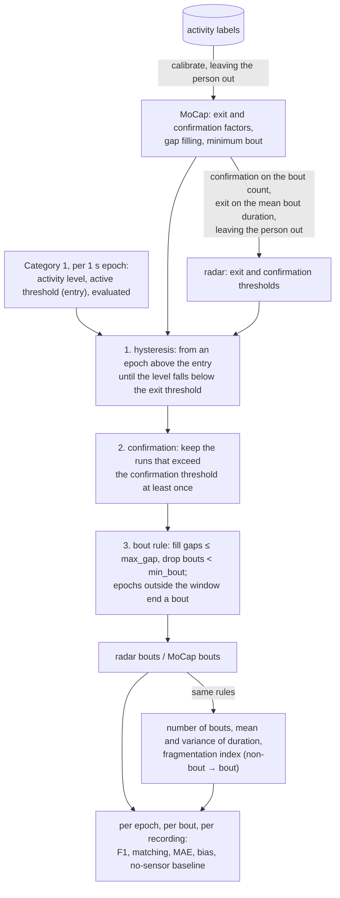

# Category 2: activity bout structure

*Number of bouts, mean and variance of bout duration, fragmentation index*, from the ceiling FMCW radar, validated against MoCap on the full January 2026 campaign. Category 2 is built on the per-epoch activity level and active/inactive calls of [Category 1](category1.md): same recordings, same alignment, same evaluation window, same leave-one-subject-out thresholds. This note covers only what Category 2 adds. The code is in `mobility/bouts.py` (bout definition and its calibration against the labels), `mobility/metrics/category2.py` (the metrics) and `mobility/evaluation/category2.py` (bout matching, radar calibration). The numbers come from `scripts/calibrate_bout_rule.py` (written to `output/groundtruth/`) and `scripts/evaluate_category2.py` (written to `output/category2/`); see [Runs and outputs](#runs-and-outputs).

## Summary

- **Radar and MoCap bouts match well, one by one.** On 148 recordings from 27 people, 90% of the bouts of each sensor are matched one to one (median bout F1 0.91 per recording, 10th–90th percentile 0.82–0.98). For 92% of the matched bouts, both onset and offset agree within 1 s, and neither sensor starts or ends bouts late on average.
- **The four metrics, and how much the radar beats a guess without any sensor** (the median MoCap value of the other people):

  | Metric | Error per recording | Bias | vs no-sensor guess |
  |---|---|---|---|
  | number of bouts | 1.8 bouts on about 24 (7.7%) | −0.06 | 0.85× |
  | mean bout duration | 0.53 s on 6.7 s (7.4%) | −0.13 s | 0.46× |
  | variance of bout duration | 17.3% | +0.1 s² | 0.44× |
  | fragmentation index | 0.016 on 0.12 (12.7%) | −0.001 | 0.73× |

- **A bout is defined by three thresholds on the activity level, the same steps for the radar and MoCap:**
  - it begins at the Category 1 active threshold;
  - it ends only when the level falls below a lower exit threshold, so a brief dip doesn't split a movement;
  - it counts only if the level exceeds a higher confirmation threshold at least once, so weak arm movements that just cross the active threshold, such as eating and drinking, don't become bouts.
- **Nothing is set by hand.**
  - The MoCap exit and confirmation thresholds (0.5× and 1.6× the active speed) and the bout rule are calibrated against the activity labels, leaving the evaluated person out. The labels support the definition: held-out F1 against the labels rises from 0.881 (plain threshold) to 0.918.
  - The radar thresholds are calibrated against the MoCap bouts, also leaving the person out. Each is matched to what it controls: the confirmation to the bout count (which bouts exist), the exit to the mean bout duration (where bouts end).
- **The fragmentation index measures how often rest is interrupted:** the non-bout → bout transition probability. It describes something the other three metrics don't: its MoCap values correlate only 0.19 with the bout count and 0.28 with 1 / mean bout duration. Its radar errors, though, follow the bout-count errors (correlation 0.88 per recording): an extra or missed radar bout is also an extra or missed interruption of rest.
- **No systematic biases remain.** An earlier definition of the fragmentation index (bout → non-bout) was simply 1 / mean bout duration and inherited the radar's slightly shorter bouts: +9% for 25 of 27 people. With the exit calibrated on duration and the new definition, the bias is gone (14 of 27 people too high, 13 too low). See [Fragmentation index](#fragmentation-index-definition-and-calibration).
- **The script still limits what the bout count can show.** Every recording follows the same 38 steps (MoCap bout count 20–26), and the radar's count error is 0.85× the guess. The campaign confirms that the radar sees the same bouts as MoCap and measures their durations and spread. It can't show that bout counts tell people apart.
- **Main bottlenecks:**
  - the scripted protocol (above);
  - movements in bed, where the two sensors cut movement into bouts differently and MoCap under the blanket is least trustworthy;
  - everything Category 1 inherits.

## Data used

The 148 recordings (27 people) evaluated in Category 1. Its [Data used](category1.md#data-used) section lists the recordings left out and why. The MoCap bout definition is calibrated on the MoCap and labels of all 150 recordings that have them (no radar needed), like the MoCap active threshold.

## Method



### 1. Bout definition

The same steps apply to both sensors, each on its own activity level ([mobility/bouts.py](../mobility/bouts.py)):

| Sensor | Activity level | Entry threshold |
|---|---|---|
| radar | log level of `n_cells` per epoch | Category 1 radar active threshold |
| MoCap | RMS joint speed | Category 1 MoCap active threshold (about 0.25 m/s) |

1. **Hysteresis:** an epoch above the entry threshold starts activity, which lasts while the level stays above a lower **exit** threshold.
2. **Confirmation:** a run of activity counts only if its level exceeds a higher **confirmation** threshold at least once. The run keeps its start at the entry threshold, so onsets don't move.
3. **Gaps:** inactive runs of at most `max_gap` epochs between two active runs are filled.
4. **Minimum bout:** active runs shorter than `min_bout` epochs (after step 3) are dropped.

```
level
confirm ┼──────────╭─╮──────────────────────────
entry   ┼───────╭──╯ ╰──╮──────────╭─╮──────────
exit    ┼────╭──╯───────╰─╮──────╭─╯─╰─╮────────
        │ ───╯            ╰──────╯     ╰──
             [  bout     ]           ✗ never reaches "confirm": not a bout
```

**Why each step:**
- **Exit below the entry:** a dip during a movement, while the person still moves at half the active speed, belongs to the bout.
- **Confirmation above the entry:** a movement that only just crosses the active threshold is mostly an arm movement (eating, drinking, putting down a plate). The labels count those as inactive. A whole-body movement easily reaches the higher level.
- **No gap filling, no minimum bout (calibrated, §2):** the confirmation already drops the 1 s blips that the minimum bout used to remove.

**Online.** Each step uses only past epochs. A bout is known once it is confirmed, usually a second or two after its onset, and is dated back to the onset.

**Evaluation window.** Epochs outside it (no MoCap, out of coverage, operator or caregiver; see [Category 1 §6](category1.md#6-evaluation-window)) end a bout. A bout never spans them, and no gap is filled across them. A bout cut by the window edge counts with its part inside the window. The radar and MoCap use the same valid epochs, so both are cut in the same places.

### 2. MoCap definition, calibrated against the labels

Per left-out person, four things are calibrated together:
- the exit factor (exit threshold = factor × entry);
- the confirmation factor;
- `max_gap`;
- `min_bout`.

**Criterion:** the combination that best separates active from inactive label epochs of the **other 26 people** (balanced accuracy).
- **MoCap active:** defined by the left-out person's fold threshold.
- **Label classes:** those of Category 1 ([mobility/labels.py](../mobility/labels.py)).
- **Grid:** exit 1.0 (none) to 0.3 × confirmation 1.0 (none) to 2.5 × `max_gap` 0–3 s × `min_bout` 1–4 s.

**Ties.** Balanced accuracies within 0.001 of the best count as tied, and the least smoothing among them is taken: lowest confirmation, then least hysteresis, then smallest `max_gap` and `min_bout`. The 0.001 margin is well below the spread between leave-person-out folds (about 0.005), so the labels can't tell such candidates apart.

The tie rule matters here. At the chosen exit and confirmation, every combination of 0–2 s gap filling and a 1–2 s minimum bout scores 0.8938–0.8943. The labels settle the two thresholds, but not the gap rule.

Balanced accuracy, all people, without gap filling or minimum bout:

| confirmation \ exit | 0.3 | 0.4 | **0.5** | 0.6 | 0.8 | 1.0 (none) |
|---|---|---|---|---|---|---|
| 1.0 (none) | 0.824 | 0.849 | 0.862 | 0.865 | 0.861 | 0.854 |
| 1.4 | 0.860 | 0.878 | 0.884 | 0.884 | 0.878 | 0.869 |
| **1.6** | 0.882 | 0.892 | **0.894** | 0.892 | 0.884 | 0.872 |
| 1.8 | 0.886 | 0.892 | 0.893 | 0.890 | 0.880 | 0.868 |
| 2.0 | 0.876 | 0.879 | 0.879 | 0.875 | 0.865 | 0.855 |
| 2.5 | 0.820 | 0.820 | 0.819 | 0.816 | 0.808 | 0.800 |

| | Value |
|---|---|
| definition, leaving each person out | exit 0.5×, confirmation 1.6× the active speed, no gap filling, no minimum bout; in all 27 folds and on all people |
| training balanced accuracy | 0.892–0.900 |
| held-out F1 against the labels | plain threshold 0.881 → this definition 0.918 (median; range 0.781–0.930 → 0.791–0.963) |

For comparison, the exit threshold alone reached 0.896; the confirmation adds most of the gain.

### 3. Radar thresholds, calibrated against MoCap

The radar's level is on a different scale (log level of a cell count), so its thresholds are calibrated separately:

| Threshold | Definition | Decides | Calibrated on |
|---|---|---|---|
| confirmation | entry + ε (on the log10 level) | which bouts exist | the bout count |
| exit | entry − δ | where bouts end | the mean bout duration |

For each left-out person, on the other people's recordings, in two steps ([mobility/evaluation/category2.py](../mobility/evaluation/category2.py), `loso_radar_bout_levels`):
1. **ε:** the confirmation of the pair (δ, ε) whose bout count is closest to the MoCap bout count (sum of absolute differences over recordings).
2. **δ:** at that ε, the exit whose mean bout duration is closest to MoCap's (mean absolute difference over recordings).

- **Fold thresholds:** as for the active thresholds, those recordings use the left-out person's fold thresholds and MoCap definition.
- **Grid:** δ 0–1.2 × ε 0–1.0.
- **Ties:** the smallest ε, then the smallest δ.

Training bout-count error per recording, mean over folds:

| ε \ δ | 0 | 0.4 | 0.5 | 0.8 | 1.2 |
|---|---|---|---|---|---|
| 0 (no confirmation) | 7.2 | 4.9 | 4.5 | 3.7 | 3.0 |
| 0.3 | 3.7 | 2.5 | 2.4 | 2.1 | 2.1 |
| **0.5** | 1.9 | 1.7 | **1.7** | 1.8 | 2.1 |
| 0.6 | 1.9 | 2.3 | 2.4 | 2.7 | 3.2 |
| 0.8 | 6.7 | 7.3 | 7.3 | 7.7 | 8.1 |

Training error of the mean bout duration at ε = 0.5 (s per recording, mean over folds):

| δ | 0 | 0.2 | 0.4 | **0.5** | 0.6 | 0.8 | 1.0 | 1.2 |
|---|---|---|---|---|---|---|---|---|
| error | 1.16 | 0.75 | 0.57 | **0.53** | 0.55 | 0.68 | 0.92 | 1.28 |

- **The count pins ε down sharply at 0.5**, about 3× the active number of moving cells, but hardly depends on δ.
- **The mean duration pins δ down at 0.5:** a radar bout lasts until its moving-cell level falls about 3× below the entry level.
- **Per recording**, the folds chose (δ, ε) = (0.5, 0.5) for 142 recordings and (0.5, 0.6) for 6.

**Why not one criterion for both.** Before, both were calibrated on the count. δ was then left almost free, and the radar ended its bouts 0.15 s early on average, which shortened them and biased the fragmentation index (see [Fragmentation index](#fragmentation-index-definition-and-calibration)). Bout F1 as the criterion prefers a slightly lower confirmation, which leaves the radar about one bout per recording too many ([Sensitivity](#sensitivity)).

### 4. Metrics

The metrics are one rule each, applied to the radar and the MoCap `States` alike ([mobility/metrics/category2.py](../mobility/metrics/category2.py)). The bout definition comes from `States.extra` (`exit_threshold`, `confirm_threshold`, `bout_rule`). `metric_table` (`mobility/evaluation/agreement.py`) sets them through `set_bout_levels` (`mobility/metrics/category2.py`).

| Metric | Unit | Rule |
|---|---|---|
| `n_bouts` | count | number of bouts in the valid epochs |
| `bout_duration_mean` | s | mean bout duration |
| `bout_duration_var` | s² | sample variance of the bout duration |
| `fragmentation_index` | per epoch | non-bout → bout transition probability: of the valid epochs outside a bout, the share followed by an epoch inside one (pairs of consecutive valid epochs). About 1 / mean rest between bouts |

**Why non-bout → bout.** SCOPE.md suggests bouts per active hour or the active → inactive transition probability. Taken on the bouts, both are about 1 / mean bout duration, so they would repeat `bout_duration_mean`. The other direction, non-bout → bout, asks how often rest is interrupted by a new bout. That is information the other metrics don't carry.

*Example:* three bouts of 4, 6 and 10 s, separated by rests of 20, 30 and 50 s. Bout → non-bout is 3 ends / 20 s = 0.15 = 1 / 6.7 s, the mean bout duration again. Non-bout → bout is 3 starts / 100 s = 0.03.

### 5. Evaluation

MoCap is the reference. All thresholds and bout definitions are calibrated leaving the evaluated person out.

- **Per epoch:** F1 of the radar's in-bout calls, next to the F1 of its Category 1 active calls. AUC doesn't apply: the in-bout call is binary. Category 1 reports the AUC of the underlying activity level (0.97).
- **Per bout:**
  - **Matching:** radar and MoCap bouts are matched one to one, greedily by overlap, when their intersection over union is at least 0.5.
  - **Scores:** precision, recall and F1 of the matching; onset and offset error (radar − MoCap) of the matched bouts.
- **Per recording, on the four metrics:** mean absolute error and bias (radar − MoCap) in the metric's own units, and the error relative to the mean MoCap value.
- **No-sensor baseline:** every recording gets the median MoCap value of the other people's recordings, and its error is compared with the radar's.

  *Why the baseline:* all recordings follow the same script, so the per-recording errors can look small even if the radar adds nothing. The baseline measures how much of the bout structure the script alone explains. It uses the same statistic (MAE) and needs no sensor.

  *Comparing versions of the definition:* each version changes the MoCap reference too (fewer or longer bouts), and with it the denominator of the relative error. The ratio to the no-sensor baseline is the fairer comparison.

## Results

All results are on the 148 evaluated recordings (27 people). "Median (10th–90th)" is over recordings.

### The four metrics

| Metric | MoCap | Radar | MAE (relative) | Bias | No-sensor MAE | Radar / no-sensor |
|---|---|---|---|---|---|---|
| number of bouts | 24 (20–26) | 23 (20–26) | **1.8** (7.7%) | −0.06 | 2.1 | 0.85 |
| mean bout duration (s) | 6.7 (5.5–9.3) | 6.6 (5.3–9.3) | **0.53 s** (7.4%) | −0.13 s | 1.14 s | 0.46 |
| bout duration variance (s²) | 38 (20–74) | 39 (20–74) | **7.5 s²** (17.3%) | +0.1 s² | 17.2 s² | 0.44 |
| fragmentation index (per epoch) | 0.124 (0.094–0.160) | 0.124 (0.098–0.156) | **0.016** (12.7%) | −0.001 | 0.022 | 0.73 |

- **Durations, their spread and fragmentation are measured, not just guessed from the script.** For these three, the radar's error is 0.4–0.7× the no-sensor guess.
- **None of the metrics has a systematic bias.**
- **The variance's relative error is largely a matter of units.** Squaring the durations doubles the relative error. Each recording's variance also depends on its longest bout (median 25 s), which carries about 45% of the sum of squares.
- **The SD of bout duration** (the square root of the variance, in seconds) carries the same information on the scale of the durations. It is reported here alongside the variance, not as a SCOPE metric:

  | | MoCap | Error (relative) | Bias | No-sensor error | Radar / no-sensor |
  |---|---|---|---|---|---|
  | SD of bout duration | 6.2 s | **0.58 s** (9.0%) | +0.00 s | 1.30 s | 0.44 |

  Its relative error is about half the variance's (9.0% vs 17.3%), while the radar is equally good at both (0.44× the guess). If the radar's SD is 10% too high, its variance is 1.1² = 1.21 times MoCap's, 21% too high.
- **The bout count is only slightly better than the guess:** 1.8 vs 2.1 bouts, on a spread of 20–26 between recordings.
- **The fragmentation index inherits the count's errors.** Per recording, its error correlates 0.88 with the bout-count error, so it beats the guess less clearly (0.73×) than the durations do.

**What each step of the definition adds** (relative MAE, with the ratio to the no-sensor guess in brackets):

| | Plain threshold + minimum bout 2 s | + exit threshold | + confirmation | **+ radar exit on duration, new fragmentation index (current)** |
|---|---|---|---|---|
| bout F1 | 0.879 | 0.907 | 0.907 | **0.909** |
| number of bouts | 7.6% (0.89×) | 7.7% (0.90×) | 7.8% (0.86×) | **7.7% (0.85×)** |
| mean bout duration | 10.4% (0.85×) | 7.8% (0.56×) | 8.5% (0.53×) | **7.4% (0.46×)** |
| bout duration variance | 24% (0.56×) | 20% (0.51×) | 16.5% (0.42×) | **17.3% (0.44×)** |
| fragmentation index | 11.4% (0.95×) | 9.4% (0.67×) | 10.6% (0.66×) | **12.7% (0.73×)** |
| held-out F1 of MoCap against the labels | 0.883 | 0.896 | 0.918 | **0.918** |

In the first three columns the fragmentation index is the earlier definition, about 1 / mean bout duration; in the last, non-bout → bout. The two are not comparable: the earlier one scored better because it measured the mean duration again.

### Per person

`scripts/plot_per_person_category2.py` draws the signed error per person, in % of the MoCap value, 100 × (radar − MoCap) / MoCap per recording. Bars are each person's mean over their recordings; dots are the recordings. All four panels share one y-scale.


| Metric | Mean signed error | Mean absolute error | People with the radar too high |
|---|---|---|---|
| number of bouts | +0.1% | 7.9% | 15 of 27 |
| mean bout duration | −1.8% | 7.2% | 7 of 27 |
| SD of bout duration | +0.8% | 9.4% | 13 of 27 |
| fragmentation index | +1.2% | 13.0% | 14 of 27 |

These are means of per-recording percentages. They differ slightly from the relative errors above, which divide the mean absolute error by the mean MoCap value. In the per-recording version, recordings with small MoCap values weigh a little more.

- **No metric has a common direction any more.** Before the radar exit was calibrated on duration, the radar's bouts were shorter for 22 of 27 people, and the earlier fragmentation index was higher for 25 of 27.
- **Number of bouts:** each person's recordings scatter by about ±10–20%. A few people lean one way:
  - fewer radar bouts: p1 (−14%) and p25 (−11%);
  - more radar bouts: p7 (+13%), p24 (+12%) and p5 (+10%).
- **Fragmentation follows the count person by person:** p1 (−19%), p26 (−18%) and p27 (−13%) at the low end; p24 (+21%), p5 (+20%) and p7 (+19%) at the high end.
- **Mean bout duration:** p26 is still clearly low (−18%); p15 (+10%) and p25 (+9%) are the highest.
- **SD:** p15 stands out at +28% (variance +68%): its radar bouts include a few that are much longer than MoCap's. p17 and p21 are the lowest (−15% and −14%).

### Fragmentation index: definition and calibration

The current definition and calibration follow from two problems with the earlier version.

**Problem 1: the earlier definition repeated the mean duration.** It was the active → inactive (bout → non-bout) transition probability. With no gap filling and no minimum bout, it was computed on the bouts themselves, so it was about 1 / mean bout duration (correlation 0.99 across recordings).

**Problem 2: the radar was systematically higher (+9% per recording, 25 of 27 people).** Since that index was 1 / mean duration, it took over the radar's slightly shorter bouts:

1. **Matched radar bouts were 0.23 s shorter.** The radar started them 0.08 s later and ended them 0.15 s earlier. Its exit threshold was calibrated on the bout count, which hardly depends on it (§3), so nothing tied the radar's bout ends to MoCap's.
2. **The radar's extra bouts are short.** They are mostly the in-bed movements MoCap doesn't confirm (see [Per epoch and per bout](#per-epoch-and-per-bout)), and they pull the radar's mean down.

**Fix 1: the radar exit is calibrated on the mean bout duration (§3).** Matched bouts now differ by −0.06 s (onset +0.05 s, offset 0.00 s). Reason 2 remains, but it weighs less (durations pooled over all bouts of the 148 recordings):

| | MoCap | Radar |
|---|---|---|
| mean duration, all bouts | 7.0 s | 6.9 s |
| mean duration, matched bouts | 7.2 s | 7.1 s |
| mean duration, unmatched bouts | 5.5 s | 4.6 s |

**Fix 2: the definition is non-bout → bout.** These candidates were compared in a one-off check on the bouts of the earlier calibration:

| Fragmentation defined as | Error | Bias | Radar / no-sensor | Correlation of the MoCap value with 1 / mean bout duration |
|---|---|---|---|---|
| active → inactive, on the Category 1 epochs (the classic ASTP) | 11.4% | −0.011 | 0.95 | 0.71 |
| bout → non-bout (the earlier definition) | 10.6% | +0.012 | 0.66 | 1.00 |
| **non-bout → bout** (current) | 12.7% | −0.002 | 0.73 | 0.28 |

- **Active → inactive on the raw epochs** has its own content, but the radar barely beats the guess. It mostly measures how much each sensor flickers from second to second.
- **Bout → non-bout** is the mean duration again in another form.
- **Non-bout → bout** is nearly independent of the mean duration and of the bout count (correlations 0.28 and 0.19), has no bias, and the radar beats the guess.

**What remains.** The radar's errors on the new index follow its bout-count errors (correlation 0.88 per recording). Rest time is about the same for both sensors, so every extra or missed radar bout is also an extra or missed interruption of rest. The index will only get better as the bout count does.

### Per epoch and per bout

| | Value |
|---|---|
| F1 per epoch: active calls (Category 1) | 0.907 (0.862–0.931) |
| F1 per epoch: in-bout calls | **0.923 (0.876–0.955)** |
| bouts, pooled | 3,408 MoCap, 3,399 radar, 3,066 matched |
| bout F1 per recording | **0.909 (0.822–0.979)** |
| bout precision / recall | 0.913 (0.809–1.000) / 0.907 (0.797–1.000) |
| onset error of matched bouts, per-recording MAE | 0.24 s (0.10–0.57); mean +0.05 s |
| offset error of matched bouts, per-recording MAE | 0.39 s (0.14–0.82); mean 0.00 s |
| matched bouts with onset and offset both within ±1 s | 92% |
| bout duration, all bouts | MoCap 5 s (3–17), radar 4 s (2–17) |

- **Bout ends are balanced:** 433 matched bouts end late, 381 early.
- **Lowest bout F1:** 0.68–0.76, in person_1/scenario_5, person_23/scenario_1, person_25 (scenarios 2, 6), person_27/scenario_6, person_26 (scenarios 1, 5) and person_15/scenario_3. 10 recordings score below 0.8.

**What the unmatched bouts are.**

| | MoCap | Radar |
|---|---|---|
| unmatched bouts | 342 (10%) | 333 (10%) |
| overlap a bout of the other sensor (split or merged differently), median duration | 124, 6 s | 153, 4 s |
| overlap nothing (missed / extra), median duration | 218, 4 s | 180, 3 s |
| share of bout time in unmatched bouts | 8% | 6.5% |

Per scripted activity (label at the middle of the bout; labels with at least 60 MoCap bouts and a clear difference):

| Activity | Bouts MoCap → radar | Unmatched MoCap / radar | Count difference per recording |
|---|---|---|---|
| Sit upright in the bed | 86 → 140 | 6% / 44% | +0.36 |
| Go from upright to lying on the bed | 84 → 128 | 8% / 39% | +0.30 |
| Lie on your back again and lie still | 123 → 144 | 2% / 13% | +0.14 |
| Walk inside the main room | 120 → 68 | 43% / 0% | −0.35 |
| between instructions | 197 → 169 | 28% / 22% | −0.19 |
| Put down the plate | 29 → 8 | | −0.14 |
| Walking, wandering, sit down, stand up, restless movement in bed, turns | within ±11% | ≤ 13% | |

- **In bed, the radar makes bouts that MoCap doesn't confirm.** For sitting up and lying down in bed, MoCap makes far fewer bouts than the radar, and most of the radar's extra bouts have no MoCap partner. The labels mark these movements as active. SCOPE.md flags MoCap as unreliable under the blanket, and the radar, 1.9 m above the bed, sees these movements clearly. Which one is right can't be decided from these data.
- **Walking in at the start, MoCap makes more bouts than the radar** (120 vs 68): MoCap splits the walk at brief stops, while the radar carries on.
- **The arm tasks are no longer a major source of disagreement.** Without the confirmation threshold, each of eating, drinking and putting down the plate or glass gave the radar up to 0.5 bouts per recording fewer than MoCap at the far chair, and more at the near chair. The bout-count bias per scenario layout is now −0.8 … +1.2, against −2.3 … +1.1 then. The largest are scenario 1 (+1.2) and scenario 3 (−0.8); the others lie within ±0.4.

### Over time

`scripts/plot_bouts.py` draws the bouts of both sensors over the whole recording, with a close-up of the bed episode, in `output/plots/bouts/`. The figures exist for the 6 development recordings, person_21/scenario_2, person_23/scenario_1 and person_1/scenario_5; the script draws any recording.
- **Bars:** solid bars are matched bouts, outlined bars unmatched ones.
- **Grey ticks:** the Category 1 active epochs, before the hysteresis, the confirmation and the bout rule.


A typical recording (bout F1 0.86; MoCap 25 bouts, radar 24, 21 matched):
- **The bed episode** matches bout for bout.
- **The disagreements are small:** short MoCap bouts between 1.5 and 2 min that the radar doesn't have, and one movement around 4.5 min that MoCap splits in two and the radar keeps whole.


The worst recording (bout F1 0.68), shown in the close-up:
- **In bed, MoCap keeps long bouts where the radar sees separate movements.** MoCap has one bout from the turn back through the button press to the first sit-up, and another from lying down to the second sit-up. The radar splits these into short bouts, one per movement.
- **Why:** between these movements MoCap's level drops below its active threshold but stays above its exit threshold, so the bout carries on. Whether that is real movement under the blanket or tracking noise can't be told from these data.

### Sensitivity

Agreement for other radar thresholds, all people alike, with the MoCap definition as calibrated. The last row has neither hysteresis nor confirmation on either sensor. Relative MAE, with the ratio to the no-sensor guess in brackets; F1 = median over recordings.

| Radar (δ, ε) | bouts | mean duration | variance | fragmentation | bout F1 | in-bout F1 |
|---|---|---|---|---|---|---|
| **calibrated: ε on the count, δ on duration (current)** | **7.7% (0.85×)** | **7.4% (0.46×)** | **17.3% (0.44×)** | **12.7% (0.73×)** | **0.909** | **0.923** |
| calibrated: both on the count (earlier) | 7.8% (0.87×) | 8.2% (0.51×) | 17.7% (0.45×) | 12.9% (0.74×) | 0.907 | 0.921 |
| calibrated on bout F1 | 8.4% (0.93×) | 8.3% (0.52×) | 16.8% (0.43×) | 13.5% (0.77×) | 0.917 | 0.927 |
| (0.5, 0): no radar confirmation | 20% (2.17×) | 13% (0.81×) | 18% (0.47×) | 29% (1.65×) | 0.868 | 0.921 |
| (0.5, 0.3) | 10.3% (1.14×) | 8.8% (0.55×) | 17.1% (0.43×) | 15.8% (0.90×) | 0.917 | 0.927 |
| (0.3, 0.5) | 7.6% (0.84×) | 8.6% (0.54×) | 16.0% (0.41×) | 12.1% (0.69×) | 0.913 | 0.922 |
| (0.5, 0.5) | 7.4% (0.82×) | 7.4% (0.46×) | 17.2% (0.44×) | 12.3% (0.70×) | 0.913 | 0.923 |
| (0.5, 0.8) | 32% (3.52×) | 14% (0.89×) | 37% (0.95×) | 41% (2.33×) | 0.750 | 0.828 |
| neither hysteresis nor confirmation | 11.8% (1.24×) | 14.5% (1.24×) | 25% (0.64×) | 14.4% (0.91×) | 0.828 | 0.907 |

- **The radar needs its own confirmation once MoCap has one.** Without it, the radar keeps the weak movements that MoCap no longer counts, and the bout-count error rises to 20%.
- **The confirmation level must be about right.** ε = 0.5 is best. Too low keeps weak movements; too high (0.8) drops real bouts, and the count and variance errors double.
- **Calibrating the exit on duration** mainly helps the mean duration (0.51× → 0.46×) and removes its bias. The other metrics move little.
- **Calibrating on bout F1** gives slightly better matching (0.917) but a worse count (0.93× the guess).

## Runs and outputs

| Run | When | Command | Output |
|---|---|---|---|
| MoCap bout definition calibration | 2026-11-17, about 1 min | `python scripts/calibrate_bout_rule.py` | `output/groundtruth/bout_rule.csv`, `bout_rule_grid.csv` |
| Category 2 evaluation, with the radar calibration | 2026-11-18, 2.3 min (session caches from Category 1) | `python scripts/evaluate_category2.py --workers 16` | `output/category2/`; log `output/category2_full.log` |
| bout figures | 2026-11-18 | `python scripts/plot_bouts.py --only ...` | `output/plots/bouts/` |
| signed error per person | 2026-11-18 | `python scripts/plot_per_person_category2.py` | `output/plots/per_person/per_person_bouts_bias.png` |
| fragmentation candidate definitions | 2026-11-03 | one-off check, not in the repository | numbers in [Fragmentation index](#fragmentation-index-definition-and-calibration) |

Machine and env: `barabas`, `distrimuse` conda env.

**Inputs and code version.**
- **Inputs:** the Category 1 thresholds (`output/category1/thresholds.csv`) and the MoCap epochs and thresholds in `output/groundtruth/`, from the runs in [Category 1](category1.md#runs-and-outputs).
- **Code:** the commit that adds this version of the note (2026-11-18, on top of `6ea79f9`). It calibrates the radar exit on the mean bout duration and defines the fragmentation index as non-bout → bout. The MoCap definition is unchanged since `21f49c4`.

**Tables in `output/category2/`:**

| File | Content |
|---|---|
| `rules.csv` | per recording: entry, exit and confirmation thresholds of both sensors, the factors, δ and ε, the bout rule |
| `radar_levels.csv` | per left-out person and radar (δ, ε): training bout-count error, mean-duration error and bout F1 |
| `epoch_scores.csv` | per recording: F1 of the active and of the in-bout calls |
| `bout_scores.csv` | per recording: bouts per sensor, matched, precision, recall, F1, onset and offset MAE |
| `bouts.csv` | every bout of both sensors: start, end, duration, matched, onset and offset error, label at its middle |
| `metrics.csv` | per recording: the four metrics, radar and MoCap |
| `agreement.csv` | per metric: MAE, bias, medians, relative MAE, no-sensor baseline MAE and the ratio |
| `sensitivity.csv` | per radar variant, and without hysteresis and confirmation: the same agreement, bout F1 |

## Bottlenecks

1. **The script imposes the bout count.** Every recording follows the same 38 steps, so the number of bouts hardly varies between people (MoCap 20–26), and a guess without a sensor is almost as close as the radar (0.85×). The campaign validates that the radar *sees the same bouts* and measures their durations and spread. It can't validate the bout count as a measure that tells people apart; that needs free-living or less scripted recordings.
2. **Movements in bed.** This is the main disagreement, in both directions:
   - **More radar bouts:** the radar counts sitting up and lying down in bed as bouts (+0.66 per recording) where MoCap often doesn't confirm them.
   - **Longer MoCap bouts:** in some recordings, MoCap carries one bout across several movements where the radar sees them separately (person_1/scenario_5).

   The blanket is the likely reason for both, but the labels can't settle it: they mark these movements as active. Settling it would need an independent reference in bed.
3. **The fragmentation index inherits the bout-count errors.** Its radar errors correlate 0.88 with the count errors, so it can only improve as the count does.
4. **The variance depends on a few long bouts.** The longest bout of a recording carries about 45% of its sum of squares, so one bout that the radar ends or splits differently moves the variance a lot (p15: +68%). The SD (same information, in seconds; error 9.0%) or the variance of log durations would read less extreme, but they answer a slightly different question than SCOPE.md's variance.
5. **The MoCap gap rule is not determined by the labels** (§2; resolved by the tie rule). The results don't hinge on it, but a different campaign may calibrate somewhat different values.
6. **Inherited from Category 1:**
   - a third of the radar time can't be evaluated;
   - bouts are cut at the window edges;
   - the radar counts everyone who moves;
   - the signal level depends on where the person is (the per-person spread of the errors).

## Decisions

| Question | Decision |
|---|---|
| Input | the Category 1 activity level per 1 s epoch, with its leave-one-subject-out active threshold as the entry threshold |
| Bout definition | hysteresis down to an exit threshold, confirmation by a higher threshold, then gap filling + minimum bout; the same steps for radar and MoCap; causal |
| MoCap exit and confirmation thresholds, gap filling, minimum bout | calibrated together against the activity labels, leaving the person out; candidates within 0.001 balanced accuracy count as tied, the least smoothing wins |
| Radar thresholds | leaving the person out, against MoCap: confirmation on the bout count, exit on the mean bout duration |
| Epochs outside the evaluation window | end a bout; no gap filled across them |
| Fragmentation index | non-bout → bout transition probability on the bouts (how often rest is interrupted) |
| Bout variance | sample variance (ddof = 1), NaN with fewer than 2 bouts (none in this campaign) |
| Bout matching | one to one, intersection over union ≥ 0.5 |
| Scores | F1 per epoch and per bout; MAE and bias per recording, next to a no-sensor baseline |

Still open:
- **Validating between-person differences:** needs recordings that are not scripted (Bottleneck 1).
- **Which sensor to trust in bed** (Bottleneck 2).
- **A combined fragmentation index** using both transition directions (bout → rest and rest → bout), being tried.

## Reproducing

```bash
PY=/cw/dtaiexp/NoCsBack/2026-Xuan/miniforge3/envs/distrimuse/bin/python3
# after the Category 1 runs (radar pass, calibrate_mocap_threshold.py, evaluate_category1.py)
$PY scripts/calibrate_bout_rule.py                                 # ~1 min, MoCap + labels only
$PY scripts/evaluate_category2.py --workers 16                     # ~2.5 min with the session caches
$PY scripts/plot_bouts.py --only person_10/scenario_2 person_1/scenario_5
$PY scripts/plot_per_person_category2.py                           # signed error per person
```
