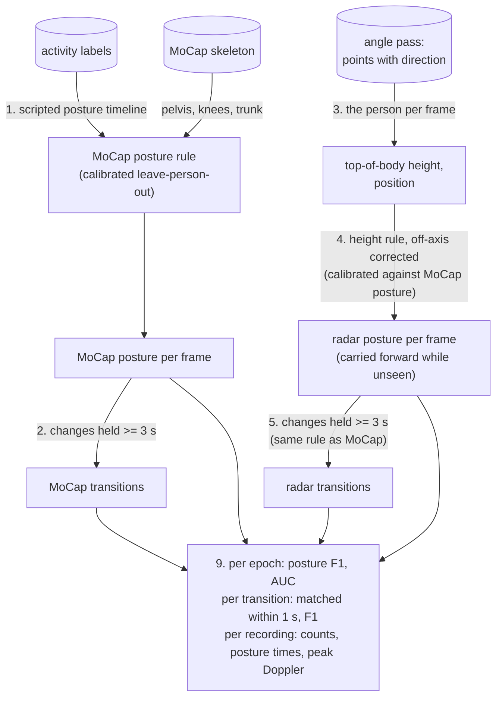

# Category 3: postural transitions

*Peak Doppler during transition, sit-to-stand, stand-to-sit, lie-to-sit counts*, and since the angle pass also *the time spent standing, sitting, lying and on the floor*, from the ceiling FMCW radar, validated against MoCap on the full January 2026 campaign. Category 3 uses the recordings, alignment and evaluation window of [Category 1](category1.md). This note covers what Category 3 adds. The code is in `mobility/posture.py`, `mobility/transitions.py` and `mobility/metrics/category3.py`; the angle comes from the angle pass ([angle.md](angle.md)). The numbers come from `scripts/calibrate_posture.py` (written to `output/groundtruth/`) and `scripts/evaluate_category3.py` (written to `output/category3/`); see [Runs and outputs](#runs-and-outputs).

**Two versions.** The first version (2026-10-23) had range and Doppler only, and needed a learned classifier on bursts of motion. With the angle (2026-10-26) the radar measures the *height* of the person, also when they keep still, so the posture itself is measured and transitions follow from it by the same rule as for MoCap. That height rule is now the main method; the first version is kept as a comparison.

## Summary

- **The radar now measures posture, also when the person keeps still.** The angle turns the radar's view into a height: the top of the body. Breathing and small movements keep a still person visible in 87% of the evaluated epochs. A height rule with three thresholds sorts each epoch into standing, sitting, lying or floor:

  | Posture, per 1 s epoch against MoCap | F1 (median over recordings) |
  |---|---|
  | standing | **0.975** |
  | sitting | **0.927** |
  | lying | **0.933** |
  | floor | 0.877 |
  | mean | 0.920 (10th–90th percentile 0.862–0.963) |

- **The time in each posture is the first Category 3 metric the radar measures better than the script predicts.** Standing, sitting and lying time per recording are off by 0.10–0.11 min (5–7%), against 0.21–0.33 min for a guess without any sensor.
- **Transitions come from the posture, by the same rule as for MoCap,** and are found more often than before: same-kind F1 per recording **0.77** (10th–90th percentile 0.58–0.92), recall 0.83, precision 0.75. Matched transitions are 0.32 s apart (median).

  | Method (all leave-one-subject-out) | Same-kind F1 | Notes |
  |---|---|---|
  | **height rule** (main) | **0.77** | posture per epoch; 3 thresholds, an off-axis correction and a hold time |
  | burst classifier, range and Doppler only (first version) | 0.73 | no posture while still |
  | burst classifier with angle features | 0.80 | highest F1, but no posture per epoch and harder to inspect |
  | hand rule on bursts | 0.40 (any kind) | |

  The height rule finds the compound movements the first version missed (getting up to the bed edge, lying down on the bed, the floor tasks: recall 0.63–0.80, was 0.27–0.39). It is weaker at the chair, which stands far off the radar axis in some layouts.
- **One correction was needed: the radar sees less of the top of the head off-axis.** Its height falls about 0.1 m per metre from the axis (to −0.25 to −0.30 m at 2–3 m), while its directions are unbiased. A correction proportional to the distance, calibrated without the evaluated person (0.10–0.15 m per m), raised the transition F1 from 0.64 to 0.77.
- **The counts are almost always right, but the script still fixes them.** Sit-to-stand, stand-to-sit and lie-to-sit are exact in 72–79% of the recordings and within ±1 in 98–100% (error 0.21–0.30 per recording; first version 0.51–0.74). A guess without a sensor is still closer (0.04–0.09), because every recording has the same scripted counts.
- **Peak Doppler: the bias came from Doppler leakage, and is fixed.** The radar's fastest cell sat on power that strong reflections leak into neighbouring Doppler bins (+0.31 m/s per transition). A power-weighted quantile of the person's own speeds (the 95th, calibrated leaving the person out) agrees with MoCap within 0.22–0.23 m/s on sit-to-stand and stand-to-sit (bias −0.08 to −0.09). Per recording the metric now beats the no-sensor guess once a constant offset is removed (0.16 vs 0.19 m/s), but reads 0.17 m/s low: it averages over the radar's own transitions, and its extra ones are slow posture flips.
- **The MoCap ground truth is unchanged:** posture from pelvis height, knee height and trunk angle, calibrated against the script leaving the person out; it reproduces 96–99% of the scripted postural changes, including lie-to-sit (98.7%), so MoCap serves for lie-to-sit too.
- **Main bottlenecks:** the scripted protocol (counts); off-axis transitions (recall 0.50 at 2–3 m from the axis); the floor, which the radar rarely sees still; the lying / floor boundary, close to the height of a person lying in bed; extra transitions, which also pull the peak-Doppler metric down.

## Data used

The 148 recordings (27 persons) evaluated in Category 1. Its [Data used](category1.md#data-used) section lists the recordings left out and why. The MoCap posture rule is calibrated on the MoCap and labels of all 150 recordings that have them (no radar needed), like the MoCap active threshold.

Each recording follows the same script with 12 postural changes:

| Kind | Scripted per recording | Labels |
|---|---|---|
| stand-to-sit | 3 | sit down on the chair; sit down on the edge of the bed (×2) |
| sit-to-stand | 3 | stand up from the chair; stand up from the bed (×2) |
| sit-to-lie | 2 | lay down on the bed; go from upright to lay on the bed |
| lie-to-sit | 2 | sit upright in the bed; get up and sit on the edge of the bed |
| to the floor, from the floor | 1 + 1 | lay down on the ground; get up and stand upright |

Picking up a coin bends the trunk but ends standing: it isn't a postural change.

## Method



### 1. Posture from MoCap (ground truth)

**From the script.** Each scripted postural change fixes the posture until the next one, so the labels give a posture timeline ([mobility/posture.py](../mobility/posture.py)). It is unknown inside a postural label and within 2 s of it (the `LABEL_MARGIN_S` of Category 1). It is also unknown outside the scripted period and during the caregiver visit. The floor tasks give a fourth posture, *floor*: lying, sitting or kneeling on the ground.

**From the skeleton**, by a rule with four parameters:

| Posture | Rule |
|---|---|
| standing | pelvis above `hip_stand` |
| floor | otherwise, pelvis or knees below `low_floor` (knees: kneeling on the ground) |
| lying | otherwise, trunk (pelvis → neck) more than `trunk_lie` from vertical |
| sitting | otherwise: chair, edge of the bed, upright in bed |

A posture counts only once it has lasted `min_hold_s`. The MoCap signals `hip_y`, `knee_y`, `trunk_deg` (and `knee_deg`, not used) are added to `mocap_signals` in [mobility/groundtruth.py](../mobility/groundtruth.py).

**Calibration**, for each person on the **other 26** ([scripts/calibrate_posture.py](../scripts/calibrate_posture.py)):
- `hip_stand` and `trunk_lie` maximise the balanced accuracy of their split on the 1 s epochs whose posture the script fixes (18,644 standing, 8,551 sitting, 10,196 lying, 1,577 floor);
- `low_floor` and `min_hold_s` maximise how well the resulting transitions reproduce the scripted changes: F1, same kind, within the label ± 1 s.

**Why the floor threshold is calibrated on the transitions.** Per epoch it is decided by label noise. The floor (pelvis or knees < 0.2 m) and sitting on furniture (> 0.43 m) are far apart. A few floor epochs where the person is already getting up push the balanced-accuracy optimum to the top of that gap, 0.42 m. There it turns sitting on a low bed edge into "floor", and the transition F1 against the script drops from 0.98 to 0.94.

Transition F1 against the script, all persons, by floor threshold (rows) and minimum hold (columns):

| `low_floor` \ `min_hold_s` | 0.5 s | 1 s | 2 s | **3 s** | 4 s | 5 s |
|---|---|---|---|---|---|---|
| 0.15 m | 0.806 | 0.916 | 0.960 | 0.968 | 0.968 | 0.954 |
| **0.25 m** | 0.848 | 0.944 | 0.977 | **0.982** | 0.982 | 0.970 |
| 0.35 m | 0.871 | 0.954 | 0.978 | 0.982 | 0.982 | 0.970 |
| 0.45 m | 0.745 | 0.827 | 0.850 | 0.855 | 0.850 | 0.829 |

| | Value |
|---|---|
| rule, all persons | standing: pelvis > 0.65 m; floor: pelvis or knees < 0.25 m; lying: trunk > 51°; held ≥ 3 s |
| rule, leaving each person out | pelvis 0.65–0.75 m, floor 0.25–0.30 m, trunk 49–53°, hold 3–4 s |
| held-out F1 per posture (median over persons) | standing 0.999, sitting 0.992, lying 0.996, floor 1.000 |
| held-out transition F1 against the script | median 0.986 (min 0.727: person_20, whose MoCap clock is off; [Category 1](category1.md#data-used)) |

**Scripted changes reproduced by the MoCap transitions** (held out, 150 recordings):

| Kind | Reproduced |
|---|---|
| stand-to-sit | 98.2% of 450 |
| sit-to-stand | 97.8% of 450 |
| sit-to-lie | 98.7% of 300 |
| lie-to-sit | **98.7%** of 300 |
| to the floor | 97.3% of 150 |
| from the floor | 96.0% of 150 |

MoCap adds 33 transitions the script doesn't have, 12 of them between labels.

- **The 3 s hold** removes short posture flips during restless movement and turning in bed, and the 1–2 s kneeling phase when getting up from the floor. In an early version with a 1 s hold and without the floor class, that phase added 118 sit-to-stand transitions to the 148 floor get-ups.
- **Lie-to-sit:** SCOPE.md proposed the labels alone, because of blanket occlusion. MoCap reproduces 98.7% of the scripted lie-to-sit changes, so MoCap is the reference for all kinds and the labels serve as the check.

### 2. MoCap transitions

A transition is a change between two consecutive stable postures (held ≥ `min_hold_s`) with no missing MoCap between them ([mobility/transitions.py](../mobility/transitions.py)). Its time is the middle of the gap between the two. Its kind is one of `stand_to_sit`, `sit_to_stand`, `sit_to_lie`, `lie_to_sit`, `stand_to_lie`, `lie_to_stand`, `to_floor`, `from_floor`. Its direction is down (away from the radar, + Doppler) or up.


### 3. The person, seen by the radar

The angle pass ([angle.md](angle.md)) keeps every range-Doppler cell more than 6 dB above its floor, with its 12 channel values, and turns each into a 3-D position (13–15 cm horizontally from the nearest MoCap joint). Per frame, `frame_features` in [mobility/radar/angle.py](../mobility/radar/angle.py) takes the clearly visible points (> 12 dB above the floor, inside the radar coverage and the room, between the floor and the radar):

| Feature | Definition |
|---|---|
| `x_person`, `z_person` | position of the person: median of those points |
| `h_top` | top of the body: 90th percentile of the heights of the points within 1 m of that position |
| `n_person`, `n_slow` | number of those points, and of them slower than 0.1 m/s |

Slow Doppler bins are included on purpose: breathing and small movements keep a still person visible. The radar sees the person in 87% of the evaluated epochs (10th–90th percentile 0.81–0.93), and its position is about 0.15 m from the MoCap centre of gravity (person_1/scenario_1). Frames with fewer than 3 points are unseen. The features are cached per recording in `angle_features.npz` and loaded with the other radar features; the height and position are smoothed with a 1 s running median (`radar_height`, `radar_offaxis` in [mobility/posture.py](../mobility/posture.py)).

The caregiver and the operator would be seen too; their periods are outside the evaluation window, as in Categories 1–2.

### 4. Radar posture: the height rule

**Rule** (`RadarPostureRule`): with *h* the top-of-body height and *d* the person's distance from the point below the radar, both from the radar,

| Posture | Corrected height *h* + *k*·*d* |
|---|---|
| standing | above `h_stand` |
| sitting | above `h_sit` |
| lying | above `h_floor` |
| floor | below `h_floor` |

Where the radar doesn't see the person, the last posture carries forward (SCOPE.md step 4: a still person who isn't seen hasn't changed posture).

**Off-axis correction *k*.** Against the MoCap head, the radar height falls with the distance from the axis (all evaluated frames, median of radar − MoCap head, m):

| Distance from the axis | standing | sitting | lying |
|---|---|---|---|
| < 0.5 m | +0.01 | −0.11 | −0.06 |
| 0.5–1 m | −0.10 | −0.07 | −0.08 |
| 1–1.5 m | −0.18 | −0.08 | −0.07 |
| 1.5–2 m | −0.20 | −0.16 | −0.09 |
| 2–3 m | −0.25 | −0.30 | −0.13 |

The directions themselves are unbiased: the radar's horizontal direction cosine is 0.99–1.02 times MoCap's at every distance (the 16,096 frames of the orientation check), and scaling it only adds error. So it's what the radar *sees* that changes: off-axis, less of the top of the head and more of the chest, which also breathes. Sitting at the far chair (2–3 m) then reads 0.72 m, right at the sitting / lying threshold, and the posture flickers. Without the correction the transition F1 was 0.64; with a fixed *k* of 0.05, 0.10 or 0.15 m/m (exploration) 0.71, 0.76, 0.77.

**Calibration, leaving the evaluated person out** (`calibrate_height_rule` in [scripts/evaluate_category3.py](../scripts/evaluate_category3.py)), with MoCap posture and transitions under that person's MoCap posture rule:
- for each *k* in 0–0.2 m/m: the three thresholds maximise the balanced accuracy of their split between neighbouring postures (standing | sitting, sitting | lying, lying | floor), per 1 s epoch where the radar sees the person;
- then *k* and `min_hold_s` (0.5–5 s) together maximise the transition F1 against MoCap on the other persons.

| | Value |
|---|---|
| rule, all persons | height + 0.10 × distance: standing > 1.26 m, sitting > 0.81 m, lying > 0.52 m; held ≥ 3 s |
| rule, leaving each person out | standing 1.26–1.35 m, sitting 0.81–0.85 m, lying 0.52–0.53 m; *k* 0.10 (18 persons) or 0.15 (9); hold 3 s |
| training transition F1 | 0.749–0.762 |

### 5. Radar transitions

The radar posture per frame goes through the *same* function as the MoCap posture (`posture_transitions`): a transition is a change between two postures each held ≥ `min_hold_s`, timed at the middle of the gap. So the two sensors define a transition the same way, as Categories 1–2 do for activity and bouts.

### 6. Comparison methods

**First version: burst classifier, range and Doppler only** (2026-10-23). Without the angle, the range is a slant range that mixes height with horizontal distance: a person standing 2 m off the axis is as far from the radar as one lying below it. So the first version detected *transitions* only, not posture:
- **bursts:** runs of the signed Doppler centroid (`v_centroid`), smoothed over 0.5 s, beyond ±0.05 m/s; same-sign runs closer than 0.5 s merged; at least 0.3 s. 15,221 bursts in the evaluation window; 86% of the MoCap transitions have one of the same direction within 1 s;
- **17 features per burst:** direction, duration, peak Doppler; range of the nearest moving reflector (`r_near`) at the start and end, and its change; range, share of moving frames and activity level before and after; time to the neighbouring bursts;
- **classifier:** gradient-boosted trees (`BurstModel`) map the features to a transition kind or "none", trained on the bursts of the other 26 persons with targets from their MoCap transitions. Early stopping on 10% of the training bursts is needed: without it the trees saturate to probabilities of 0 or 1 and whole held-out persons were missed (persons 2, 4, 6, 8, 10: median F1 0–0.3). Kinds with fewer than 10 training bursts are left out;
- **detection threshold:** a burst is a transition when P(not "none") reaches it; it maximises the F1 of out-of-fold classifications of the 26 training persons (5 folds grouped by person): 0.10–0.30. Of the transitions of one direction within 1.5 s, the most probable is kept.

What didn't work without the angle, which is why it was learned:

| Approach | Result |
|---|---|
| hand rule: peak speed, range change, duration, thresholds calibrated leave-one-subject-out (`rule_baseline.csv`) | F1 0.40 even ignoring the kind: walking, bending and moving in bed pass it |
| posture carried forward through an up/down state machine (exploration, not kept) | typed F1 0.27: one wrong event puts every later one in the wrong state |
| Doppler purity or stillness after a down-transition (exploration, not kept) | hardly separate transitions from other bursts |

**Burst classifier with angle features** (2026-10-26): the same, with six more features per burst: the top-of-body height at its start and end and before and after, its change in the burst's direction, and the distance from the axis (`ANGLE_BURST_FEATURES`). Detection threshold 0.15–0.40.

### 7. Peak Doppler

The peak radial speed within 1 s of each transition, the maximum over that window of a per-frame speed, for both sensors:

| Sensor | Speed per frame |
|---|---|
| radar | the person's speed: of their moving points (§3; faster than 0.1 m/s), the \|velocity\| below which a fraction *q* of the received power lies (power-weighted quantile; features `v_q900` … `v_q995`) |
| MoCap | `vr_max`: the fastest of the 16 joints along the line to the radar |

Both are speeds along the line to the radar, as SCOPE.md asks.

**Why a quantile, not the fastest cell.** The first version took the fastest cell more than 12 dB above its floor (`v_peak`). It read 0.31 m/s above MoCap at the MoCap transitions. Testing the causes on those 1,178 transitions (`peak_measures.csv`, and an exploration):

| Radar measure | Median (MoCap 0.96 m/s) | Bias | MAE | MAE without the bias |
|---|---|---|---|---|
| fastest strong cell (`v_peak`, first version) | 1.35 | +0.31 | 0.46 | 0.31 |
| fastest strong cell of the person only (exploration) | 1.32 | +0.28 | 0.44 | 0.30 |
| person's cells within 20 dB of their strongest (exploration) | 1.13 | +0.10 | 0.30 | 0.26 |
| person, power-weighted quantile 0.90 / 0.95 / 0.98 / 0.99 / 0.995 | 0.87 / 0.96 / 1.00 / 1.04 / 1.09 | −0.18 / −0.11 / −0.03 / +0.02 / +0.06 | 0.26 / **0.24** / 0.24 / 0.26 / 0.28 | 0.28 / 0.26 / 0.25 / 0.26 / 0.26 |

- **Not other reflectors:** keeping only the person's points barely changes the fastest cell.
- **Doppler leakage:** a strong reflection spreads power into neighbouring Doppler bins, and the fastest cell above the floor sits on that spread (whether from the window's sidelobes or from the motion's own spread within a frame isn't separated here). Ignoring weak cells relative to the person's strongest one, or taking a high quantile of the power, removes most of the bias.
- **Calibration:** the quantile minimises the MAE against MoCap on the other persons' transitions. It is 0.95 for every left-out person (`peak_rule.csv`).
- **Not the centre of gravity:** the radar peak doesn't follow the peak radial speed of the MoCap centre of gravity (median 0.42 m/s) any better than a constant; the fastest joint stays the reference.

### 8. Metrics

Each metric is one rule, applied to the radar and the MoCap results inside the valid epochs ([mobility/metrics/category3.py](../mobility/metrics/category3.py)). `metric_table(..., transitions=..., postures=...)` sets them in `States.transitions` and `States.posture`.

| Metric | Unit | Rule |
|---|---|---|
| `sit_to_stand_count` | count | sit-to-stand transitions |
| `stand_to_sit_count` | count | stand-to-sit transitions |
| `lie_to_sit_count` | count | lie-to-sit transitions (sitting up in bed, getting up to the edge) |
| `peak_transition_doppler` | m/s | mean peak radial speed over these three kinds (radar: its own transitions of these kinds) |
| `standing_time`, `sitting_time`, `lying_time`, `floor_time` | min | valid epochs in that posture (an epoch's posture: its most frequent one) |

### 9. Evaluation

MoCap is the reference, inside the Category 1 evaluation window; everything calibrated is calibrated without the evaluated person.
- **Per epoch** (posture): F1 per posture, and the AUC of the corrected height for each pair of neighbouring postures (threshold-free).
- **Per transition** (SCOPE.md): radar and MoCap transitions matched one to one, closest first, within ±1 s; *same kind* (the main score) or *any kind*; precision, recall, F1, and the time error of matched transitions.
- **Per recording,** on the metrics: mean absolute error and bias (radar − MoCap) in the metric's own units, the error relative to the mean MoCap value, and the no-sensor baseline of Category 2: every recording gets the median MoCap value of the other persons' recordings.

## Results

All results are on the 148 evaluated recordings (27 persons), with the height rule unless stated. "Median (10th–90th)" is over recordings.

### Posture per epoch

| | Value |
|---|---|
| epochs where the radar sees the person | 0.87 (0.81–0.93) |
| F1 standing / sitting / lying / floor | 0.975 (0.950–0.990) / 0.927 (0.860–0.966) / 0.933 (0.874–0.969) / 0.877 (0.645–0.962) |
| mean F1 | **0.920** (0.862–0.963); per person 0.88 (person_24) to 0.97 |
| AUC of the height: standing vs sitting / sitting vs lying / lying vs floor | 0.992 / 0.995 / 0.752 |

Pooled epochs (rows MoCap, columns radar; `posture_confusion.csv`):

| | standing | sitting | lying | floor |
|---|---|---|---|---|
| **standing** | 19,732 | 918 | 35 | 50 |
| **sitting** | 205 | 13,294 | 640 | 104 |
| **lying** | 1 | 436 | 11,903 | 202 |
| **floor** | 0 | 66 | 555 | 2,733 |

- **Standing, sitting and lying are separated almost perfectly by height** (AUC ≥ 0.99). Most errors are around the transitions themselves, where the two sensors change posture at slightly different moments.
- **Lying vs floor is the weak boundary** (AUC 0.75). The radar rarely sees a still person on the floor (2 m off-axis and low), so the floor posture is mostly carried forward from the moment of lying down. When the descent is missed, the floor epochs become "lying": the four lowest recordings (mean F1 0.62–0.69: person_19/scenario_5, person_4/scenario_4, person_24/scenario_4, person_26/scenario_6) have floor F1 0. The lying threshold (0.52 m) is also close to the height of a person lying in bed (about 0.55–0.6 m), so the posture briefly dips to "floor" in bed (figure below).

### Per transition

| Method | Same kind: F1 | precision / recall | Any kind: F1 | Pooled matched / MoCap / radar |
|---|---|---|---|---|
| **height rule** | **0.769 (0.583–0.917)** | 0.750 / 0.833 | 0.784 | 1,387 / 1,762 / 1,948 |
| classifier, range and Doppler | 0.727 (0.559–0.861) | 0.793 / 0.667 | 0.750 | 1,196 / 1,762 / 1,564 |
| classifier with angle features | 0.800 (0.613–0.909) | 0.833 / 0.750 | 0.818 | 1,320 / 1,762 / 1,632 |
| hand rule | | | 0.400 (0.291–0.493) | 1,220 / 1,762 / 4,444 |

- **The height rule finds the most transitions** (recall 0.83) and **makes the most extra ones** (precision 0.75). The classifier with angle features has the best balance (F1 0.80), and the height rule is at least as good in 49% of the recordings: their errors are different, not nested.
- **Per person** the height rule ranges from 0.58 (person_24) to 0.92 (person_16), against 0.44–0.89 for the classifier with angle features and 0.53–0.82 for the range-only one. Per layout: 0.87 in scenario_1, 0.73–0.77 in the others.
- **Timing:** matched transitions are 0.32 s (0.22–0.43) apart.

**Per kind** (height rule, pooled; the last columns are the radar kind at the time of each MoCap transition, whatever the kind):

| Kind | MoCap | Radar | Matched | F1 | Missed: none / other kind |
|---|---|---|---|---|---|
| **sit-to-stand** | 441 | 457 | 348 | **0.775** | 80 / 13 |
| **stand-to-sit** | 443 | 460 | 382 | **0.846** | 60 / 1 |
| **lie-to-sit** | 294 | 311 | 233 | **0.770** | 59 / 2 |
| sit-to-lie | 296 | 317 | 221 | 0.721 | 74 / 1 |
| to the floor | 144 | 170 | 114 | 0.726 | 15 / 15 |
| from the floor | 144 | 169 | 89 | 0.569 | 33 / 22 |
| lie-to-stand, stand-to-lie | 0 | 42, 22 | | | radar skips a sitting phase shorter than 3 s, or the floor |

**Recall by scripted activity**, height rule against the first version:

| Activity | Height rule | Range-only classifier |
|---|---|---|
| sit down on the edge of the bed | 0.96 | 0.85 |
| stand up from the bed | 0.92 | 0.93 |
| sit upright in the bed | 0.82 | 0.80 |
| lay down on the ground (compound) | 0.80 | 0.39 |
| lay down on the bed (compound) | 0.80 | 0.37 |
| get up and sit on the edge of the bed (compound) | 0.78 | 0.39 |
| go from upright to lay on the bed | 0.71 | 0.84 |
| sit down on the chair | 0.67 | 0.75 |
| get up and stand upright (from the floor; compound) | 0.63 | 0.27 |
| stand up from the chair | 0.53 | 0.80 |

- **Compound movements are no longer the problem.** The posture before and after doesn't depend on how a movement is split into bursts.
- **The chair is now the weak spot.** In several layouts it stands 2–3 m off the axis (recall there 0.50, below), where the height is least reliable even after the correction, and a sit-down there makes short posture flips.
- **The radar's extra transitions** (561 unmatched): getting up from the floor (80), between labels (67), standing up from (56) and sitting down on (47) the chair, lying down on the ground (45), and drinking (47; raising a glass while seated moves the top of the body).

**Distance from the radar axis** (share of the counted MoCap transitions found with the right kind; `offaxis.csv`):

| Distance | Transitions | Height rule | Range-only classifier |
|---|---|---|---|
| < 0.5 m | 184 | 0.86 | 0.75 |
| 0.5–1 m | 764 | 0.88 | 0.79 |
| 1–1.5 m | 28 | 0.86 | 0.79 |
| 1.5–2 m | 47 | 0.60 | 0.60 |
| 2–3 m | 155 | 0.50 | 0.83 |

The range-only classifier did better far off-axis: it learned each layout's range levels from the other persons, who used the same layouts. The height rule doesn't depend on the layout, which should generalise better to an unseen room, but the off-axis height is still its weakest input.

### The metrics

| Metric | MoCap | Radar | MAE (relative) | Bias | No-sensor MAE |
|---|---|---|---|---|---|
| sit-to-stand count | 3 (3–3) | 3 (2–4) | **0.30** (10%) | +0.11 | 0.09 |
| stand-to-sit count | 3 (3–3) | 3 (3–4) | **0.21** (7%) | +0.12 | 0.07 |
| lie-to-sit count | 2 (2–2) | 2 (2–3) | **0.26** (13%) | +0.12 | 0.04 |
| peak transition Doppler (m/s) | 1.03 (0.83–1.38) | 0.89 (0.73–1.11) | **0.19** (18%) | −0.17 | 0.19 |
| standing time (min) | 2.27 (1.91–2.81) | 2.20 (1.83–2.67) | **0.11** (5%) | −0.09 | 0.33 |
| sitting time (min) | 1.57 (1.30–2.01) | 1.62 (1.31–2.07) | **0.11** (7%) | +0.05 | 0.24 |
| lying time (min) | 1.37 (1.13–1.72) | 1.42 (1.15–1.82) | **0.10** (7%) | +0.07 | 0.21 |
| floor time (min) | 0.38 (0.17–0.57) | 0.34 (0.13–0.53) | **0.06** (17%) | −0.03 | 0.15 |

- **Posture times beat the no-sensor guess** by a factor of 2–3: how long someone stands, sits or lies varies between recordings even in a script, and the radar follows it. The 90th percentile of the error is 0.18–0.23 min.
- **The counts improved a lot** (first version: 0.51–0.74) and are exact in 72% (sit-to-stand), 79% (stand-to-sit) and 76% (lie-to-sit) of the recordings, within ±1 in 98–100%. The script still fixes them at 3, 3 and 2, so the no-sensor guess is closer; the slight positive bias is the extra transitions.
- **Peak Doppler:**
  - **On matched transitions** (1,387) the radar is 0.97 times MoCap (median ratio): bias −0.17 m/s, MAE 0.30 m/s; per recording, MAE 0.24 m/s (0.13–0.58; first version 0.47). Per kind:

    | Kind | MoCap | Radar | Bias | MAE |
    |---|---|---|---|---|
    | sit-to-stand | 0.99 | 1.00 | −0.08 | 0.23 |
    | stand-to-sit | 0.89 | 0.91 | −0.09 | 0.22 |
    | lie-to-sit | 0.98 | 0.87 | −0.21 | 0.32 |
    | sit-to-lie | 1.21 | 1.08 | −0.19 | 0.33 |
    | to the floor | 1.73 | 1.43 | −0.31 | 0.43 |
    | from the floor | 1.55 | 1.22 | −0.49 | 0.62 |

    (median m/s; bias and MAE: radar − MoCap, m/s). The fast floor movements are under-read: 2 m off the axis and low, their fastest parts return less power.
  - **The metric** (mean over each sensor's own counted transitions) reads 0.17 m/s low. The radar's extra counted transitions are slow posture flips (median peak 0.61 m/s, against 0.91 for its matched ones), and they pull its mean down; the mean error per person ranges from −0.50 to +0.02 m/s.
  - **Against the no-sensor guess:** MAE 0.19 = 0.19, but after removing a constant offset (estimated without the evaluated person) 0.16 m/s: the radar now follows part of the variation between recordings, which the first version didn't (0.18).

### Over time

`scripts/plot_transitions.py` draws the posture and transitions of both sensors over the whole recording, with a close-up of the bed episode, in `output/plots/transitions/`. The figures exist for the 6 development recordings, person_15/scenario_3 and person_26/scenario_6; the script draws any recording. Rows, top to bottom:
- the activity labels;
- the posture per frame of MoCap (blue) and the radar (orange; carried forward while unseen);
- the transitions of both sensors (▼ down, ▲ up; filled = matched in kind and time, outlined = not);
- the height: the radar's corrected top of the body (dots, from the angle, also while still) and the MoCap head.


A typical recording (F1 0.72, 9 of 12 matched). In bed the radar height follows the MoCap head through every posture, also while the person lies still, and the radar posture follows MoCap's. The errors show too: the height dips just below the lying / floor threshold while lying (brief "floor"), and sitting down at the far chair (2.6 m off-axis, minute 1.5) makes short flips and unmatched transitions.


The worst recording (F1 0.32: 4 of 10 matched, 15 radar transitions). Most extra transitions are in bed: this person's height while lying dips to about 0.5 m, just under the lying / floor threshold (0.52 m), which makes false to-floor / from-floor pairs, and restless movement lifts it into "sitting" for a few seconds (Bottleneck 3). Sitting up and lying down are found, but some more than 1 s from MoCap.

## Runs and outputs

| Run | When | Command | Output |
|---|---|---|---|
| MoCap signals for posture (pelvis, knees, trunk, joint radial speed) | 2026-10-23, 40 s | first load after the code change (any script) | `output/<person>/<scenario>/mocap_50hz.npz` |
| radar feature `v_peak` | 2026-10-23, 70 s | first `load_session` after the code change | `output/<person>/<scenario>/features.npz` |
| posture rule calibration | 2026-10-23, 17:48–17:50 | `python scripts/calibrate_posture.py --workers 16` | `output/groundtruth/posture_*.csv`; log `output/calibrate_posture.log` |
| angle pass | 2026-10-25 18:31 – 2026-10-26 01:28 | `python scripts/angle_pass.py --device cpu --threads 8` | `output/<person>/<scenario>/points.npz` ([angle.md](angle.md)) |
| per-frame angle features | 2026-10-26, about 1 min (16 workers) | first `load_session` after the code change | `output/<person>/<scenario>/angle_features.npz` (60 MB in all) |
| Category 3 evaluation | 2026-10-26, rerun with the peak-speed quantile (the angle features recomputed once to add `v_q900` … `v_q995`) | `python scripts/evaluate_category3.py --workers 16` | `output/category3/`; log `output/category3_full.log` |
| transition figures | 2026-10-26 | `python scripts/plot_transitions.py --only ...` | `output/plots/transitions/` |

Machine and env: `barabas`, `distrimuse` conda env. The evaluation spends most of its time calibrating the height rule over its grid (5 off-axis corrections × 7 holds, per left-out person) and about 3 min training the two classifiers for comparison.

**Inputs and code version.**
- **Inputs:** the Category 1 recordings and thresholds (`output/category1/thresholds.csv`), the MoCap posture rule (`output/groundtruth/posture_rule.csv`), and the angle-pass points.
- **Code:** the runs used the working tree on top of commit `ac098d0`. Neither the Category 2 nor the Category 3 code, nor the angle pass, is committed yet; commit them to pin the version that produced these numbers.
- **Effect on Categories 1–2:** none; the new MoCap signals and radar features are additions.

**Tables in `output/groundtruth/`:**

| File | Content |
|---|---|
| `posture_rule.csv` | MoCap posture rule per left-out person (and `ALL`): thresholds, hold, training F1, held-out F1 per posture and of the transitions |
| `posture_epochs.csv` | every 1 s epoch: pelvis, knee, trunk, scripted posture |
| `posture_scripted.csv` | every scripted change, held out: whether MoCap reproduces it |
| `posture_extra.csv` | MoCap transitions inside the script that match no scripted change |

**Tables in `output/category3/`:**

| File | Content |
|---|---|
| `radar_posture_rule.csv` | height rule per left-out person (and `ALL`): thresholds, off-axis correction, hold, training F1 |
| `peak_rule.csv` | peak speed per left-out person (and `ALL`): the quantile used, its training MAE |
| `peak_measures.csv` | per candidate radar peak measure, at the counted MoCap transitions: medians, bias, MAE, MAE without the bias |
| `posture_scores.csv` | per recording: F1 per posture and mean, AUC per pair of neighbouring postures, share of epochs seen |
| `posture_confusion.csv` | epochs, MoCap posture × radar posture, pooled |
| `event_scores.csv` | per recording, height rule: transitions of each sensor, matched (same / any kind), precision, recall, F1, time and peak-speed error |
| `events.csv` | every transition of both sensors, height rule: time, kind, direction, peak speed, matched, the other sensor's kind in time, distance from the axis |
| `per_kind.csv` | per kind, pooled, height rule |
| `offaxis.csv` | counted MoCap transitions found, by distance from the radar axis |
| `methods.csv` | per recording and method (height rule, classifier, classifier+angle): transitions, matched, F1 |
| `thresholds.csv` | per left-out person and classifier: detection threshold, out-of-fold F1 |
| `metrics.csv` | per recording: the eight metrics, radar (height rule) and MoCap |
| `agreement.csv` | per metric: MAE, bias, medians, relative MAE, MAE after removing the other persons' bias, no-sensor baseline MAE |
| `rule_baseline.csv` | per recording: the hand rule (thresholds used, matched, F1 any kind) |

## Bottlenecks

1. **The script fixes the counts.** Every recording has 3 sit-to-stand, 3 stand-to-sit and 2 lie-to-sit, so a guess without a sensor beats any sensor on the counts. This campaign validates the *detection* of transitions (per-transition F1, timing within 0.3 s) and the posture per epoch; it can't validate the counts as a measure that differs between people. That needs free-living or less scripted recordings, as for Category 2. Posture times are the exception: they vary between recordings, and the radar follows them.
2. **Off-axis transitions.** At 2–3 m from the axis (the chair in several layouts) the height rule finds half the transitions (0.50; 0.86–0.88 within 1.5 m), because the radar sees less of the top of the head there; the linear correction helps but doesn't remove it. Possible next steps: a correction per posture or per elevation angle; a height measure that weights the head-like points (moving, highest); combining the height rule with the classifier, whose errors are different (one is at least as good as the other in about half the recordings each).
3. **The floor.** A still person on the floor is rarely seen, so the floor posture depends on catching the descent; when it is missed, floor epochs become "lying" (floor F1 0 in four recordings). The lying / floor threshold (0.52 m) is also close to the height of a person lying in bed, which makes brief false "floor" dips in bed.
4. **Extra transitions** (precision 0.75). Short posture flips at the chair, around the floor task and while drinking. The 3 s hold, calibrated on transition F1, already trades them against missed transitions.
5. **Peak Doppler depends on the transitions it averages.** The leakage bias is gone, and on matched sit-to-stand and stand-to-sit the radar is within 0.22–0.23 m/s of MoCap. But the metric averages the radar's own transitions, and its extra ones (slow posture flips) pull it 0.17 m/s low; fewer extra transitions (Bottleneck 4) would fix both. A median instead of the mean would also resist them. The floor movements are under-read by 0.3–0.5 m/s. The MoCap reference is the fastest joint; which body part gives the radar's peak hasn't been checked.
6. **Inherited from Category 1:**
   - a third of the radar time can't be evaluated;
   - transitions at the window edges can be cut;
   - the radar sees everyone who moves. With the angle, separating the subject from a caregiver is now possible; it would change the evaluation window of all three categories, so it is a separate step.

## Decisions

| Question | Decision |
|---|---|
| Posture classes | standing, sitting, lying, floor (lying, sitting or kneeling on the ground); floor transitions aren't counted |
| MoCap posture rule | pelvis, lowest of pelvis and knees, trunk angle; calibrated against the script, leaving the person out; never set by hand |
| Floor threshold and hold (MoCap) | calibrated on the transitions against the script (per epoch, label noise sets the floor threshold too high) |
| Lie-to-sit reference | MoCap, like the other kinds (it reproduces 98.7% of the scripted lie-to-sit); the labels check it |
| Radar method (main) | the height rule: posture from the top-of-body height (angle), off-axis corrected, carried forward while unseen; transitions by the same rule as MoCap. Chosen over the classifier with angle features (F1 0.80 vs 0.77) because it measures posture per epoch, is interpretable, and doesn't learn the layouts |
| Height rule calibration | thresholds: balanced accuracy per epoch against MoCap posture; off-axis correction and hold: transition F1 against MoCap; all leaving the person out |
| Comparisons kept | the range-only burst classifier (first version), the classifier with angle features, the hand rule |
| Posture times | metrics per recording (standing, sitting, lying, floor), epochs by their most frequent posture |
| Matching | one to one, within ±1 s, same kind (and any kind, reported separately) |
| Peak Doppler | max \|radial speed\| within 1 s of the transition, both sensors; radar: power-weighted quantile of the person's moving speeds (0.95, calibrated leaving the person out; the fastest cell sat on Doppler leakage), MoCap: fastest joint along the line to the radar |
| Scores | F1 and AUC per epoch; F1 per transition; MAE and bias per recording, next to a no-sensor baseline |

Still open:
- **Validating counts between people:** needs recordings that are not scripted (Bottleneck 1).
- **Off-axis height and the floor** (Bottlenecks 2–3).
- **Peak Doppler under extra transitions** (Bottleneck 5).
- **Separating the subject from a caregiver** with the angle (Bottleneck 6).

## Reproducing

```bash
PY=/cw/dtaiexp/NoCsBack/2026-Xuan/miniforge3/envs/distrimuse/bin/python3
# after the Category 1 runs (radar pass, calibrate_mocap_threshold.py, evaluate_category1.py) and the angle pass
$PY scripts/calibrate_posture.py --workers 16                      # ~3 min, MoCap + labels only
$PY scripts/evaluate_category3.py --workers 16                     # height rule + comparisons; computes the angle features once
$PY scripts/plot_transitions.py --only person_10/scenario_2 person_26/scenario_6
```
