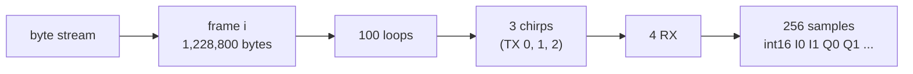

# Raw radar data, January 2026

What the raw FMCW recordings of the January 2026 campaign look like, and where data is missing. `mobility/io/raw.py` reads them; `scripts/radar_pass.py` turns each recording into a range-Doppler cube. This replaces `PREPROCESSING.md` of the original preprocessing code (commit `dc5c08c`, `distrimuse_data_processing/`).

## Where

```
/cw/dtaidata/dtaigeel/2021-NextPerception/DistriMuse/January_2026/Measurement Campaign Januari 2026/FMCW/person_<N>/scenario_<M>/
```

156 recordings:
- **person_1–27, scenario_1–6 (152 recordings):** a few scenarios are missing for some people (person_3, 6 and 24 have scenarios 1–4; person_8 has 1, 2 and 4; person_13 has 2–6).
- **person_100, person_101, person_102, scenario_100/101 (4 recordings):** no MoCap and no labels, so they can't be evaluated.

Each recording folder holds:

| File | Content |
|---|---|
| `test2x_1_Raw_<k>.bin` | raw ADC data from the TI DCA1000, split into ~1 GB files |
| `test2x_1_Raw_LogFile.csv` | capture start and end time, packet counts, lost (zero-filled) packets |
| `test2x_1_LogFile.txt` | mmWave Studio API log (radar configuration commands) |

**Capture time.** `Raw_LogFile.csv` gives the capture start and end in local time (CET = UTC+1 in January), to the whole second only, e.g. `Capture start time - Mon Jan 26 10:23:07 2026`. Radar frame 0 comes 0.2–1 s after the logged start; `mobility/align.py` finds the exact offset by matching radar movement to MoCap (see [category1.md](category1.md)).

## Radar settings

They are the same for all recordings, from `mobility/io/config.mmwave.json`.

| Setting | Value |
|---|---|
| Radar | TI IWR6843AOP, ceiling, looking down |
| Antennas | 3 TX, time-division (chirp 0/1/2 = TX 0/1/2), 4 RX: 12 virtual channels |
| Chirp | 256 complex ADC samples at 6 Msps, slope 80 MHz/µs, 150 µs per chirp |
| Frame | 100 loops × 3 chirps (one per TX), every 50 ms → 20 frames/s |
| Range | 4.40 cm per bin; the 128 bins kept cover 0–5.6 m |
| Doppler | 4.34 cm/s per bin, ±2.78 m/s; + = away from the radar |
| Bytes per frame | 100 × 3 × 4 × 256 samples × 4 bytes = 1,228,800 |

## Byte layout

A recording is one byte stream, nested frame → loop → chirp (TX) → RX → samples.

- **Sample encoding:** every 8 bytes hold two complex samples as little-endian int16 `I0, I1, Q0, Q1`: the samples are `I0 + jQ0` and `I1 + jQ1`.
- **Frame position:** frame *i* is stream bytes [*i* · 1,228,800, (*i* + 1) · 1,228,800).



**Files.** The DCA1000 cuts the stream into `.bin` files of 1,073,741,760 bytes (873.8 frames) each, regardless of frame boundaries, so frames can straddle two files.
- `Raw_<k>.bin` holds stream bytes from *k* · 1,073,741,760 onwards; the last file is shorter.
- A file's position follows from its number *k*, also when earlier files are missing.

## Missing and damaged data

### Missing or truncated files

| Recording | Files | Effect |
|---|---|---|
| person_23/scenario_5 | `Raw_0` truncated (1,055,195,136 of 1,073,741,760 bytes) | frames 858–873 missing (NaN) |
| person_101/scenario_100 | `Raw_0`–`Raw_29` absent, data starts at `Raw_30` | frames 0–26,214 missing (NaN) |
| person_6/scenario_3 | `Raw_11` truncated, `Raw_12`–`Raw_14` absent; `Raw_15` (5 MB) left out | the recording ends in `Raw_11` |

`Raw_15` of person_6/scenario_3 doesn't line up with its expected position in the stream, so its ~4 frames can't be placed; `mobility/io/raw.py` lists it in `EXCLUDE`.

The reader skips every frame that is not completely on disk, including frames cut at the edges of a gap, and the cube keeps them as NaN rows. Row *j* is therefore always frame *j*, i.e. *j* / 20 s after frame 0, and the time axis never shifts.

### Lost packets

The DCA1000 fills packets lost during the capture with zeros and counts them in `Raw_LogFile.csv` ("Number of zero filled packets"). **76 of the 156 January recordings have lost packets:** 18–486 per recording, with a median of about 60. person_10/scenario_2 has the most (486), followed by person_3/scenario_1 (474) and person_10/scenario_1 (275).

A packet is 1,456 bytes and a frame about 844 packets, so a lost packet zeroes part of a frame rather than a whole one. **Packets are lost in bursts:** person_10/scenario_2 logs 486 lost packets in 11 out-of-sequence events, and they damage only 10 frames.

A damaged frame looks like a burst of movement: the gap in the samples spreads energy over all range and Doppler bins. In person_10/scenario_2 the damaged frames had up to 138 times the moving power of their neighbours, and thousands of cells above the floor where the neighbouring frames had none.

The radar pass therefore turns these frames into NaN rows (`mobility/radar/cube.py`):
- **Entirely zero frames** become NaN.
- **Damaged frames** become NaN too: a frame is damaged when it has at least 16 consecutive samples with I = Q = 0. A lost packet zero-fills 364 samples in a row; real ADC data practically never has that many exact zeros in a row.

Each recording's `pass_info.json` lists the damaged frames next to the number of lost packets from the log, as a cross-check. Recordings without lost packets have no damaged frames (e.g. person_1/scenario_1).
